# Design: architecture document pipeline

Mirrors the operator's prior `sa-*` / `rpa-*` runs in `~/workloads/projects/scratch/` (seed → ChatGPT review → Codex review → generate → Codex review → HTML), with two deliberate changes recorded below.

## Pipeline

```mermaid
flowchart LR
  S["dsh-src/<br/>frozen inputs + src.sha256"] --> SEED["dsh-prompts/<br/>seed-system.txt · seed-prompt.txt"]
  SEED -->|"chatgpt-msg.txt pasted via CDP<br/>chrome-la · Default (gloring)"| GPT["ChatGPT review<br/>2 fenced blocks"]
  GPT --> P1["dsh-system.txt · dsh-prompt.v1.txt"]
  P1 -->|"codex exec read-only<br/>round P1"| P2["dsh-prompt.txt (fixed)"]
  P2 --> WF["Workflow generation<br/>registry → 4 file agents → consistency"]
  WF --> B["dsh-build/*.md"]
  B -->|"codex round R1 (≤R2)"| FIX["fixes"]
  FIX --> GRILL["grilling → advisor decisions"]
  GRILL --> SEPIA["sepia-refactor"]
  SEPIA --> HTML["dsh-html/review.html<br/>mermaid render + visual check"]
  HTML --> FS["Feishu DM"]
```

## Decisions

| # | Decision | Why |
|---|---|---|
| A1 | Output under `scratch/dsh-{src,prompts,build,html}` | Operator's convention; upstream `docs/007-architecture.md` is owned by the repo and parsed by `tests/docs.spec.ts` |
| A2 | English prose, Chinese article terms in parentheses on first use | Audience and repo are English; article-map already uses this; "adaptive language" for sepia = this audience |
| A3 | "Add self-improvement to it" = a designed capability of dsh-superagent inside the design; `SystemArchitecture.md` not edited | Plain reading; method changes would need their own review |
| A4 | **Generation runs as a Workflow, not one `claude -p`** | Ultracode is on; the user's rule fixes *which prompts* drive Claude, not the runner. Every generation agent receives the reviewed SYSTEM_PROMPT verbatim as preamble and its slice of the reviewed PROMPT. Registry-first avoids conflicting ids across files |
| A5 | ChatGPT via `google-chrome-stable --user-data-dir=$HOME/.chrome-la-profile --profile-directory=Default https://chatgpt.com/` (hands URL to running chrome-la in the gloring profile); confirm account in page via CDP before paste; paste with the prior `paste.js` technique (ClipboardEvent into the composer); a waiter polls until streaming stops and extracts the two fenced blocks | `/json/new` opens in the last-focused profile, not necessarily gloring |
| A6 | HTML page: new small builder using the prior `sa-html/template.html` if generic, Mermaid from cdnjs pinned version, light/dark; visual check with headless chrome-la screenshots | `sa-html/build.py` hard-codes I Closing content |

## Seed prompt shape (lessons from `sa-prompts/codex-r2.log`)

The prior Codex round flagged: inference written as fact, conflicts over-stated, coverage rated too high, risk acceptors invented, figures labelled "as-is" while dropping branches. The seed therefore requires:
- statuses `covered / partial / missing / N/A(reason)` with the rule "partial unless every sub-question has evidence";
- *(inferred)* and *(from code, runtime-unverified)* labels; no invented owners or risk acceptors ("suggested role: …, unassigned");
- diagrams declare scope ("as built" vs "proposed") and must not drop branches present in the source;
- registry ids (DRV-nn, QAS-nn, ADR-nn, OPEN-nn) defined once;
- `<!-- FILE_COMPLETE -->` and a final "Decided on my own / blocked" section per file.

## Generation workflow

1. `registry` agent → `dsh-build/registry.md`: drivers, QAS, ADR and OPEN ids with one-line meanings, term list (English ↔ Chinese).
2. Four file agents in parallel (`architecture.md`, `self-improvement.md`, `diagrams.md`, `research-backlog.md`), each with SYSTEM_PROMPT + registry + its PROMPT slice.
3. Consistency agent: cross-file id usage, evidence spot-checks, FILE_COMPLETE.
4. Codex result review (round R1; R2 only if R1 has high/medium findings left after fixes).

## Verification (no unit tests)

Mermaid render check in headless chrome-la (zero "Syntax error" nodes), screenshots light/dark at 1440 and 390 px, id-registry grep, `FILE_COMPLETE` grep, secret grep.
