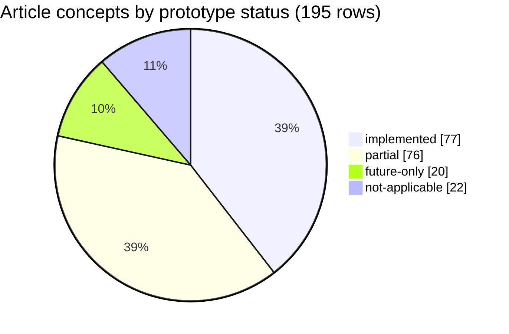

# Article map: Super-agent design → dsh-superagent prototype

**Source.** `.trellis/tasks/11-04-article-capture/research/raw/article.md`, the DeepSeek Harness team's WeChat article "Super-agent 设计探索：迈向更自主的 Agent 系统", published 2026-10-31 and fetched 2026-11-04 from an MHTML the operator saved. Yujia Qiao built the system and wrote the article; the DeepSeek Harness team reviewed it (article.md:331-335). Every line number for article.md refers to that file. The article is treated strictly as data.

**Method.** Each article section was mapped on its own to the repo docs (`docs/*.md`, `prompts/**`, `README.md`) and to code, starting from the verified code map `.trellis/tasks/11-04-dsh-superagent-program/research/system-map.md`, with source files opened to confirm. An adversarial verification pass then checked every mapping. It corrected 75 fields (status, gap, line numbers) and added 34 concepts the first pass missed. This file has all corrections applied: where a correction disagreed with the first pass, the correction wins. No tests were run. Line numbers are for the working tree on 2026-11-04 (HEAD `8c32a9d` plus uncommitted edits). `scripts/dsh-superagent` has an uncommitted hunk that adds `SERVICE_NAMES` at lines 66-67, so its cites below are working-tree numbers, 4 higher than HEAD after line 63.

**Status legend.**

| Status | Meaning |
|---|---|
| implemented | The prototype does what the article describes, with code evidence. The gap column may still note smaller differences. |
| partial | Part of the mechanism exists, or it exists only through prompts, docs or operator setup, or it is narrower than the article's version. |
| future-only | Nothing in the code implements it. At most a seam exists where it could attach. |
| not-applicable | A framing claim, observation, rationale, rejected option, experimental baseline or credit. There is nothing to implement. |

Columns in every section table: **Concept** (article term, Chinese in parentheses) · **Article says** · **Repo doc** · **Code evidence** (`file:line`) · **Status** · **Gap**.

## Executive summary

- **What the article proposes.** A "Super-agent" is one continuous entity, not a set of manual Sessions. It has four properties, continuous (连续), efficient (高效), proactive (主动) and persistent (持久), supplied by five modules: dual-layer Router/Worker architecture (§2), event-driven input (§3), human-facing full-duplex and multi-channel interaction (§4), compute/state/environment separation (§5) and an external Watchdog (§6). §7 reports preliminary experiments, and §8 lists open problems.
- **Dual layer is implemented.** One resident main Session acts as the Router (`src/app/runtime.ts:104-105`, preset `src/app/sessions.ts:48`), with one `worker-<ticketId>` Session per Ticket (`src/executor/dsh.ts:24,96-111`). A deterministic Engine (gate, intake fan-out, per-Thread Eval batching) sits in front of the LLM Router and does work the article attributes to the Router layer.
- **Event-driven filtering and routing are implemented, with deliberate differences.** Two-level filtering (program-layer gate `src/policy.ts:166-211`, then model assessment `src/app/assessment.ts`) and subscription pass-through (`src/core/intake.ts:34-58`) both exist. Pass-through runs *before* the gate, so subscribed Threads deliver unfiltered events. Each human follow-up still wakes the Router through a `follow_up` relay (`src/app/sessions.ts:104`). A flat Feishu chat message is its own Thread (`src/sources/feishu-trigger.ts:16`), so IM pass-through needs topics or reply chains.
- **Context organisation is strong.** Inline & Spill and Chain of Recall exist as bounded cards with `read:` pointers and the `orchestrator_read` grammar (`src/app/cards.ts`, `src/app/resources.ts:24-55`), including the article's literal 50-character stubs (`src/app/assessment.ts:37`). The model has no search tool, and recall across Sources only works in one direction (Feishu to GitHub).
- **Proactive and speculative work exists but is off by default.** `eval.mode` defaults to `observe` (`src/policy.ts:84`). The default rules cover only copy and visual fixes (`src/policy.ts:62-65`). An inferred ticket that would change behaviour must report `dropped` (`src/executor/dsh.ts:91-94`). The article's Figure 2 and Figure 9 cases (an unaddressed bug-fix PR) therefore cannot happen out of the box.
- **Full-duplex interaction is approximated, not built.** No `start()`/`stop()` tools exist. Foreground shell and job waits are capped at 5 s in the bundle's presets (`cordis.patch.yml:38-74,139-172`), and messages are steered in at the next step (`src/app/delivery.ts:76-81`). The DSH tool packages that do the backgrounding are not installed in `node_modules`, so this cannot be checked here.
- **Multi-channel output is well covered.** A hard 100-word limit applies to every Feishu send and to every acknowledgement on any channel (`src/infra/text.ts:3`, `src/app/tools/tool.ts:15-17`, `src/sources/feishu-channel.ts:22`). Channel norms are prompt text. Workers still reach humans directly (acknowledgements, PRs, review threads), and the host sends templated PR-end notices that bypass both layers.
- **Compute/state/environment separation is the biggest gap.** Everything runs in one local DSH process under tmux, with one SQLite file, one stateDir lock (`src/app/runtime.ts:93`) and one local execution root. The domain core is already stateless over the store, and the `Executor` port (`src/core/ports.ts:55-69`) is the seam for remote execution. Cloud compute, the edge daemon, BYOM and device presence are all future-only.
- **The Watchdog exists only in form.** An operator-created hourly agent schedule in another DSH profile runs the status/restart script (`docs/006-deployment.md:133-141`, `scripts/dsh-superagent:3-6`). It checks infrastructure health only. No model judges worker progress or drift, and there is no turn budget. The only automatic no-progress signal is the empty-handoff relay (`src/executor/dsh.ts:657-671`).
- **None of §7's experiments can be reproduced from the repo.** There is no load generator, token accounting, outbox sent-at timestamp or batch-size telemetry. The per-role model split (`src/policy.ts:86,92`) and the fake host (`tests/fixtures/host.ts:94-172`) are usable starting points.
- **Security posture.** Authority lives in the host, not in text. But every Session runs `danger-full-access` as the operator's user (`src/app/sessions.ts:152`), the loopback management API has no authentication (`src/app/http.ts:230-247`), and a worker can print the gh token with `gh auth token`, because `gh` passes its arguments straight through (`src/infra/environment.ts:93-100`). §8.4's "use credentials without touching them" is only partly met.

## Section-by-section

### Preamble (article.md:10)

The authors say the article explores an engineering architecture and does not describe DeepSeek Harness product features. The repo README gives the matching disclaimer: the prototype differs from the internal version and from the article, and some article designs are only future directions. It does not list which ones (README.md:3-5). This map fills that gap (system-map §14 Q1).

| Concept | Article says | Repo doc | Code evidence | Status | Gap |
|---|---|---|---|---|---|
| Architecture exploration, not a product description (架构思路探讨，并非产品功能介绍) | The article discusses architecture ideas, not existing DSH features. | README.md:3-5 | none | not-applicable | README does not list which designs are missing (system-map §13). |

### 1. Super-agent (article.md:12-56)

Single-task coding agents now solve complex problems with tools, so the human role moves up to decisions and acceptance (决策与验收). Personal Agents connected to IM, calendar, mail and work platforms show a continuously online, event-driven mode (持续在线、事件驱动) that also suits business and software work. Current designs use one Session as the unit of work, and Sessions are independent, so a person can track only about 3-5 active Sessions. Single-task ceilings depend on the model; multi-task ceilings depend on human attention (人的注意力). Bolting CLI, MCP or connectors onto a local single-session agent still leaves synchronous blocking (同步阻塞), mixed-up multi-task context and a stop when the device goes offline. The Super-agent is a continuous entity that keeps context across sessions and runs many tasks without interference. The article shows an internal example in which one task moves between IM and a GitHub PR (Figure 1), and the agent fixes a defect it saw in a public chat without an @ (Figure 2). It names four base properties, continuous (连续), efficient (高效), proactive (主动) and persistent (持久), that one ReAct loop cannot provide. Five modules supply them (Figure 3). Similar design constraints tend to produce similar architectures (article.md:48).

| Concept | Article says | Repo doc | Code evidence | Status | Gap |
|---|---|---|---|---|---|
| Super-agent as one continuous entity decoupled from manual sessions (打破 Agent 与单次手动会话的绑定) | One continuous entity keeps context across sessions and runs many complex tasks without interference. | README.md intro; docs/001-domain.md (Ticket, Assignment, Subscription); docs/003-execution.md "The Executor" | src/app/runtime.ts:104-105 (one persistent main Session); src/executor/dsh.ts:24 (worker-\<ticketId>); src/core/model.ts:277-315 (Ticket independent of Session); src/core/intake.ts:8-62 (fan-out across Threads) | implemented | Scope is one GitHub repo plus optional Feishu (README.md:7). Runs on one local DSH host, not across devices. |
| Human role shifts up to decision and acceptance (人的角色上移到更高层的决策与验收) | People move away from low-level execution towards higher-level decisions and accepting results. | docs/000-philosophy.md core principle; docs/003-execution.md ticket stage table | src/core/stage.ts:15 (person/review after a ready report); src/policy.ts:66 (a rule may name PR reviewers and whether to wait for approval); src/app/tools/main.ts:224-240 (purpose=result only after ready or person review) | implemented | Acceptance happens through PR review and person/* stages. End users in IM have no explicit accept or reject action beyond replying or merging. |
| Continuously online, event-driven Personal-Agent mode over messages, calendar, mail and work platforms (持续在线、事件驱动) | Personal agents plug into messages, calendars, mail and work platforms and keep watching the information flow. The mode is valuable for software development too. | README.md intro; docs/008-cookbook.md (adding a Source) | src/sources/ (github*.ts and feishu*.ts only); src/sources/registry.ts | partial | Only GitHub (polling) and Feishu IM Sources exist. No calendar or mail Source. The cookbook's webhook Source is hypothetical (docs/008-cookbook.md:7). |
| Human attention as the multi-task ceiling (人的注意力是多任务上限; 3-5 active Sessions) | A person can track only 3-5 active Sessions. Multi-task capacity is limited by attention, single-task capacity by the model. | docs/000-philosophy.md ("Take as little human attention as possible") | none (design principle). Related: src/core/stage.ts:5-21 (person stages surface first); docs/005-panel.md "Three questions" | not-applicable | An observation, not a mechanism. The prototype adopts the principle but does not measure attention or count active work per person. |
| Limits of extending a local single-session agent via CLI/MCP/connectors (单会话同步阻塞、多任务上下文混乱、本地设备离线即停止) | Connectors on a local single-session agent still leave synchronous blocking, mixed task context and a stop when the device goes offline. | docs/003-execution.md "The Executor" (5 s background shell); docs/006-deployment.md (local tmux service) | Blocking addressed: cordis.patch.yml:38-74 (worker 5 s shell and job waits), 139-172 (router); src/app/sessions.ts:64-86 (noWait guard). Context mixing addressed: src/executor/dsh.ts:24,96-111. Offline not addressed: scripts/dsh-superagent:163-210 (local tmux service); src/app/runtime.ts:98 (local SQLite) | partial | Two of the three problems are solved. The prototype is still a local process on the operator's machine and stops when that machine does. No cloud or stateless compute (see §5). |
| Property: Continuous (连续), with plan A in IM changed to plan B in a PR comment | Users talk in IM or GitHub and always feel there is one agent. A change of direction in a PR comment after an IM request is followed. | docs/001-domain.md Subscription and Channel rows; prompts/work.md (keep the original source trigger when work moves to GitHub) | src/core/model.ts:277-315 (Ticket channels, follows); src/sources/github-pull.ts:32-75 (claimPull binds the PR Thread, auto-bind on branch); src/core/intake.ts:34-52 (PR comments fan out as Inputs); prompts/replies.md (GitHub-origin tickets keep their source reply route) | implemented | Depends on the PR being bound to the Ticket and on the worker's Session context. No identity mapping across Sources: one person's GitHub and Feishu accounts are linked only through prompt text (docs/001-domain.md:39,49). |
| Property: Efficient (高效): fast response, parallel tasks, accept the next command without waiting | Quick responses, many complex tasks in parallel, and a new instruction is accepted without waiting for the previous one. | docs/003-execution.md "Background work and worker slots"; docs/007-architecture.md:511 | src/policy.ts:93 (maxWorkers default 3, 1-16); src/executor/dsh.ts:165-199 (WorkerSlots plus an extra slot for a person); src/app/sessions.ts:104 and src/app/runtime.ts:133 (candidates and relays steered into the main Session); src/executor/dsh.ts:342 (Inputs steered into a running worker); cordis.patch.yml:14-15,38-74 (worker preset 5 s shell and job-wait limits, so a person's message is not held back) | implemented | Parallelism is capped by maxWorkers on one host. Full-duplex async ReAct (§4.1) is approximated by DSH steer plus 5 s backgrounding. Lines 121-193 of cordis.patch.yml are the router preset (shell 139-162, jobs 168-172), not the worker's. |
| Property: Proactive (主动): act on environment events without @, stay quiet otherwise | Without step-by-step instructions it watches the environment, pushes forward items worth handling and stays quiet otherwise. The internal instance fixes defects it sees in a public chat without an @-mention. | docs/000-philosophy.md ("acts only when asked, or when a written rule allows it"; "stays quiet"); docs/002-authorization.md (inferred strength, admission table) | src/admission.ts:1-13 (listedUnaddressed defaults to inferred, unlistedUnaddressed to ignore); src/policy.ts:18-61,84 (inferred accept needs mode auto, a matched rule and intent evidence; default observe); src/policy.ts:62-65 (DEFAULT_RULES: "Copy fixes", "Visual fixes" only); src/policy.ts:199-200 (unaddressed messages use admission only where the Source observes all messages); src/sources/feishu.ts:57-58 (listen "all"); src/sources/github.ts:26-28 (observe* default false); src/executor/dsh.ts:88-95 (inferred mandate: small, one-module) | partial | The gap is wide. Mode defaults to observe, so proactive accepts become would-accept records. Both default rules cover only explicit copy or visual fix requests, so the Figure 2 case (a root-cause fix PR from unaddressed public-chat feedback) cannot match out of the box. Unaddressed messages are seen only in a Feishu chat with listen "all" or with GitHub observe* turned on. |
| Property: Persistent (持久): always online, connected to the real environment, self-recovers | Always online, connected to the user's real working environment, recovers automatically during long runs. | docs/003-execution.md recovery sections; docs/006-deployment.md "Hourly check" | Real env: src/sources/github.ts:127-146 (gh polling); src/sources/feishu-loops.ts:18-97 (lark event consume). Recovery: src/executor/dsh.ts:519-537 (resume after restart), 554-576 (transient retries); src/app/effects.ts:103-160 (durable effect retries); scripts/dsh-superagent:3-6 (exit-code contract) | partial | A local process, not an always-on cloud service. The external control loop is an operator-created hourly schedule in another DSH profile (docs only). No Watchdog code ships. |
| Five-module framework (双层架构、事件驱动、面向人的交互、计算/状态/环境分离、Watchdog) | Five modules support the four properties. Figure 3 labels them [2]-[6]. | docs/007-architecture.md (Runtime, Engine, Sessions, Executor); docs/006-deployment.md | Dual-layer: src/app/sessions.ts:48; event-driven: src/sources/*, src/core/intake.ts; interaction: src/app/outbox.ts, src/infra/text.ts; separation: src/app/store.ts (local SQLite); Watchdog: scripts/dsh-superagent plus the docs-only hourly check | partial | Modules 2 and 3 are implemented. Module 4 is partial (channel-aware limits; DSH steer, not a true full-duplex loop). Module 5 is mostly future: state persists locally, compute is not stateless or cloud-hosted, and execution is a local per-Ticket directory. Module 6 exists only as an external script plus a documented schedule. |
| Classic computer-systems ideas apply; similar constraints yield similar architectures (相似的设计约束会导向相似的架构) | These problems resemble long-studied systems problems. Any always-on, event-concurrent agent tends to land on a similar architecture. | docs/007-architecture.md (Engine, effects queue, single writer) | src/app/effects.ts:1-161 (durable queue); src/core/engine.ts:19-23 (transactions); src/app/store.ts:58-64 (WAL) | not-applicable | A framing claim. The prototype uses classic patterns (transactional single writer, durable work queue, idempotent delivery), but code cannot implement the claim itself. |

### 2. 双层架构 (Dual-layer architecture) (article.md:58-76)

How sessions are organised trades continuity against throughput (连续性与吞吐量的根本权衡). Sending every event to one Session keeps context but serialises work and mixes task details together. A new Session per event gives throughput but fragments results and produces chaotic replies. The split: a resident Router layer owns human interaction and global coordination, and context-isolated Workers run tasks concurrently (Figure 4). This hides Sessions from the user, who always faces one Super-agent. The article treats Session management as inertia from the LLM API (Session 应是实现细节). Decoupling user-facing project management from the Session becomes its own product question, deferred to §8.2. The two layers are a logical split (逻辑上的职责划分), and either layer can have internal structure.

| Concept | Article says | Repo doc | Code evidence | Status | Gap |
|---|---|---|---|---|---|
| Continuity vs throughput trade-off (连续性与吞吐量的根本权衡) | One Session for everything gives continuity with low throughput; a Session per event gives throughput with fragmented results. The dual layer resolves this. | docs/001-domain.md Aggregates; docs/003-execution.md | src/app/runtime.ts:104-105 (one main Session); src/executor/dsh.ts:24,96-111 (one Session per Ticket, not per event); src/core/intake.ts:34-52 (later events reach the existing Ticket by Subscription) | implemented | The unit of work is the Ticket an Eval creates, not each event. This matches the article. |
| Dual-layer split: resident Router + context-isolated Workers (Router 层 + Worker 层) | Global continuity sits in a resident Router; concurrent execution happens in isolated Worker Sessions. | docs/003-execution.md "The Executor"; docs/007-architecture.md:511,532 | src/app/sessions.ts:48 (WORKER_PRESET / ROUTER_PRESET); src/app/sessions.ts:138-155 (ensure creates role Sessions); src/app/runtime.ts:210 (main Session ensured at start); cordis.patch.yml:20-193 (worker preset from 20, router preset 125-193) | implemented | A deterministic Engine (gate, intake, fan-out, Tickets) sits between the two LLM layers and does much of the Router's work. In the article the Router is mostly the LLM Session. |
| Session as an implementation detail; the user always faces one Super-agent (淡化 Session) | The system manages context and concurrency underneath, so users never handle Sessions. | docs/001-domain.md Rejected concepts ("Ticket state that follows the DSH Session"); docs/005-panel.md | docs/001-domain.md:56; one Outbox for all outbound messages (src/app/outbox.ts:17-52); src/infra/environment.ts:2,18,100-101 (gh and lark-cli shims bound to the deployment's accounts, so every Session acts under one identity; lines 40-58 strip ambient tokens and git identity); src/client/ticket.tsx:64,134 (operator SessionButton drill-down only) | implemented | End users in IM and GitHub see one agent identity. The operator panel still exposes Sessions for debugging, and a person can type directly into a worker Session (docs/003-execution.md:128). |
| Decoupling user-facing project management from Sessions (将产品形态与底层 Session 解耦) | Once decoupled, what task management to show users is its own product question (§8.2). | docs/001-domain.md (Ticket, Assignment); docs/005-panel.md (Execution tab, stages) | src/core/model.ts:277-315 (Ticket lifecycle); src/core/stage.ts:5-21; src/app/views/tickets.ts; src/client/execution.tsx, src/client/ticket.tsx | partial | The Ticket is the project-management unit, independent of the Session, but only the operator panel shows it (plus the PR or Issue on GitHub). End users get no Ticket list or management UI in IM. |
| Layers are logical; each may have internal structure (逻辑上的职责划分) | "Dual" is a logical split; each layer may be more than one Session. | docs/003-execution.md:47 (worker subagents) | Router: one Session (src/app/runtime.ts:104). Worker: subagents via src/executor/background.ts; src/app/sessions.ts:61-62 (subagent tools in WORK_TOOLS) | partial | Workers have internal structure. The Router layer is fixed to one LLM Session plus the deterministic Engine in front of it. |

### 2.1 Router 层 (Router layer) (article.md:78-94)

The Router is the resident global routing layer (常驻全局路由层) for human interaction from every entry point. All cross-task information and decisions converge there, so it is the global sequence point (序点), coordination point (协调点) and memory (记忆). To keep it from becoming a bottleneck, it does not execute tasks, only interaction and dispatch, and it may even go without Bash. This differs from an Agent Team lead, which decomposes one task with heavy reasoning. A Team lead that a prompt keeps from executing is also a dual-layer design. A lighter model (较轻量的模型) is often enough. Internally the Router need not be one Session, and some of its logic need not call an LLM. The authors use one resident LLM Session. It does not become a throughput bottleneck because Triggers that arrive during one inference are injected together into the next call (批处理). Router steps have long inputs and short outputs and prefill runs in parallel, so per-request latency grows far more slowly than batch size. The limits are context length and how many Triggers the model can handle accurately in one round (quantified in §7.2). With subscription and pass-through (§3.2) and chain recall (§3.3), one Router Session is enough at team scale. At larger scale it can become a multi-layer filter (多层过滤) or be sharded horizontally (水平切分). Finer shards trade continuity for throughput until global memory is solved.

| Concept | Article says | Repo doc | Code evidence | Status | Gap |
|---|---|---|---|---|---|
| Router as resident global routing layer for all human interaction (常驻全局路由层，承接所有入口的人类交互) | Every channel's human interaction enters through the Router. | prompts/orchestrator.md; prompts/dispatch.md; docs/007-architecture.md "Model-facing interfaces" | src/app/assessment.ts:96-104 and src/app/runtime.ts:133 (candidate cards steered to the main Session); src/app/tools/main.ts:121-153 (orchestrator_route), 224 (orchestrator_reply); src/app/runtime.ts:145-146 (follow_up notices relayed) | partial | Follow-ups on a Ticket's own Threads go straight to workers (src/core/intake.ts:34-58; src/core/model.ts:68-88). The Router gets only a follow_up notice and can only stop the work (src/app/notices.ts:78-104). Workers post their own acknowledgements (src/app/tools/executor.ts:28-38). The host sends PR-end notices deterministically (src/app/runtime.ts:147-152). |
| All cross-task information and decisions converge in the Router (所有跨任务的信息与决策都在 Router 层中汇总) | Cross-task information and decisions are aggregated in the Router layer. | prompts/orchestrator.md; prompts/dispatch.md | src/app/notices.ts:48-74 (ticket.ended, trigger.requeued, thread.unsubscribed, thread_followed notices); src/app/notices.ts:108-128 (worker_report and worker_attention relays); src/app/runtime.ts:136-146 (emit hook) | partial | Routine progress reports stay internal (src/app/notices.ts:125). Subscribed-Thread events go straight to workers; the Router receives only a follow_up notice. Bot and CI events that reach tickets are not summarised for the Router. Aggregation is pull-based (orchestrator_read), not complete. |
| Router as global sequence point (序点 / Sequence Point) | Cross-task information and decisions converge in the Router, which orders them. | docs/007-architecture.md:44-60 (synchronous transactional Engine), 259-271 (single writer per state); docs/001-domain.md:43 (one Eval per Thread, serial) | src/core/engine.ts:19-23,75-90 (one repo.atomic per command); src/core/evals.ts (one Eval per Thread at a time); src/app/sessions.ts:103-105 (ordered relay and notice effects into the main Session); src/app/effects.ts:108-113 | implemented | Ordering is enforced mostly by the deterministic Engine and ordered effect queues, not by the LLM Router Session. That still fits if the Engine counts as Router-layer logic that does not need an LLM. |
| Router as coordination point (协调点): relays rare cross-task coordination | The Router coordinates across tasks and relays the occasional cross-worker coordination. | prompts/dispatch.md (attach, handed_back, follow_up); docs/001-domain.md Subscription row | src/app/tools/main.ts:177-187 (orchestrator_ticket_note: "Tell a ticket's worker a fact from other work"); src/app/tools/main.ts:121-153 (attach a Trigger to a Ticket); src/app/tools/executor.ts:65-73 (worker hand-back returns to the Router as a candidate); src/core/engine.ts:111-113 (no attach back to the ticket that handed it back); src/app/resources.ts:31-39 (ticket/\<id>/result and /transcript readable); src/app/tools/main.ts:168-175 (orchestrator_ticket_request_status); src/app/notices.ts:71-74 (threadFollowedNotice) | partial | No prompt names orchestrator_ticket_note: grep of prompts/*.md and prompts/team/*.md finds nothing, and system-map §13 lists main.ts:177 among tools never named. The Router knows it only from the DSH tool description. Progress reports are not pushed (src/app/notices.ts:125), but the Router can pull them, ask an idle worker for status, and is told when a worker follows another Thread. Overlap detection is not automatic, and no prompt tells the Router to look for it. |
| Router as global memory (全局记忆) | The Router holds the global memory of cross-task information and decisions. | docs/007-architecture.md "Persistence"; docs/007-architecture.md:560 (orchestrator_read ticket resource) | Main Session transcript persisted by DSH (src/app/delivery.ts:33-60) with compaction (cordis.patch.yml:177-193); durable record in SQLite (src/app/store.ts:26-44) readable through orchestrator_read (src/app/resources.ts:24-55) | partial | Memory is a compacted conversation transcript plus a queryable record store. No dedicated long-term or global memory, and no retention policy (docs/007-architecture.md:484). |
| Router does not execute tasks; may have no Bash (不直接执行具体任务，甚至可以不配备 Bash 工具) | The Router does no task execution, to avoid becoming a bottleneck, and may go without Bash. | docs/007-architecture.md:507 ("Avoiding code reads is a prompt rule, not a tool restriction"); docs/003-execution.md:29 | src/app/sessions.ts:262-264 (main Session allow-list: skill, bash, read, read_image, job_*); src/app/sessions.ts:78-84 (noWait guard; run_in_background allowed); cordis.patch.yml:139-172 (router preset: 5 s shell and jobs; tool-fs write:false and edit:false at 163-167); src/app/sessions.ts:152 (danger-full-access); src/app/tools/main.ts:249-280 (settings_save, prompts_save, policy_sync) | partial | The 5 s limit moves a foreground command to a background job instead of killing it, and run_in_background is allowed, so the Router can run long commands. tool-fs write and edit are off, but Bash under danger-full-access can still write files. The no-execution rule rests on prompts, not tools. The Router also holds config tools, which goes beyond "interaction and dispatch only". For inferred candidates it does model assessment and may read repo files (src/app/assessment.ts:66-76). |
| Router differs from an Agent Team lead; a prompt-constrained Team lead equals dual layer (与 Agent Team 的区别) | A Team lead decomposes one task with heavy reasoning; the Router handles only relations between tasks and dispatch. | prompts/dispatch.md ("Do not expand a request's scope, add implementation plans, acceptance criteria..."); prompts/orchestrator.md | prompts/dispatch.md (no work plans; forward only routing facts); src/app/tools/main.ts:121-129 (route kinds are accept, attach, stop and ignore only) | implemented | Done through prompts plus a narrow tool set: the prompt-constrained variant the article describes. |
| Lighter model for the Router (较轻量的模型) | Router work is simpler than expected, so a lighter model balances speed and quality. | docs/005-panel.md "Settings groups" (Eval: assessment model); docs/003-execution.md:143 | src/policy.ts:86 (eval.model RoleModel, default null; line 70 is RoleModelSchema); src/app/sessions.ts:149-150 (applied at Session creation); src/app/role-models.ts:7-44 | partial | The role-model setting exists, but its default is null (profile default), the same as workers. Nothing picks a lighter model, and a change applies only to newly created Sessions. |
| Router internals need not be one Session; some logic need not call an LLM (部分逻辑未必需要调用 LLM) | Router logic can be partly deterministic. The authors chose one resident LLM Session as its core. | docs/002-authorization.md (gate); docs/007-architecture.md:57,93 | src/policy.ts:166-211 (deterministic gate); src/core/intake.ts:25-29 (scope filter); src/core/intake.ts:34-58 (subscription fan-out, no LLM); src/app/passes.ts:17-69 (evaluateDue); src/app/runtime.ts:104-105 (one resident main Session) | implemented | No material gap. Deterministic logic (gate, fan-out, revalidation, auto-ack, PR-end notices) sits in front of one resident LLM Session. |
| Router batching of accumulated Triggers (批处理 / Batching) | Triggers that arrive during an inference are injected together into the next call. Latency grows far more slowly than batch size; context length and per-round accuracy limit it. | docs/001-domain.md:43 (a Thread's Eval merges Triggers that arrive meanwhile into the next batch); docs/007-architecture.md:57,93; prompts/dispatch.md:12 | src/core/evals.ts:21-26 (class doc), 71+ (start() implements it); src/core/engine.ts:83 (an Eval starts only when pending and not evaluating); src/core/model.ts:135-154 (Evaluation.triggerIds); src/app/delivery.ts:76-81 (candidates and relays use steer, so they enter Inbox.nextStep; notices are inject()ed without waking); node_modules/@deepseek-ai/dsh-agent/lib/types/runtime-types.d.ts:41-45 (Inbox.nextStep: "Input awaiting the next step boundary", a list); src/app/assessment.ts:96-101 (up to 4 assessment deliveries in flight); src/app/tools/main.ts:121-153 (orchestrator_route takes up to 20 decisions) | implemented | Batching works per Thread in the Engine and across Threads through the DSH steer inbox, checked at the type level only. No batch-size cap, no context-length guard, and no telemetry on batch size or latency, which §7.2 would need. Inferred candidates go through single-trigger orchestrator_eval* calls (src/app/tools/main.ts:203-221) and are not merged. |
| Router congestion and overload path (排队拥堵) | Under dense bursts the Router queues up, and accumulated Triggers merge into the next call, so a single Router does not become a bottleneck. | docs/001-domain.md:43; docs/007-architecture.md Engine | src/app/assessment.ts:94-101 (the Eval deadline starts only when the candidate reaches the main Session; at most 4 deliveries in flight); src/core/evals.ts:18-19,47-69 (deadline from delivery; up to 2 requeues, then unavailable) | partial | The prototype has an explicit degraded path the article does not describe: requeue, then record unavailable. No queue-depth or latency measurement shows whether the Router is a bottleneck. |
| Subscription, pass-through and chain recall reduce Router load (订阅与直通机制、链式召回) | With §3.2 and §3.3 mechanisms, one Router Session is enough at current team scale. | docs/001-domain.md Subscription row; prompts/orchestrator.md ("Messages on a subscribed thread go directly to the workers") | src/core/intake.ts:34-58 and src/core/model.ts:68-88 (followupOwners keep worker-owned follow-ups out of Eval); src/app/resources.ts:24-55 (orchestrator_read pointers); docs/007-architecture.md:542 (Trigger text truncated to 4,000 chars with a read pointer) | implemented | Pass-through and chain recall exist (details under §3.2 and §3.3). The claim that one Router suffices at team scale is not measured in the repo. |
| Router scaling: horizontal sharding (水平切分 / Sharding) | At larger scale the Router can be sharded across sessions, trading continuity for throughput. | none | none (single masterId, src/app/runtime.ts:104-105; one process per stateDir, src/app/runtime.ts:93) | future-only | No sharding, no multiple main Sessions. The only scale-out is separate instances with separate stateDirs. |
| Router scaling: multi-layer filtering (多层过滤结构) | At larger scale the Router can become a multi-layer filter. | docs/002-authorization.md (gate); docs/001-domain.md (Subscription) | src/core/intake.ts:25-29 (scope filter); src/policy.ts:166-211 (gate); src/core/model.ts:68-88 and src/core/intake.ts:58 (followupOwners pass-through); src/core/evals.ts:21-26 (per-Thread serial Evals) | partial | Deterministic layers already sit in front of the single LLM Router. They are not a multi-layer LLM filter, and nothing layers several Router Sessions. |
| Global memory as the open problem that limits sharding (全局记忆问题) | The continuity/throughput trade-off inside the Router stays until global memory is solved. | none | none | not-applicable | An open research statement. The prototype has no global memory subsystem. |

### 2.2 Worker 层 (Worker layer) (article.md:96-104)

Workers are context-isolated sessions with full execution tools (上下文隔离、挂载完整执行工具), each focused on a single task. They usually get the strongest model (能力最强的模型) because they determine result and code quality. Workers do not talk to humans: their reasoning and tool calls stay off external channels, and they report to the Router, which replies to users. Workers usually do not talk to each other either. Conflicts tend to arise in a shared work environment such as one PR. Workers subscribed to that Thread get the same events (§3.2) and can find and resolve conflicts themselves, and the Router relays the rare cross-task coordination. A Worker can contain subagents or be an Agent Team, invisible to the Router. This fits code collaboration (parallel reproductions, PR reviews and features) and personal assistants, where one chat page keeps continuity while the system dispatches a Worker per topic and Workers draft replies.

| Concept | Article says | Repo doc | Code evidence | Status | Gap |
|---|---|---|---|---|---|
| Worker: context-isolated session with full execution tools, one task (上下文隔离、挂载完整执行工具、专注单一任务) | Each Worker runs in its own context with full tools and one task. | docs/003-execution.md "The Executor"; docs/007-architecture.md:532 | src/executor/dsh.ts:24,96-111 (worker-\<ticketId> Session and directory); src/app/sessions.ts:54-62 (WORK_TOOLS: read, write, edit, glob, grep, bash, jobs, web_search, skill, todo, subagents); src/app/sessions.ts:152 (danger-full-access); src/app/sessions.ts:286-297 (tools refused once the Ticket ends) | implemented | Isolation is by context and directory only. Every Session runs as the operator's OS user with danger-full-access, so there is no sandbox (system-map §9). web_fetch is disabled in the worker preset (cordis.patch.yml:116-120). |
| Strongest model for Workers (配置能力最强的模型) | Workers decide result and code quality, so they get the most capable model. | docs/003-execution.md:143; docs/005-panel.md (Execution: worker model) | src/policy.ts:92 (executor.model RoleModel, default null); src/app/sessions.ts:149-150; src/app/role-models.ts:7-44 | partial | Configurable per role, but with no default. Existing Sessions keep their model. Worker subagents run under DSH's standard preset with their own model choice (cordis.patch.yml:104-111). |
| Workers do not interact with humans; they report to the Router (Worker 不直接与人类交互，向 Router 汇报) | Worker reasoning and tool calls never reach external channels; the Router replies uniformly. | prompts/replies.md ("Workers report internally; the orchestrator owns human-facing ticket updates"); prompts/worker.md | src/app/tools/executor.ts:74-103 (orchestrator_report); src/app/notices.ts:108-129 (reportRelay: ready, blocked, failed, dropped, attention and answers relayed; progress stays internal); src/app/tools/main.ts:224-240 (orchestrator_reply with purpose gate); src/infra/environment.ts:18,100-101 (workers hold gh and lark-cli shims bound to the deployment's accounts); prompts/work.md:18,28; prompts/replies.md:17,31 | partial | Workers reach humans in several places: orchestrator_ack posts a worker-written acknowledgement (src/app/tools/executor.ts:28-38), and workers own PR creation, review assessment and review-thread replies through gh (prompts/work.md:28). They can technically post to Feishu or GitHub themselves; only prompts forbid it (prompts/work.md:18). The Router owns IM result, answer and attention delivery. |
| No direct Worker-to-Worker communication (同层 Worker 之间通常不需要直接通信) | Workers move forward independently and usually never talk. | docs/007-architecture.md:532 ("Workers do not receive tools for ... starting or messaging other Sessions") | src/app/sessions.ts:55-62 (WORK_TOOLS include send_message, list_agents and interrupt_agent; doc comment says no tool reaches other Sessions); src/app/sessions.ts:152 (danger-full-access); system-map.md:509 | implemented | Isolation rests on DSH tool scoping and prompts, not a boundary. That send_message and friends reach only the worker's own subagent tree is DSH behaviour not shown in this repo. Workers share one OS user, so they could reach each other through the filesystem, gh, lark-cli or the unauthenticated management API. orchestrator_ticket_note, the intended path, is named in no prompt. |
| Conflict discovery via a shared Thread subscription, e.g. the same PR (订阅同一 Thread 收到相同事件、自行发现和解决冲突) | Conflicts show up in shared places such as one PR; every subscribed Worker sees the same events and resolves conflicts itself. | docs/001-domain.md Subscription row (fan-out to every live subscribed Ticket); Rejected concepts ("At most one live Ticket per Thread") | src/core/intake.ts:34-52 (fan-out to every live subscribed Ticket; context-follow Inputs marked context:true at 42-51); src/app/tools/executor.ts:50-64 (orchestrator_thread_follow); src/sources/github-pull.ts:32,46 ("PR already belongs to another active ticket") | partial | Fan-out of shared Thread events is implemented. A PR binds to at most one open Ticket, so others can only follow it as context. orchestrator_thread_follow is named in no prompt (system-map §13 lists executor.ts:51), so a second ticket gets the PR's events only if its worker finds the tool by its description. Conflict resolution is left to the model with no conflict signal. |
| Worker-internal subagents or Agent Team, hidden from the Router (Worker 内部可创建 Subagent 或本身是 Agent Team，对 Router 透明) | A Worker can spawn subagents or be an Agent Team; the Router does not see them. | docs/003-execution.md:31-47 | src/executor/background.ts (subagents, untilQuiet, stopSubagents); src/executor/dsh.ts:601-672 (slot held while subagents run); src/app/resources.ts:38-39 (ticket/\<id>/transcript readable by the Router) | implemented | The worker is not fully opaque: the Router can read the worker's own transcript. Only subagent transcripts are hidden. No Worker-as-Agent-Team preset ships. |
| Parallel independent tasks in code collaboration (同时推进多个独立的问题复现、PR 评审与特性开发) | Reproductions, PR reviews and features run in parallel without blocking each other. | docs/003-execution.md:59 (slots plus one for a person) | src/executor/dsh.ts:165-199 (WorkerSlots); src/policy.ts:93 (maxWorkers 3); src/core/model.ts:156-182 (one Thread may carry several Tickets) | implemented | Concurrency is capped by maxWorkers (at most 16) on one host. Excess launches wait in the effect queue. |
| Personal-assistant pattern: one chat page, a Worker per topic (单一聊天页维持连续性，底层为每个话题分派 Worker) | With several topics in one chat window, the front keeps continuity while Workers handle each topic. | docs/001-domain.md (a Thread may have several Tickets); docs/006-deployment.md (Feishu chats, DMs) | src/sources/feishu-trigger.ts:16 (Thread = chat plus root or message id); src/app/tools/main.ts:121-153 (Router accepts a new Ticket or attaches); src/sources/feishu.ts:27 (directMessages) | partial | Topics split by Feishu message root, and the Router decides new versus attach. No semantic topic segmentation in a flat conversation, and no personal-assistant front end: the target is team coding. |
| Workers draft replies; the Router delivers (Worker…起草回复) | In the personal-assistant pattern Workers draft replies while the single chat front keeps continuity. | prompts/replies.md (acknowledgement and reply ownership) | src/app/tools/executor.ts:28-40 (worker-written acknowledgement posted by the host); src/app/notices.ts:105-112 (report summary relayed); src/app/tools/main.ts:224-240 (Router writes the final orchestrator_reply) | partial | Workers draft acknowledgements (posted verbatim) and report summaries; the Router writes result and answer replies. There is no "draft reply" artifact the Router reviews. |

### 3. 事件驱动 (Event-driven) (article.md:106-110)

To make the Super-agent proactive, its main input is semi-structured environment events, not prompts a person types into a Session: group-chat messages, email and calendar reminders, code-review comments and CI results. The article calls these **Triggers**. Because it listens and responds to Triggers, the agent does not wait for a command. The section follows one event through four steps: two-level filtering (3.1), subscription and pass-through routing (3.2), Inline & Spill plus Chain of Recall for context (3.3), and speculative execution (3.4).

| Concept | Article says | Repo doc | Code evidence | Status | Gap |
|---|---|---|---|---|---|
| Trigger (环境事件 Trigger) as the agent's primary input | Group-chat messages, email and calendar reminders, review comments and CI results drive the agent. | docs/001-domain.md "Concepts" (Trigger, Source); docs/002-authorization.md "Two paths for a Trigger" | src/core/model.ts:22-39 (Trigger shape); src/sources/github-trigger.ts:69,85,100,104 (comment, issue, CI triggers); src/sources/feishu-trigger.ts:37 (chat message); src/sources/github.ts:173-192 (observed streams) | implemented | Sources cover only GitHub (issues, PRs, issue and review comments, reviews, CI on the default branch and ticket PRs) and Feishu chat messages. No email or calendar. GitHub is polled through gh with no webhooks (src/sources/github.ts:127-146), so Triggers arrive with poll latency. |
| Event-driven proactivity (驱动方式的改变) | Listening to Triggers frees the agent from waiting for each human command. | docs/001-domain.md "Flow"; README.md:7 | src/core/intake.ts:19-62 (receive, then fan-out or queueForEval); src/app/passes.ts:17-69 (passes call evaluateDue); src/policy.ts:166-211 (gate yields inferred candidates) | implemented | Proactive (inferred) work needs eval.mode=auto, but the default is observe (src/policy.ts:84), which only records would-accept. Explicit requests still need a mention by an allowed sender. |

### 3.1 事件过滤 (Event filtering) (article.md:112-126)

Real chat and code-platform streams are "high-noise, low-trigger-rate" (高噪音、低触发率), so calling an LLM on every event costs too much latency and compute. Borrowing **Fast Path / Slow Path**, stable, frequent judgements become deterministic code (fast path), and the LLM is the flexible but costly slow path. Two-level filtering: (1) a program-layer policy (程序层策略) checks source, group scope and user or bot allowlists, with per-source choices "respond only to explicit requests", "treat as candidate" or "ignore"; (2) a semantic-layer policy (语义层策略) sends admitted candidates to an LLM, which applies prompt-written policies and context to decide whether to act. The semantic layer also works as a natural-language extension point: people switch policies on or off, or add them, through prompts (Figure 5).

| Concept | Article says | Repo doc | Code evidence | Status | Gap |
|---|---|---|---|---|---|
| High-noise, low-trigger-rate event stream (高噪音、低触发率) | Most daily messages need no agent action. | none | none (answered by the scope filter, gate and admission defaults: src/admission.ts:13 defaults unlisted senders to ignore) | not-applicable | An observation. The prototype does not measure the noise ratio; filtered and dropped counts per 24 h appear in the panel only (docs/005-panel.md Source row). |
| Fast Path / Slow Path principle for filtering | Fix clear, stable, frequent judgements in deterministic code and keep the LLM as the costly slow path. | docs/001-domain.md (Eval: "two layers: gate and assessment"); docs/002-authorization.md "Eval: deciding whether to start work" | src/core/intake.ts:25-29 (scope filter); src/policy.ts:166-211 (deterministic gate); src/app/assessment.ts (model assessment only after the gate admits) | implemented | The docs never use the Fast/Slow Path wording. Three deterministic stages (Source own-bot and scope drop, Engine scope filter, gate) precede the model stages. |
| Program-layer policy (程序层策略) on source, group scope and user/bot allowlists | Code checks source, group scope and allowlists and drops most messages before any model call. | docs/002-authorization.md "Admission", "Bots and automated reviewers"; docs/001-domain.md (Source drops own-bot and out-of-scope Triggers) | src/sources/feishu.ts:54-60 (scope); src/sources/github.ts:59-61 (scope always listened:true); src/core/intake.ts:25-29 (filtered disposition); src/policy.ts:121-126 (listedBot), 170-188 (machineGate: unlisted bots get not_human), 191-211 (allowedSender, admission cells); src/sources/feishu-trigger.ts:33-38; src/sources/github-trigger.ts:46-47,62-63; src/app/passes.ts:28,34-38; src/core/evals.ts:96,273 | implemented | The gate runs in evals.start/decide after storage, per Thread batch. A stored Trigger requests a pass at once (passes.ts:34-38); the 2 s interval is only a backstop. On subscribed Threads the order is reversed: intake fans out to Tickets before and without the gate (src/core/intake.ts:38-52), so an unlisted human's or unlisted bot's message still reaches the worker (docs/002 "Subscriptions": "bypasses the gate"). The intake scope filter drops only Feishu Triggers, because GitHub always reports listened:true. Rejections are recorded as Decisions with reason codes such as not_human, not_a_member, admission_ignored and no_mention. |
| Per-source admission choices: explicit only / candidate / ignore (仅响应明确请求 / 作为候选事件 / 直接忽略) | Each source can respond only to explicit requests, treat events as candidates, or ignore them. | docs/002-authorization.md "Admission" (cells explicit, inferred, ignore) | src/admission.ts:8-13 (Admission values, options, defaults); src/sources/feishu.ts:24-28 (chat listen mentions or all; otherChats none or mentions; directMessages); src/sources/github.ts:26-28 (observeIssues, Pulls, Comments, Ci) | implemented | Finer-grained than the article: a per-scope row with four cells (listed or unlisted, addressed or unaddressed). Unaddressed cells apply only where the Source receives every message (Feishu "all", GitHub observe switches). |
| Semantic-layer policy (语义层策略): the LLM judges against prompt-written policies | Admitted candidates go to an LLM, which decides from prompt policies and context. | docs/002-authorization.md "Routing candidates", "Accept mode and rules"; docs/007-architecture.md "MasterAssessor"; docs/004-prompts.md "Assembly and precedence" | src/app/assessment.ts:18-39 (schemas, constants, EXPLICIT at :39), 89+ (MasterAssessor; orchestrator_eval, _eval_read, _eval_decide); src/policy.ts:34-61 (assessmentOutcome: per-rule assessment, settled direction, intent_evidence); prompts/admission.md:1-68; src/app/links.ts:55-71 (candidate card) | implemented | Two model paths, not one. Inferred candidates get full rule assessment through orchestrator_eval*. Explicit candidates skip assessment and are routed with orchestrator_route. The main Session may also ignore a candidate from its card alone when it touches no enabled rule (prompts/admission.md:2; recorded as ignoredFromCard). The assessor is the Router Session itself, not a separate cheap classifier. |
| Semantic layer as a natural-language extension point (通过提示词开关或新增策略) | People can switch policies on or off or add new ones by editing prompts. | docs/002-authorization.md "Accept mode and rules"; docs/004-prompts.md "What a team writes" | src/policy.ts:62-68,80 (RuleSchema {id, name, enabled, instruction up to 2000}; DEFAULT_RULES copy and visual); src/app/tools/main.ts:248-263 (orchestrator_settings_save on explicit human request); src/app/tools/main.ts:276-299 (orchestrator_prompts_save); src/policy.ts:111-118 (a rule change bumps the policy version) | implemented | Rules are editable in the panel or by asking the main Session in chat. The "explicit human request only" limit on tool saves is only tool-description text (system-map §9). A rule change discards running Evals and sends policy-changed Inputs to live Tickets. |
| Per-Thread debounce batching and serial Eval (one Eval per Thread at a time) | Not stated in §3. §3.1 only asks to avoid an LLM call per event; batching appears in §2.1 and §7.2. | docs/001-domain.md (Thread: at most one Eval at a time; Aggregates: merges Triggers that arrive meanwhile) | src/core/model.ts:172-174 (Thread.pending, evaluating); src/core/evals.ts:71-117 (one Eval over all pending Triggers; strongest admissible picked) | implemented | An extra cost reducer: it spreads slow-path LLM calls across bursts on one Thread, which serves §3.1's cost goal beyond the two-level filter. |

### 3.2 事件路由 (Event routing) (article.md:128-150)

Fast/Slow Path also applies to routing. Forwarding every later event through the global Router would overload it, so the Router handles only the cold start of new tasks and cross-task coordination. Consecutive events under one GitHub PR, IM topic or email chain form a **Thread** (Figure 6). When the Router creates a Worker from a Thread's first event, the Worker subscribes (订阅) to that Thread. Subscribed events take the fast path: code passes them straight to the Worker (直通) with no Router tool call, and a Worker can unsubscribe or hand an out-of-scope event back to the Router. Unsubscribed events take the slow path: the Router can observe all events for global state but decides and dispatches only unsubscribed new ones (Figure 7). Subscriptions are many-to-many (多对多). A new event on a shared Thread reaches every subscribed Worker, so Workers learn of each other's actions and can resolve conflicts without peer-to-peer messages. On the output side, Workers report key conclusions to the Router, which replies to users and syncs global memory.

| Concept | Article says | Repo doc | Code evidence | Status | Gap |
|---|---|---|---|---|---|
| Router handles only cold start and cross-task coordination (Router 层仅负责新任务的冷启动与跨任务协调) | Follow-ups with a known owner skip the Router. | docs/002-authorization.md "Subscriptions: continuing existing work"; docs/007-architecture.md "Messages delivered to Sessions" | src/core/intake.ts:38-58 (fan-out, then queueForEval only when no owner); src/core/model.ts:75-88 (followupOwners); src/app/runtime.ts:139-146 (followupNotice relay); src/app/notices.ts:84-109 (follow_up relay with FOLLOWUP_NOTE) | partial | The Router makes no tool call to forward owned follow-ups. But every human follow-up that reaches a live Ticket is also steered into the main Session as a follow_up relay, costing a Router turn so it can honour a stop. The Router also writes all human-facing result replies. Router load drops but does not disappear. |
| Thread (事件流 Thread) | Consecutive events under one GitHub PR, IM topic or email chain form a Thread. | docs/001-domain.md "Concepts" (Thread, Correlation, Channel) | src/core/model.ts:11-12,156-182 (Thread aggregate); src/sources/github-trigger.ts:69,85,104 (github:\<number>), 100 (github:ci:\<branch>); src/sources/feishu-trigger.ts:8-9,16,36-37 (feishuThreadId = chat plus rootId or messageId); src/sources/feishu-read.ts:159-163 (chat_neighbours fallback) | partial | Partial for IM. A Feishu message with no root_id gets its own Thread, so in a flat group chat every message is a separate Thread. Messages form one Thread only through topics or reply chains. The chat_neighbours fallback adds nearby messages to assessment context but does not extend fan-out. No email-chain Thread. GitHub review comments join the PR's Thread (per-review-thread reads go through github/pulls/\<n>/thread/\<comment-id>). Trigger.threads[] and Thread.correlated allow multi-thread Triggers, but no Source emits more than one Thread, so correlation is never populated. |
| Thread formation in flat IM chats (同一个 IM 话题 as the Thread unit) | Consecutive events under one IM topic form one Thread, and later events go to the subscribed Worker. | docs/001-domain.md (the Source defines which Triggers form one Thread); docs/001 "What is reusable" (Feishu topic replies) | src/sources/feishu-trigger.ts:16,36-37; src/sources/feishu-read.ts:159-163 | partial | Follow-ups posted flat in an ordinary group chat (not as topic replies) never reach the subscribed worker by pass-through. They go to Eval and the Router, which can attach them only on an explicit pointer (docs/004 "Attach only on an explicit reference"). Acknowledgements are posted as topic replies, which nudges people into the topic. |
| Worker subscribes to the Thread after the Router creates it (订阅) | The Worker created from a Thread's first event subscribes to that Thread. | docs/001-domain.md (Subscription); prompts/subscriptions.md | src/core/tickets.ts:37-56 (accept creates the Ticket and subscriptions); src/sources/github-pull.ts:35-75 (claimPull binds the PR Thread); prompts/subscriptions.md:2 | implemented | The subscriber is the Ticket, not the DSH Session. With one worker-\<ticketId> Session per Ticket (src/executor/dsh.ts:24) the effect is the same. Ended Tickets keep their subscriptions, and a person's message resumes them. |
| Subscription scope on accept: every Thread of the accepted batch | After the Router creates a Worker from a Thread's first event, the Worker subscribes to that Thread. | docs/001-domain.md (Subscription) | src/core/tickets.ts:52 (for each Trigger in the Eval batch, for each Thread: subscribe) | implemented | Wider than the article: the Ticket subscribes to every Thread of every Trigger in the batch. A PR is later bound as an own follow (src/sources/github-pull.ts:35-75), and the worker can add context follows. |
| Subscribed fast path: direct pass-through to the Worker (已订阅 / 直通) | Later events on the Thread go by code straight to the subscribed Worker. | docs/002-authorization.md "Subscriptions"; docs/001-domain.md Rejected concepts ("append to Ticket" Decision, admission checks on Subscriptions) | src/core/intake.ts:38-58 (addInput per reached Ticket, wake); src/core/model.ts:75-88 (a person's message owned by a worker takes no Eval) | implemented | Bot and CI messages on a subscribed Thread are fanned out and also queued for Eval (src/core/intake.ts:56-58); the gate usually drops them cheaply. The fast path is exclusive only for human messages. Human-stopped Tickets receive nothing. Context-follow Threads deliver but grant no authority. |
| Fan-out bypasses the program-layer filter for subscribed Threads (过滤先于路由 ordering) | The lifecycle filters first (3.1) and routes after (3.2): routing applies to filtered events. | docs/002-authorization.md "Subscriptions" ("This delivery bypasses the gate"); docs/001-domain.md:37 ("with no check of who sent it"); Rejected concepts ("Admission checks on Subscriptions") | src/core/intake.ts:25-29 (only the Source scope filter runs first), 38-52 (fan-out), 58 (Eval after fan-out); src/core/evals.ts:96 (gate) | implemented | A deliberate departure. Subscribed-Thread events skip the sender and allowlist gate and arrive as context bounded by the Mandate. Authority comes from the Mandate, not from filtering, so the fast path routes unfiltered events. |
| Worker unsubscribes or hands an out-of-scope event back (取消订阅或交回 Router) | A Worker may unsubscribe from, or return, an event outside its task. | docs/002-authorization.md "Handing back and releasing follow-ups"; docs/001-domain.md Subscription row | src/app/tools/executor.ts:41-49 (orchestrator_thread_unrelated), 65-73 (orchestrator_trigger_handback); src/core/tickets.ts:185-198 (markUnrelated: sourceThread and followedThread refusals, then hand-back of owned Triggers); src/core/part.ts:36-55 (handBack queues for Eval only without another owner); src/app/notices.ts:62-68 | partial | A worker cannot drop its origin Thread or a Source-bound (PR) Thread; only attached Threads can be dropped. Hand-back is once per Trigger and queues nothing for messages the Ticket did not own, such as bot messages. Only a person or the main Session can drop every subscription on a Thread (src/app/tools/main.ts:240-247). |
| Unsubscribed slow path; the Router observes all events (未订阅 / Router 可观测所有事件) | The Router can observe all events for global state but only dispatches unsubscribed ones. | docs/007-architecture.md "Messages delivered to Sessions", "Read resources" | src/app/runtime.ts:139-146 (only human trigger.received, ticket.resumed and trigger.followup become follow_up relays); src/app/notices.ts:84-97; src/app/resources.ts:122-126 (triggers list with disposition, pull only) | partial | Slow-path dispatch through Eval and candidate cards is implemented. "Observe all" is not pushed: bot and CI messages that fan out to Tickets, and filtered Triggers, never reach the main Session; it can only pull them with orchestrator_read. |
| Many-to-many Thread-Worker subscriptions with multicast (多对多订阅) | A Worker can subscribe to several Threads and a Thread to several Workers; new events go to all subscribers. | docs/001-domain.md (Subscription: "A many-to-many relation"); Rejected concepts | src/core/model.ts:156-182 (Thread.subscriptions[], context[]); src/core/intake.ts:34-52; src/app/tools/executor.ts:50-64 (orchestrator_thread_follow); src/app/tools/main.ts:106-109 (route attach) | implemented | Authority is asymmetric: context follows grant nothing and do not resume. A PR binds as own to at most one open Ticket (src/sources/github-pull.ts:19-20,45-46,65). Attach by the main Session needs an explicit pointer to the Ticket. |
| Workers resolve conflicts through shared-Thread notifications, without P2P | Multicast lets Workers see each other's actions and resolve conflicts with no peer messages. | none (docs/001 Subscription row covers fan-out only) | src/core/intake.ts:38-52 (same Trigger to every subscriber); grep "conflict" finds only prompts/admission.md:33 (rule conflicts) | partial | Shared visibility exists through fan-out. No prompt or code tells a worker to detect or resolve conflicts with another Ticket. Worker trigger and thread reads are redacted to the worker's own Ticket (src/app/resources.ts:213-226), so it cannot see the other Ticket's identity or reports. orchestrator_ticket_note (main Session only) is the only cross-task path. |
| Router-side cross-task coordination (跨任务协调) as a distinct duty | Besides cold start, the Router handles cross-task coordination. | docs/002-authorization.md "Context-only subscriptions" ("Notes from the main Session about other work are also context only") | src/app/tools/main.ts:177-187 (orchestrator_ticket_note); src/app/links.ts:55-70 (candidate card: related_tickets, referenced_tickets, delivered_to, handed_back); src/app/tools/main.ts:106-109 (route attach) | partial | The tools exist: a note to a worker, attach to an existing ticket, related tickets on candidate cards. Coordination is manual and prompt-driven. No code detects overlapping tickets (two live Tickets on one Thread, branch or files) and alerts the Router. |
| Output side: Workers report to the Router, which replies and syncs global memory (Router 统一回复并同步全局记忆) | Workers report key conclusions; the Router replies to the user and updates global memory. | prompts/replies.md; docs/007-architecture.md "Messages delivered to Sessions" (worker_report, worker_attention) | src/app/tools/executor.ts:74-103 (orchestrator_report, then reportRelay); src/app/notices.ts:110-129 (progress stays internal); src/app/tools/main.ts:224-240 (orchestrator_reply); prompts/work.md:18 | partial | Workers post acknowledgements themselves (src/app/tools/executor.ts:27-38) and act directly on GitHub (PR creation, review-thread replies and resolution per prompts/team/communication.md:72). There is no "global memory" object: Router state is its DSH transcript plus orchestrator_read over SQLite. |

### 3.3 上下文组织 (Context organisation) (article.md:152-177)

After filtering and routing, the question is how much to inject. Too much crowds the window and dilutes attention; too little forces repeated tool reads. "Wasting the context window is wasting the model's intelligence" (浪费上下文窗口，就是浪费模型的智能). The window is managed like a cache with two operations, using locality (局部性). **Inline** (内联) puts likely-needed information into the window to save tool round-trips. **Spill** (溢出) keeps over-budget or rarely used content outside and leaves a reference or summary. Start with only the object's ID and a summary. Then inline closely related IDs, then nearby content in time and place: the first 50 characters, adjacent IM messages and the replied-to message, adjacent comments in a review discussion. Cap length and spill the rest by truncating with a continuation entry. Applying Inline & Spill to every object, including recalled ones, gives **Chain of Recall** (链式召回). Triggers, Threads and Worker Sessions have unique IDs, and each injected or recalled object inlines its neighbours' IDs and summaries, forming a reference graph the model follows hop by hop (Figure 8). Example: message, then Thread, then Worker Session, then that Worker's other review Thread. This limits the Router's long-horizon loss of earlier information when a user brings up an old task from another channel.

| Concept | Article says | Repo doc | Code evidence | Status | Gap |
|---|---|---|---|---|---|
| Context window managed as a cache (将上下文窗口当作 Cache 管理) | Too much injection dilutes attention; too little forces repeated reads. | docs/007-architecture.md "Read resources", "Messages delivered to Sessions"; docs/004-prompts.md:61 (inline Trigger cards, pointers only for truncated content) | src/app/cards.ts:1 ("Compact, bounded model-facing projections ... full texts stay behind readable resources"); tests/model-surface.spec.ts:38-42 (prompt budgets 59,000 and 40,500 chars) | partial | Applied through fixed per-field caps and paging. No dynamic window budget, eviction or cache accounting. "Cache" in code means only the in-memory TextCache of read pages (src/app/cache.ts). |
| Inline (内联) | Put soon-needed information directly into the window. | docs/007-architecture.md "Messages delivered to Sessions" ("Workers receive assignments and Inputs inline") | src/executor/dsh.ts:113-124 (ASSIGNMENT_CHARS 1500, TRIGGER_CHARS 600, replies_to preview 160); src/app/links.ts:55-71 (candidate card inlines related_tickets, delivered_to, referenced_tickets, handed_back); src/app/cards.ts:36-47 (input text inline up to 80 chars) | implemented | None of substance. |
| Spill (溢出) with a reference or summary left behind | Keep over-budget content outside and leave a reference or summary. | docs/007-architecture.md "Read resources" (text page 4,000 default, 8,000 max; lists 20 and 50) | src/executor/dsh.ts:114-116 (capped(): text, ellipsis, chars, read); src/app/cards.ts:88-92 (textPage next_offset); src/app/notices.ts:108-114 (worker_report summary capped at 600 at :110, read pointer at :112); src/app/resources.ts:103-110 (source pages cached per session) | implemented | None of substance. |
| Start with minimal info: ID plus summary (从最少信息开始) | Provide only the object's ID and a short summary at first. | docs/007-architecture.md "Read resources" | src/app/cards.ts:8-15 (triggerCard: trigger_id, preview 160, chars, read), 26-33 (ticketCard), 71-83 (threadCard, decisionCard) | implemented | Worker Inputs inline the full Trigger up to 600 chars, a deliberate inline choice. The "summary" on trigger, thread and decision cards is a mechanical 160-char whitespace-collapsed cut (cards.ts:8), not a written summary. Only ticket cards carry model-written text: the latest report summary, also cut to 160 (cards.ts:32). |
| Locality-based inlining of related IDs and nearby content (first 50 chars, adjacent IM messages, replied-to message, adjacent review comments) | Inline closely linked IDs first, then nearby content: first 50 characters, IM neighbours and replied-to message, adjacent review comments. | docs/007-architecture.md "Result shapes and assessment context" (first five plus five either side; 400 and 1,200 chars; 50-char stubs) and "Read resources" | src/app/assessment.ts:37 (TRIGGER_CHARS 4000, NEAR_CHARS 1200, WINDOW_CHARS 400, STUB_CHARS 50), 198 (stubs for loaded messages outside the window), 201-202 (1,200 chars for two messages on each side of the Trigger); src/sources/admission-context.ts:6-17 (first 5 plus a window of 5 around); src/sources/github-read.ts:159-177 (review thread is the window for an inline review comment); src/sources/feishu-read.ts:159-163 (five preceding chat messages for a message outside a topic); src/sources/github-trigger.ts:48-58 (inline review comment text adds file:line and the last 3 diff-hunk lines); src/executor/dsh.ts:124 (replies_to inlined); src/app/resources.ts:210-235 (trigger/\<id>: replied_to, around) | partial | The assessment path implements both of the article's locality examples, including the literal 50-char stubs, but only for inferred candidates (explicit ones skip orchestrator_eval, assessment.ts:39). Worker deliveries inline only replies_to; IM and review-thread neighbours are one read away for workers. |
| Small length cap; spill the excess with a continuation entry (截断并保留续读入口) | Cap long content, truncate, keep a resume pointer. | docs/007-architecture.md ("Read pointers appear only for truncated content") | src/executor/dsh.ts:114-116; src/app/assessment.ts:191 (cut with chars); src/app/cards.ts:88-92 (offset and next_offset paging) | implemented | None of substance. |
| Chain of Recall (链式召回): unique IDs, reference graph, hop-by-hop recall | Each injected or recalled object inlines neighbour IDs and summaries, forming a graph the model follows hop by hop. | docs/007-architecture.md "Read resources" ("Every id a page shows reads through one of these") | src/app/resources.ts:24-55 (grammar), 133-148 (thread/\<key>: ticket cards, decisions, trigger lines), 210-235 (trigger/\<id>: thread key, delivered_to, replied_to, around), 237-252 (ticket/\<id>: threads incl. bound PR Threads, transcript); src/app/cards.ts:9-15,60-69 | implemented | The full graph walk works for the main Session. Worker pages are redacted (no Decisions, no other Tickets, unreachable neighbours hidden; src/app/resources.ts:96-100,213-226). The "Worker Session" node is the Ticket id (transcript at ticket/\<id>/transcript). Images and GitHub or Feishu originals are leaves. |
| Recalled objects also follow Inline & Spill (每一次召回的对象本身同样遵循 Inline & Spill) | Each recalled object inlines the next hop's summary and ID. | docs/007-architecture.md "Read resources" | src/app/resources.ts:87-92 (text pages 4,000/8,000; lists 20/50), 210-233 (trigger/\<id> inlines replied_to and neighbours as triggerLine cards at offset 0, then pages the body), 133-148 | implemented | Recall pages inline neighbour cards (160-char preview, chars, read pointer) and page long bodies. Worker views are redacted (resources.ts:96-100,145,215-219). Neighbours are one before and one after, excluding CI (docs/007). |
| Recovering an old task mentioned from another channel (跨信道找回旧任务 / Router 长程信息丢失) | Chain of Recall lets the Router recover an old task's context when a user mentions it elsewhere. | docs/007-architecture.md (candidate carries referenced Tickets from Issue/PR links); docs/001-domain.md (Correlation) | src/app/links.ts:47-53 (referencedTickets: #N and URLs, max 4, resolved via SourceRegistry.find); src/sources/github.ts:67-70 (GitHub find returns threads); src/sources/feishu.ts:67 (Feishu find returns threads: []); src/app/cards.ts:93-96 (relatedTickets, max 8); src/app/resources.ts:118-121,128-132 (tickets newest first; threads list shows only subscribed Threads) | partial | Automatic recall happens only through explicit references or the Thread's own Tickets, and only in one direction across Sources: a Feishu message citing #12 or a PR URL recalls the GitHub ticket, but a GitHub comment linking a Feishu message recalls nothing. The model has no free-text search: GET search is panel-only (src/app/views/threads.ts:55-88). No summaries or memory are built for the Router. |

### 3.4 提前行动 (Acting ahead) (article.md:179-187)

Borrowing **Speculative Execution** (投机执行), the agent tries work in the background on environment signals before it knows whether the result will be used. It spends background compute to cut human waiting, delivers the result if it has value and discards it otherwise. Personal-assistant example: on a meeting invite or to-do message, check calendar conflicts, gather background and draft a reply for the user to confirm. R&D example: an internal DSH user group has a "silently reproduce and fix" (静默复现并修复) policy. When someone reports a problem or discusses a change, the agent tries to reproduce and fix it in the background, and delivers only once the problem is confirmed with a simple fix. In Figure 9 it submitted a fix PR while the group was still discussing.

| Concept | Article says | Repo doc | Code evidence | Status | Gap |
|---|---|---|---|---|---|
| Speculative execution (投机执行 / 提前行动): try in the background, deliver if valuable, discard if not | Spend extra compute on signals to save human waiting; deliver valuable results and discard the rest. | docs/003-execution.md "How a Ticket ends" ("Nothing to do ... reports dropped"); docs/002-authorization.md "Accept mode and rules" | src/policy.ts:55-61 (inferred accept only in auto mode, otherwise would_accept); src/policy.ts:24-27 (settled direction and implementation intent required); src/core/assignments.ts:128-132 (dropped ends the ticket); prompts/work.md:6,45; prompts/admission.md:24 (silent acceptance per rule); src/core/replies.ts:43-45 (default accept posts an acknowledgement), 72-74 (purpose=result allowed on a dropped outcome); src/app/notices.ts:121-129 (dropped report relayed); src/app/tools/main.ts:224-226 | partial | No speculative mode. Default is observe. Admission needs a settled direction, which blocks work while a discussion is open, the opposite of Figure 9. Silence is opt-in per rule. The reply gate lets a result through on a dropped ticket, and every dropped report is relayed, so only the orchestrator_reply tool description keeps a discarded attempt from being announced. Speculative tickets share the maxWorkers pool with no separate budget or priority. |
| "Silently reproduce and fix" policy (静默复现并修复) | When the group reports or discusses a problem, reproduce and fix in the background, deliver only a confirmed simple fix, otherwise stay quiet. | docs/003-execution.md "How a Ticket ends"; docs/002-authorization.md "Accept mode and rules" | src/policy.ts:62-65 (DEFAULT_RULES copy and visual only); src/executor/dsh.ts:87-108 (inferred mandate), 91-94 (an inferred ticket that needs public-interface or behaviour changes must stop and report dropped); prompts/admission.md:38 (accept only when implementation was requested and no product decision remains), 55-56 (scope: small internal change); prompts/work.md:6 | partial | No such rule ships. A team could write one with silent acceptance and the dropped outcome, but mandateInstructions forbids behaviour changes on inferred tickets and admission requires a settled direction, so most bug fixes found in discussion cannot be expressed as shipped. |
| Personal-assistant speculation: meeting invite, calendar check, draft for confirmation | On an invite or to-do, check conflicts, gather background and prepare a draft the user only confirms. | none | none (no email or calendar Source; README.md:7 scopes the bundle to one GitHub repository plus optional Feishu) | not-applicable | The prototype is a coding agent. No email or calendar ingestion, no "draft awaiting confirmation" object and no outbox approval step. |

### 4. 面向人的交互 (Human-facing interaction) (article.md:189-191)

The dual layer keeps context continuous across channels. Real interaction must also be continuous and efficient (连续与高效), which leaves two problems. (1) An **asynchronous ReAct Loop** must stop slow background work from blocking the foreground conversation, so the session can take a new instruction at any time (4.1). (2) When people use the work channels they already know, output must fit each channel's bandwidth and habits (4.2).

| Concept | Article says | Repo doc | Code evidence | Status | Gap |
|---|---|---|---|---|---|
| Continuity plus efficiency in interaction as the goal (连续与高效) | Interaction needs a non-blocking foreground and output that matches each channel. | docs/000-philosophy.md:5-7; docs/003-execution.md:27-29; docs/004-prompts.md "Principles of the built-in text" | cordis.patch.yml:13-19,121-124 (presets that move work to the background); src/app/sessions.ts:64-86 (noWait guard); src/infra/text.ts:3,12-16 (IM word cap); prompts/team/communication.md:1-60 | partial | Both halves exist, but as DSH preset configuration and prompt rules, not as a dedicated duplex or channel-adapter layer. Only two channels exist. |
| Cross-channel continuity: deliver in the source conversation (跨信道连续 / 回到源会话交付) | Context stays continuous across channels; people get the outcome where they asked. | docs/003-execution.md:104 (chat Channels get one final PR-outcome notice) | src/core/replies.ts:28-32,84,94 (result goes to the origin conversation via sourceChannel); prompts/team/communication.md:1-3,17; prompts/dispatch.md:21 ("Do not substitute a GitHub comment for the IM delivery of an IM-origin ticket's result"); prompts/replies.md:34-35; src/sources/github-pull.ts:90-105 | implemented | Work done on GitHub is delivered back to the IM thread where it started, enforced by channel selection in code and by prompts. |

### 4.1 全双工交互 (Full-duplex interaction) (article.md:193-205)

In the classic ReAct loop a synchronous `run()` tool call blocks until the tool returns, so the session cannot respond to new input. The fix moves the conversation from half-duplex (半双工) to full-duplex (全双工) (Figure 10). Long command and sub-task calls become asynchronous `start()` and `stop()`, forming the "asynchronous ReAct Loop". `start()` returns "Started" at once; when the tool finishes, its result arrives in the session as a new event message, and the model can `stop()` a command that runs too long. New input is handled when the current reasoning step ends. The article says DeepSeek Harness implements this mechanism but does not enable it by default.

| Concept | Article says | Repo doc | Code evidence | Status | Gap |
|---|---|---|---|---|---|
| Classic synchronous ReAct loop blocks on run(); half-duplex to full-duplex (经典 ReAct Loop 阻塞, 半双工 → 全双工) | A synchronous run() blocks the loop until the tool finishes; the conversation must become full-duplex. | docs/003-execution.md:27 (foreground commands move to background jobs after 5 s); docs/004-prompts.md:78 ("The main Session does not wait") | cordis.patch.yml:38-56 and 139-157 (bash and pwsh timeoutMs and maxTimeoutMs 5000 for worker and router), 69-74 and 168-172 (job waitTimeoutMs 5000) | partial | Full-duplex is approximated by capping every foreground call at 5 s and letting DSH move it to a background job. Tools stay nominally synchronous, and a call can still block for up to 5 s. Worker subagents run under standard and block for up to 60 s (cordis.patch.yml:17-18,111; docs/003-execution.md:47). The backgrounding lives in DSH packages (dsh-tool-bash, dsh-tool-jobs, dsh-bash-sandbox, dsh-tool-subagent) that are not installed in node_modules/@deepseek-ai, so it cannot be verified here. |
| Asynchronous ReAct Loop: start() returns "Started" immediately (异步 ReAct Loop, start() 返回已启动) | Long command and sub-task calls become async start(); the loop does not wait. | docs/003-execution.md:27,31-35; prompts/work.md:40 | cordis.patch.yml:14-15,38,49-50 (foreground command moves to a job after 5 s); src/app/sessions.ts:71-86,263-264 (main-Session guard; :82 requires a timeout or run_in_background only when !routed(), i.e. a main Session still on DSH standard) | partial | No start() tool. A command starts as an ordinary bash call and goes to the background only with run_in_background or after the 5 s timeout, so the model may wait up to 5 s. Under the router preset no flag is required because the preset caps the call. "Started" is DSH's job-handle response, not defined here. |
| Background result delivered as a new event message (后台完成后结果作为新事件消息投递) | When the background tool finishes, its result enters the session as a new event. | docs/003-execution.md:33,39; docs/004-prompts.md:78 | cordis.patch.yml:69 ("the job's end wakes the worker with its result"); prompts/work.md:40; prompts/orchestrator.md:16; src/executor/background.ts:66-104 (untilQuiet); src/executor/dsh.ts:594-598 ("Background job ended" notice after handoff), 647-655 ("Background jobs killed" notice); src/app/delivery.ts:76-81 | implemented | Wake-on-job-end is DSH behaviour the presets rely on. The plugin adds inject notices only for jobs left running after a handoff and jobs killed at the 30-min limit; these do not wake the worker, which reads them at its next turn. |
| Model-initiated stop() of an over-long command (stop() 主动终止) | The model can stop a background command that runs too long. | docs/003-execution.md:35,39 (30-minute background limit) | src/app/sessions.ts:61-62 (worker job_kill, interrupt_agent), 263 (main Session allow-list includes job_kill); src/executor/background.ts:110-119 (killJobs); src/executor/dsh.ts:32 (BACKGROUND_LIMIT_MS 30 min), 629-655 (host kills jobs past the limit and tells the worker) | implemented | The model-side stop is DSH's job_kill (and interrupt_agent), not a stop() paired with start(). The host-enforced 30-minute cap after a turn is a prototype addition; it kills shell jobs but lets subagents continue. |
| Async sub-task tool calls (子任务工具调用异步化) | Sub-task calls, not only commands, become async. | docs/003-execution.md:33,47; docs/007-architecture.md:42,177 | Worker: cordis.patch.yml:96-111 (dsh-tool-subagent, standard preset); src/app/sessions.ts:61-62. Router: src/core/ports.ts:55-69 (Executor.start, deliver, stop only queue work); src/app/tools/main.ts:121-153 (orchestrator_route returns at once); src/app/notices.ts:108-129 (results arrive later as relays); src/app/sessions.ts:104 | implemented | At the Router level dispatch is fully async: accept returns at once and results arrive as worker_report or worker_attention relays. Stop is route kind=stop, a domain stop rather than a tool-handle stop. Worker-level subagent asynchrony depends on DSH. |
| Foreground/background decoupling; new input after the current step (前台响应与后台执行解耦) | The agent responds while long work runs; new input is handled when the current step ends. | docs/003-execution.md:27,41; docs/007-architecture.md:42 ("Relays arriving during a turn are delivered together at its next step"), 177 | src/executor/dsh.ts:342 (worker Inputs delivered with steer); src/app/delivery.ts:63,80 (steer into inbox.nextStep; followup into nextTurn); node_modules/@deepseek-ai/dsh-agent/lib/types/runtime-types.d.ts:45,192-209 (steer: "Submit steering for the nearest step"); src/app/sessions.ts:104; src/executor/dsh.ts:165-199,306-308 (extra worker slot for a person's wake) | implemented | Matches the article. The extra "person" slot, which keeps new work from starving a person's message, is a prototype addition. |
| Router must never block: no-wait guard (主会话不等待) | Implied: the foreground must never block on background work. | docs/004-prompts.md:78 (guard refuses sleep, shell timeouts over 30 s and job waits over 5 s) | src/app/sessions.ts:64-86 (NO_WAIT messages, SLEEP regex, guard), 263-264 (installed on the main Session); prompts/orchestrator.md:16 | implemented | Goes further than the article: a tool guard enforces non-blocking on the Router in addition to prompt text. The 30 s bash threshold matters only on the standard fallback, because the router preset already caps maxTimeoutMs at 5000. Workers have no guard and rely on the 5 s preset limits. |
| Background work keeps the turn and slot alive until quiet (后台任务运行期间不视为空闲) | Not in the article; it follows from the async loop. | docs/003-execution.md:31-41 | src/executor/dsh.ts:601-672 (workerIdle: settle until quiet, 30-min limit, then report waiting); src/executor/background.ts:96-104; src/executor/dsh.ts:583-600 (handOff: jobs left to a person hold no slot) | implemented | A prototype-specific lifecycle so a Ticket is not reported waiting while jobs run. The article does not address slot accounting. |
| Async mechanism exists in DSH but is off by default (已在 DSH 实现但尚未默认开启) | DSH implements the async task mechanism but does not enable it by default. | docs/003-execution.md:27-29,47 | cordis.patch.yml:13-19 (worker preset), 121-124 (router preset), 38-56, 69-74, 139-157, 168-172 (5 s overrides) | partial | Equivalence is unverified. The bundle only lowers shell and job timeouts to 5000 ms. DSH's standard preset already backgrounds after 60 s, so timeout backgrounding is on by default and is probably not the article's off-by-default start()/stop() mechanism. No doc or prompt mentions an async ReAct loop, start() or duplex. Sessions keep the preset they were created with (docs/003-execution.md:29). |

### 4.2 多信道交互 (Multi-channel interaction) (article.md:207-215)

Channels differ in information density and habits, and output should match them. Copying the single-user terminal style (long reasoning, dense tool calls) into a group chat overloads it. The dual layer already helps: reasoning and tool calls stay inside Worker Sessions and only the Router layer talks externally. The system must also connect to people's everyday work environments, with per-channel rules set in prompts. In IM the agent writes little and interrupts rarely: like a colleague (像人类同事一样), it notifies only when a decision or acceptance is needed, asks direct questions and gives short conclusions. One validated hard rule: no single reply exceeds 100 words (单次回复不超过 100 词). GitHub, email and documents are async channels with structured, dense output: a PR per project conventions carries the full problem background, change description and verification results. In the personal-assistant case the agent drafts structured emails and document summaries.

| Concept | Article says | Repo doc | Code evidence | Status | Gap |
|---|---|---|---|---|---|
| Output matched to channel bandwidth and habits (输出匹配信道带宽，避免群聊信息过载) | Terminal style copied into group chat overloads people. | docs/000-philosophy.md:5-7,26; docs/004-prompts.md:79 | prompts/team/communication.md:1-60 (IM is a delivery notification, not a work report); prompts/replies.md:26-35; src/sources/feishu-channel.ts:19-24 (Markdown, --reply-in-thread); src/sources/github-channel.ts:18-52; src/sources/github-pull.ts:90-105 (pullEndNotices skip GitHub channels and send a one-line notice only to chat channels); src/app/outbox.ts:29 | implemented | Matched through prompt text, two transport adapters and some code-level channel branching (PR-end notices, the Feishu word check). No generic channel profile object: the IM limit is hard-coded to source "feishu" (docs/007-architecture.md:279). |
| Worker isolation hides reasoning; the Router layer alone talks externally (Worker 内部隔离，由 Router 层统一对外交互) | Reasoning and tool calls stay in Worker Sessions; the Router handles all external interaction. | docs/004-prompts.md:77 ("Separate roles"), 84 ("Ask through human_action") | prompts/replies.md:25,31-33; prompts/work.md:18,28 ("Workers own review assessment, thread replies and resolution; the orchestrator only routes"); src/app/notices.ts:115-129; src/app/tools/executor.ts:23-38 (orchestrator_ack), 80-95 (human_action via the Router); src/core/replies.ts:36-92; src/sources/github-pull.ts:90-105 (host PR merged/closed notices, kind "notice") | partial | Reasoning and tool traces stay in Workers. But workers write externally: acknowledgements, PR creation and descriptions, review-thread replies and resolution, closing PRs (prompts/team/communication.md:71-80; prompts/team/delivery.md:26-28). A third path skips both layers: the host's templated PR-end notices. The Router owns only IM-style result, answer and attention delivery. |
| Connect to users' everyday work environments (接入用户日常使用的各类工作环境) | Plug into IM, GitHub, email and documents. | docs/001-domain.md:27 (Source); docs/007-architecture.md:185-195, 275-286; docs/008-cookbook.md:7 | src/sources/github*.ts (polling); src/sources/feishu*.ts (disabled by default, cordis.patch.yml:9-12); src/sources/kind.ts:85-113 (SourceKind with channel) | partial | Only GitHub and Feishu IM. No email, calendar or document Source; Feishu documents are read-only context through the skill (skills/dsh-superagent-feishu/SKILL.md). Word limits, links, cards and skills are hard-coded to the two Sources (system-map §13). |
| Per-channel norms customised through prompts (通过提示词针对不同信道定制交互规范) | Interaction rules per channel are set in prompts. | docs/004-prompts.md (team sections communication, scope, delivery) | src/app/prompts.ts:14,105-110 (TEAM_SECTIONS: communication, scope, delivery), 59,110 (prompts/replies.md is built-in part runtime/replies), 77-78 (config.overrides), 68-69 (skills); src/app/sessions.ts:314-327; skills/dsh-superagent-github/SKILL.md, skills/dsh-superagent-feishu/SKILL.md; src/app/http.ts:208-211 (PUT prompts) | implemented | Norms are team-editable prompt text with revision history. prompts/replies.md is built-in but overridable. There is no per-channel prompt slot: IM and GitHub norms share one communication section plus per-Source skills. |
| IM: low disturbance, notify only for a decision or acceptance (IM 低打扰，只在需要决策或验收时通知) | Like a colleague, notify in IM only when a decision or acceptance is needed. | docs/004-prompts.md:79 ("Message only when a person must act or can use a result"); docs/000-philosophy.md:12-13 (speak only when a person must act; one concrete question at a time) | prompts/team/communication.md:6-20,39,46 (unsolicited IM only for a ready outcome, necessary human action or definitive inability); src/app/notices.ts:121-127 (progress without answers not relayed); src/core/replies.ts:69-74 (result refused unless ready, completed, merged or dropped), 75-78; prompts/replies.md:4-9 | implemented | Enforced partly in code (reply purposes, readiness, no routine progress relay) and partly in prompts. One extra message type the article does not mention: the request acknowledgement before substantial work (prompts/replies.md:13-24). |
| IM: only direct questions and short conclusions (只问直接问题、给简短结论) | Ask only direct questions; give short conclusions. | docs/004-prompts.md:79, 84 ("Ask through human_action", one concrete question) | src/app/tools/executor.ts:80-81 (human_action: one concrete question, max 1000 chars); prompts/team/communication.md:29-35,51-53; prompts/dispatch.md:17-19 (forward the stored question unchanged) | implemented | "One concrete question" is schema description plus prompt text. Code enforces only one open attention per Ticket and an exact text match (src/core/replies.ts:77). |
| Hard rule: a single IM reply is at most 100 words (单次回复不超过 100 词) | A validated hard rule: no single reply exceeds 100 words. | docs/004-prompts.md:79; docs/007-architecture.md:279 | src/infra/text.ts:2-16 (IM_WORDS 100, Intl.Segmenter("zh"), checkedImText throws "Do not split it into multiple messages"); src/app/outbox.ts:28-29 (Feishu "reply" at enqueue); src/sources/feishu-channel.ts:22 (every Feishu send, any kind, incl. host notices); src/app/tools/tool.ts:15-17 (AcknowledgementSchema: 100 words "regardless of which channel"); src/app/tools/executor.ts:33; src/app/tools/main.ts:53,65,181 (accept acknowledgement; orchestrator_ticket_note also capped); src/app/assessment.ts:276 | implemented | Enforced in code for every Feishu send and for all acknowledgements on any channel, GitHub included. Only purpose replies on GitHub are uncapped (orchestrator_reply allows 20,000 chars, main.ts:231; prompts say "keep GitHub messages concise", communication.md:55). Link labels and URLs count; Chinese is counted by segmenter words. |
| Async channels: structured, dense delivery, e.g. a PR with background, change and verification (异步信道侧重结构化、高信息密度交付) | When creating or updating a PR, write the full problem background, change description and verification per project conventions. | docs/004-prompts.md:85 ("Honest delivery"); docs/006-deployment.md:157 | prompts/team/communication.md:35,37,48-50, 68 (GitHub disclosure line), 80 (PR description covers the current solution, verification and limitations); prompts/team/delivery.md:1-7 (Before/After evidence for UI PRs); prompts/work.md:21 (read the repo's AGENTS.md) | implemented | GitHub only, and through prompts only: no PR template or structural check in code. "Problem background" is not named in the prompt, which lists solution, verification and limitations. |
| Review-thread etiquette on the async GitHub channel (异步信道的结构化交付：评审线程) | Async channels carry structured delivery that follows project conventions. | docs/004-prompts.md:88 ("Handle reviews by outcome"), 89 ("Yield to duplicate work") | prompts/team/communication.md:71-97 (resolve fixed findings silently; one-sentence reason for a declined suggestion; no top-level comment instead of thread replies; at most three bot review rounds); src/sources/github-channel.ts:24-39 (reply into the review thread root, fallback to a top-level comment) | implemented | Prompt-only rules, with code supplying thread-targeted transport. |
| Email and document channels; drafting structured emails and document summaries (邮件与文档信道) | In the personal-assistant case the agent drafts structured emails and summaries. | none (README.md:7 scopes the prototype to one GitHub repository) | none (no mail or document Source; Feishu documents are read-only context) | future-only | No email Source, no document-writing channel, no personal-assistant mode. Adding one needs a new SourceKind with a channel, and Outbox limit logic is hard-coded to Feishu. |
| Thread-scoped replies keep the group chat clean (IM 话题内回复) | Implied by low disturbance: replies should not flood the main chat. | docs/003-execution.md:104 | src/sources/feishu-channel.ts:18-24 (--reply-in-thread with an idempotency key); src/core/replies.ts:28-32,84; src/app/outbox.ts:44-45 (per-ticket, per-conversation ordering) | implemented | A prototype detail supporting the IM goal. Idempotent reply ids also stop duplicates across retries and restarts. |
| Matching people's language per channel (回复语言) | Output fits each channel's habits; that includes the conversation's language. | none | prompts/team/communication.md:55 ("Reply in the language of the source conversation"); src/app/tools/main.ts:53 (accept acknowledgement in the source language); src/sources/github-pull.ts:98-101 (Han-script detection picks Chinese or English for PR-end notices) | implemented | Prompts cover model text. Code picks a language only for host-templated notices. |
| Coworker tone and per-channel identity disclosure (像人类同事一样) | In IM the agent should behave like a human colleague. | docs/000-philosophy.md:12 | prompts/team/communication.md:33 ("brief coworker language without an identity preamble"), 68-69 (every GitHub message must begin "This is by an automated agent, not a human"; IM messages do not, because the bot account identifies itself) | implemented | A per-channel rule not in the article. Prompt-only, with no code check. |
| Host-generated channel-aware notices that bypass the Router (宿主模板通知) | The Router layer handles all external interaction. | docs/003-execution.md:104 | src/sources/github-pull.ts:90-105 (pullEndNotices: one-line merged or closed notice, chat channels only, kind "notice"); src/core/ports.ts:72 (OutboundMessage kind "notice") | implemented | A deterministic, non-model path to IM. It counts against "the Router alone handles external interaction", and is an example of output shaped by channel in code. |

### 5. 计算、状态与环境的分离 (Separating compute, state and environment) (article.md:219-221; plain-text heading in the source)

Local agents bind three things to one device: the compute that advances the Agent Loop, the persistent session state, and the execution environment (repo, local toolchain). If the device sleeps or goes offline, the agent stops and cannot reach environments on other devices. Borrowing compute-storage separation (存算分离) from computer systems, the article decouples them in two steps: compute from persistent state, so the agent is always online in the cloud (5.1); then the cloud Agent Loop from the heavy-state execution environment, so real environments stay where they are and can be reached across devices (5.2).

| Concept | Article says | Repo doc | Code evidence | Status | Gap |
|---|---|---|---|---|---|
| Three-way binding of compute, state and environment on one device (计算、状态、环境绑定在同一台设备) | Local agents bind loop compute, session state and environment to one machine; it stops when the machine does. | docs/006-deployment.md "Start and stop"; docs/007-architecture.md "Persistence" | scripts/dsh-superagent:163-210 (start; tmux-launched local dsh --profile at 181-186); src/app/runtime.ts:90-98 (SQLite under local stateDir); src/app/execution-environment.ts:18 (ticket dirs under one local root); src/app/sessions.ts:138-155 (Sessions in local DSH) | not-applicable | The problem statement, not a mechanism. The prototype is an instance of the binding the article criticises: compute, state (SQLite plus DSH session files) and environment (ticket worktrees) all live on the operator's machine in one DSH process. |
| Compute-storage separation principle (存算分离) | Decouple compute, state and environment in two steps. | none | none | future-only | No doc or code adopts the principle. README.md:5 says only that some article designs are future directions. |

### 5.1 计算与状态分离 (Compute vs state) (article.md:223-225)

The compute that advances the Agent Loop can be stateless; only session state must persist. The Agent Loop runs in stateless, elastic cloud containers (无状态弹性计算容器), and Sessions and other persistent state go into a database. Containers can scale horizontally, restart or be replaced while persistent storage keeps sessions and tasks continuous, so the agent outlives any one device and stays online in the cloud.

| Concept | Article says | Repo doc | Code evidence | Status | Gap |
|---|---|---|---|---|---|
| Stateless Agent Loop compute in elastic cloud containers (无状态弹性计算容器) | Loop compute is stateless and runs in cloud containers that scale, restart or are replaced. | docs/007-architecture.md "Persistence" (Store and lock) | src/core/engine.ts:25-31 (Engine holds only repo, options and sub-services; Tickets, Assignments, Evals and Intake keep no instance Maps or Sets); src/app/effects.ts:61-66 (effects stored first); src/app/runtime.ts:93 (lockSync on stateDir: one process); src/app/runtime.ts:77,118 and src/executor/dsh.ts:207-226 (TextCache, RetryHealth, executor maps in memory) | partial | The domain core is already stateless over the store: every command runs in one repo.atomic. Process-bound state lives in the app and executor layers and in the DSH agent loop. Elastic, horizontally scaled cloud containers are future-only: the lock allows one process per stateDir. |
| Persistent session and task state in a database (Session 等持久化状态存入数据库) | Sessions and other persistent state go into a database, separate from compute. | docs/007-architecture.md "Persistence"; docs/003-execution.md "Stored work" | src/app/store.ts:58-64 (SQLite WAL, synchronous=FULL); src/app/runtime.ts:98 (\<stateDir>/orchestrator.sqlite); src/app/effects.ts:1-161 (durable effect queue); src/app/delivery.ts:44-56 and src/app/runtime.ts:243 (Session transcripts and inboxes held by DSH sessionPersistence); src/index.ts:8 | partial | Domain state (Triggers, Threads, Decisions, Tickets, Assignments, effects, outbox, settings, prompt versions) is in one local SQLite file. Session state belongs to DSH's sessionPersistence on the same host. The DB is a local embedded file, not a network database that stateless workers could share. |
| Continuity guaranteed by persistent storage across restart or replacement (会话与任务的连续性由持久化存储保障) | Because state persists, compute can restart or be replaced and work continues. | docs/003-execution.md "Restart", "Stored work" (144-151); docs/007-architecture.md "Persistence" | src/executor/dsh.ts:519-537 (resume: cancel running Assignments with keepInbox, re-queue pending launches oldest first; 529-533 Cordis fiber restart while DSH Sessions keep running); src/core/assignments.ts:21,78-92 (RECOVERY_NOTE; interrupted() restarts only unsettled Assignments); src/core/tickets.ts:318-337 (requeue unread delivered Inputs); src/app/effects.ts:61-66,103-160; src/app/runtime.ts:230-253 (graceful shutdown); src/index.ts:18-19 | partial | Only restart of the same process on the same host with the same stateDir. Replacement elsewhere is ruled out by the stateDir lock and local sessionPersistence. Not every interrupted Assignment restarts with RECOVERY_NOTE: one whose latest report is waiting, ready, blocked or failed, with no Input since, keeps its Session and only has undelivered Inputs flushed. An in-process Cordis fiber restart is a narrow form of "restart compute, keep state". In-memory caches and retry timers are lost (docs/007-architecture.md:482). |
| Escape the single-device lifecycle; online in the cloud (摆脱单台本地设备生命周期，云端持久在线) | With state separated, the agent outlives any one device. | docs/006-deployment.md "Start and stop", "Hourly check" | scripts/dsh-superagent:163-210 (local tmux service, dsh --profile \
 --no-open); src/app/http.ts:231 (management API must bind 127.0.0.1) | future-only | A local tmux process on the operator's machine. If it sleeps, the agent stops. GitHub polling resumes from durable cursors after wake (src/sources/github.ts:123-165), but there is no cloud runtime, and the loopback-only API ties the panel to that host. |

### 5.2 计算与执行环境分离 (Compute vs execution environment) (article.md:227-241)

Much of the model's context comes from tool calls into repos, local files and services, so the environment is itself context (广义的上下文也包含执行环境本身). Two common approaches are rejected: rebuilding and syncing the environment in a cloud sandbox is costly and lossy (uncommitted changes, private credentials, intranet services, special hardware or toolchains), and forcing users to work in the cloud costs them too much. The second decoupling keeps the Agent Loop in the cloud and leaves the heavy-state environment in place. Each device runs a lightweight daemon (端侧轻量 daemon) that keeps no session state and only executes commands and returns results. This matches Anthropic's "decoupling the brain from the hands" (stateless harness, session log outside the harness, uniform on-demand interface to environments); the difference is that this design first targets intermittently online personal machines. It supports BYOM (Bring Your Own Machine) as well as cloud-hosted or on-demand machines. An agent can switch execution devices, pick an environment per task, and serve intermittently online devices: when one reconnects, the cloud agent finishes the work that needed it (Figure 11).

| Concept | Article says | Repo doc | Code evidence | Status | Gap |
|---|---|---|---|---|---|
| Execution environment as broad context (广义的上下文也包含执行环境本身) | Much context comes from tool calls into the environment, so the environment is context. | docs/001-domain.md glossary "Execution environment / 执行环境"; docs/003-execution.md "Execution variables" | src/app/execution-environment.ts:10-15 (DSH_SUPERAGENT_* variables shown to the worker prompt); src/executor/dsh.ts:98-111 (per-Ticket directory); src/app/prompts.ts:113 (runtime/environment prompt part) | partial | The environment is variables plus a per-Ticket directory, exposed to the worker prompt and the prepare command. Workers read the local filesystem directly; nothing makes the environment a remotely addressable context source. |
| Rejected approach A: rebuild or sync the environment in a cloud sandbox (云端沙箱重建同步环境) | Syncing into a cloud sandbox is costly and lossy. | none | none | not-applicable | Rationale. For comparison, executor.prepare (docs/006-deployment.md:149-154; src/executor/dsh.ts:247-262) builds a fresh git worktree per Ticket on the same machine, a local checkout rather than a cloud sync. |
| Rejected approach B: make users migrate to the cloud (要求用户迁往云端) | Abandoning local environments costs most users too much. | none | none | not-applicable | Rationale only. |
| Cloud Agent Loop with the environment left in place (Agent Loop 在云端，重状态执行环境留在原地) | Keep the loop in the cloud and the heavy environment where it is; read context on demand. | none | src/core/ports.ts:55-69 (abstract Executor port: start, deliver, stop; docs/001-domain.md:36 "The Executor is outside the domain"); src/executor/dsh.ts (only implementation, local DSH Sessions) | future-only | Loop and environment run on the same host. The Executor port is the only seam where a remote executor could plug in. |
| Stateless edge daemon that only runs commands (端侧轻量 daemon，不保存会话状态) | Each device runs a daemon with no session state that executes commands and returns results. | none | src/infra/environment.ts:128-134 (runAsWorker: local subprocess.spawn); src/app/sessions.ts:152 (danger-full-access); cordis.patch.yml:20-120 (worker preset uses local dsh-bash-sandbox and dsh-tool-bash) | future-only | No daemon, remote-exec protocol, SSH or RPC transport. Shell tools run in-process through DSH's local subprocess service. |
| Uniform on-demand interface to execution environments (通过统一接口按需接入执行环境) | The harness reaches every environment through one uniform interface, on demand. | docs/001-domain.md:70 (Executor), 99 (Execution environment); docs/003-execution.md "Execution variables" | src/core/ports.ts:55-69 (Executor port: Assignment lifecycle, not command execution); src/app/execution-environment.ts:10-30 (variable contract, extensible by Sources); src/executor/dsh.ts:247-262 (single prepare command via runAsWorker) | future-only | The uniform parts are a per-Ticket variable contract and one prepare command. No interface runs a command or reads a file in a chosen environment. |
| Session log kept outside the harness (把会话日志存放在 harness 之外) | As in Anthropic's design, the log lives outside the stateless harness so the harness can be replaced. | docs/003-execution.md "Restart"; docs/007-architecture.md "Persistence" | src/index.ts:8 (sessionPersistence injected); src/app/delivery.ts:44-56 (Session events read by offset); src/app/runtime.ts:243 (flush on shutdown); docs/003-execution.md:150-151 (inbox copy persisted across a crash) | partial | Session logs live outside the plugin's agent objects in DSH's persistence service and survive restarts and crashes. They stay in the same DSH profile on the same machine, not in a store a replacement harness elsewhere could open. |
| Alignment with Anthropic's "Decoupling the brain from the hands" (脑手分离) | Same idea: stateless harness, external session log, uniform interface; different setting (personal machines). | none | none directly; see the two rows above | not-applicable | Comparative context. The session log is externalised from the plugin into DSH's sessionPersistence (src/app/delivery.ts:44-56; src/app/runtime.ts:243). What is missing is a log outside the host process and machine, plus a stateless harness for the agent loop. |
| Environments carry uncommitted changes and local credentials, used in place (未提交的修改和本地凭据) | Personal machines hold uncommitted edits, credentials, intranet access and toolchains that a sandbox cannot reproduce; use them where they are. | docs/006-deployment.md "Permissions and isolation", Settings item 3; docs/003-execution.md "Preparing a Ticket directory" | src/infra/environment.ts:38-58 (agentVariables strip GH_TOKEN, GITHUB_TOKEN and git identity), 106-115 (worker gitconfig), 145-157 (verifyDirectory rejects credential.* and extraheader); docs/006-deployment.md:149-154 (fresh worktree from a fetched ref; personal CLIs blocked) | partial | The prototype runs on the operator's machine, so intranet, hardware and toolchains are reachable in place. For credentials and uncommitted work it deliberately does the opposite of BYOM: it strips the operator's credentials, blocks personal CLIs and starts each Ticket from a fresh worktree. A BYOM design needs an explicit credential and working-copy trust model. |
| BYOM: Bring Your Own Machine | Connect users' dev machines or PCs, plus cloud-hosted or on-demand machines. | none | src/app/execution-environment.ts:18 (one executionRoot: executor.directory or \<stateDir>/work); src/policy.ts:94 (executor.directory: one absolute path) | future-only | The agent always runs on the machine that hosts it. Nothing connects other machines. |
| Multi-device switching; environment per task (在不同执行设备之间切换，按任务选择环境) | The agent picks an execution environment per task. | none | src/executor/dsh.ts:98-111 (ticketExecution: executionRoot plus name; no device field); src/core/model.ts:277-315 (Ticket.execution: name, directory, assignment only) | future-only | No device or environment selector. Every Ticket gets a directory under the same local root. One repository only (README.md:7). |
| Intermittently online devices; trigger work when a device returns (间歇在线设备重新上线后自动触发任务) | When a device reconnects, the cloud agent finishes the tasks that needed it. | docs/002-authorization.md "Waiting conditions belong to Sources" (145); docs/001-domain.md:50,68 | none (system-map §13: no waiting-condition Source; Eval never schedules delayed Triggers) | future-only | No device presence and no deferred scheduling. The domain's prescribed shape would be a presence Source that emits Triggers to resume subscribed Tickets. |

### 6. Watchdog (article.md:243-251)

Persistent operation also needs automatic recovery. A long-running distributed system can hardly stay reliable through internal logic alone, so the article adds an independent external **Control Loop** outside the main system. Liveness probes and monitoring scripts are not enough, because many agent failures are not crashes: the model loops without effect or drifts from its goal. So the system must watch task progress as well as infrastructure liveness. The team runs a separate Watchdog Session, driven by timed messages (定时消息), outside the main system. Besides infrastructure faults such as API errors and failed state recovery, it uses the model to judge whether each Worker is making real progress and whether its direction has drifted. On an anomaly it steps in to repair; for transient external faults it keeps re-checking until they clear. Because it is a full-tool Agent Session, maintainers can ask it in natural language why something failed and have it correct the main system online, for example by changing prompts or trigger rules.

| Concept | Article says | Repo doc | Code evidence | Status | Gap |
|---|---|---|---|---|---|
| Persistent online needs automatic recovery (持久在线需要自动从异常恢复) | A long-running system must recover from anomalies by itself. | docs/003-execution.md "Failure and recovery"; docs/006-deployment.md "Start and stop" | src/executor/dsh.ts:28 (PREPARE_TIMEOUT_MS 10 min), 30,575 (15/30/60 s backoff for worker-turn resume only), 39-43 (failed prepare never retried), 44-56 (transient classifier), 548-576; src/app/effects.ts:70,150-159 (effect retry with backoff); src/sources/github.ts:123-165; src/sources/feishu-loops.ts:43-97 (consumer restart backoff 1-60 s); src/app/settings.ts:90-99 (policy sync 1 min to 1 h backoff) | partial | Plenty of internal recovery, all inside the main process: exactly the internal mechanisms the article calls insufficient alone. Launch retries ride the effect queue; delivery retries forever, quietly. Process-level recovery is an operator-scheduled restart recipe. |
| Independent external Control Loop outside the main system (主系统外部独立控制回路 Control Loop) | A persistent system needs an external control loop. | docs/006-deployment.md "Start and stop" (exit codes 0-3), "Hourly check" (133-141), "Management API" (159-165) | scripts/dsh-superagent:3-6 (exit-code contract), 85-99 (state), 106-133 (runtime_up, part_errors, outcome, status read GET state health), 136-152 (stop writes the manual-stop marker at 143, no forced kill at 149), 223-224 and 236-238 (--respect-stop), 231-235 (flock) | partial | The repo ships the sensor and actuator: a status and restart CLI with a 0-3 exit contract and manual-stop respect. The loop itself is an operator recipe: an agent schedule in another DSH profile, not code. When a restart still exits 1, the recipe has the agent read the newest .artifacts log and Troubleshooting, "fix what you can" and report. The management API is documented for agents, so the check agent could read GET state, tickets and sources, but the recipe stops at exit codes. |
| Liveness probing and monitoring scripts are insufficient (仅靠传统进程存活探测或监控脚本不够) | Many failures are ineffective loops or drift, not crashes. | docs/006-deployment.md "Start and stop" | scripts/dsh-superagent:85-99,111-123 (reads every health entry; part_errors covers effects, worker, models, evals, Source parts and sync:\<source>); src/app/runtime.ts:121,128,155 (HealthBoard: runtime, models, worker, evals) | partial | The prototype has exactly the probe layer the article calls insufficient. It reads all health entries, and the evals entry is a model-availability signal, but everything is infrastructure-level, with no task-progress signal. (Marked partial rather than not-applicable because the probe layer itself is implemented.) |
| Monitor task progress, not just liveness (监控任务本身的进展) | Watch task progress as well as infrastructure. | docs/003-execution.md "Background work and worker slots", "Ticket stages" | src/executor/dsh.ts:32,629-672 (30-min cap on post-turn background work), 657-671 (a turn that settles with no text and no report relays "Worker ended without a status report"); src/core/stage.ts:5-26; src/core/model.ts:216 (ReportState "progress"); src/app/notices.ts:121-129 (progress reports stay internal); src/app/tools/main.ts:168-175 (request_status, manual, idle workers only); src/core/evals.ts:56-69; src/app/views/overview.ts:46-60 | partial | Progress is tracked only structurally: stages from reports, a time cap on post-turn background work, Eval deadlines, and the empty-handoff relay (the only automatic no-progress signal). Nothing ages progress reports or flags a stale ticket. A worker stuck inside a long active turn, looping or drifting is never detected. No turn or step budget. |
| Dedicated Watchdog Session driven by timed messages (独立 Watchdog Session，由定时消息驱动) | A separate Watchdog Session outside the main system, woken by scheduled messages. | docs/006-deployment.md "Hourly check" (nearest analogue) | cordis.patch.yml:20-23,125-128 (only worker and router presets; no watchdog preset); src/app/runtime.ts:104-105 (derives masterId), 210 (main Session created); src/executor/dsh.ts:26,313-316 and src/app/sessions.ts:138-155 (worker Sessions) | partial | The bundle creates no Watchdog Session or preset and no timer. The documented hourly check is the analogue: an agent Session in another DSH profile with a scheduled prompt, set up by hand, scoped to the script's exit codes and logs. |
| Timed messages driving a Session (用定时消息驱动 Session) | The schedule is what closes the external Control Loop. | docs/006-deployment.md "Hourly check" | src/executor/dsh.ts:555-576 (resumeAfter: timer-driven sessions.prompt(..., "queue") into a worker), 650-652 (timer-driven injected note after BACKGROUND_LIMIT_MS) | partial | The primitive exists: the bundle already sends timer-driven prompts into its own Sessions. No periodic scheduler targets a monitoring Session; the only scheduled driver is the operator's hourly schedule outside the bundle. |
| Watchdog handles infrastructure faults: API errors, failed state recovery (处理接口报错、状态恢复失败等基础设施故障) | It handles faults such as interface errors and failed state recovery. | docs/006-deployment.md "Hourly check", "Troubleshooting" | scripts/dsh-superagent:111-123 (exit 1 restartable, 2 part error, 3 setup); src/app/effects.ts:7,150-159 (FAILURES_BEFORE_ERROR 3: non-quiet effect kinds set health to error); src/app/runtime.ts:92-93 (compromised lock sets runtime error), 155-156 (evals error on unavailable Evals in the last hour); src/executor/dsh.ts:234-235 (delivery is quiet), 539-543 (worker error); src/app/store.ts:56,66 (refused schema or failed migration); src/app/views/overview.ts:38-79 | partial | Effect, eval and worker errors are non-runtime part errors, so the script exits 2 and the hourly check reports them; it does not repair them. Only delivery is quiet and invisible to the script. State-recovery faults map to concrete paths: a lost lock gives exit 1 and a restart; a failed migration leaves the service unreachable, so exit 1, restart, then a log and Troubleshooting read. |
| Model judges each Worker's real progress and drift (由模型判断各 Worker 是否有实质进展、方向是否偏离) | The Watchdog uses the model to judge progress and goal drift. | none | none. The main Session gets reports by relay (src/app/notices.ts:108-129) with no review duty; prompts/dispatch.md:51 (use request_status for a missing report), 52 ("Never read detailed transcripts to invent a plan"); src/executor/dsh.ts:87-95 (worker self-checks its inferred scope at start) | future-only | No model-based progress or drift assessment. The main Session is told not to audit transcripts, so a drift reviewer would need to sit outside it. |
| Intervene and repair on an anomaly (发现异常时及时介入修复) | On detecting an anomaly, step in to repair. | docs/003-execution.md "Retry"; docs/006-deployment.md "Hourly check" | src/app/tools/main.ts:163 (orchestrator_ticket_retry, explicit human request only); src/app/http.ts:193-195 (panel retry, stop, pause); scripts/dsh-superagent restart | partial | Repair levers exist (retry, stop, pause, restart), triggered by a person or by the main Session on request. The hourly check is the only automatic intervention, and it only restarts. |
| Keep re-checking transient external faults until recovered (外部偶发故障持续复查直至恢复) | For transient faults, re-check until normal. | docs/003-execution.md "Failure and recovery", "Stored work" | src/executor/dsh.ts:44-56 (transient() for 408, 429, 5xx, network), 313-324 (delivery retries forever, 2-60 s); src/app/effects.ts:130-160; src/sources/github.ts:123-165; src/sources/feishu-loops.ts:43-97; docs/006-deployment.md:135-141 | partial | Re-checking is in-process backoff plus an hourly external poll; neither reasons about whether a fault is transient. A launch that failed after 3 transient tries is not retried on its own (docs/003-execution.md:130). |
| Watchdog is a full-tool Agent Session you can query in natural language (维护者可用自然语言询问故障原因) | Maintainers can ask it why something failed. | docs/006-deployment.md "Hourly check", 159-165 (Management API) | docs/006-deployment.md:135-141 (check agent in the operator's DSH profile); src/app/sessions.ts:138-155 (Sessions are ordinary DSH Sessions); src/app/runtime.ts:210; docs/003-execution.md:128 ("a person can continue in the Session directly"); src/client/index.tsx:34-45 (uiWorkspace.openSession) | partial | Because the check runs as an agent in the operator's profile, the operator can ask it about failures; that is a DSH property. It could also curl GET state, sources and tickets today. The bundle gives no Session diagnostic tools over health, effects and logs; orchestrator_read covers domain records only. |
| Online correction of the main system: change prompts or trigger rules (在线修正主系统行为) | Maintainers can have the Watchdog change prompts or trigger rules online. | docs/004-prompts.md; docs/006-deployment.md "Management API" (163) | src/app/tools/main.ts:248-299 (orchestrator_settings_save, orchestrator_prompts_save, effective next request); src/app/http.ts:193-211 (PUT prompts, PUT settings/:block, POST executor/pause, POST tickets/:id/retry and stop); src/app/settings.ts:44-51 (tool origin cannot change environment or accounts) | partial | The levers exist with versioned history. An external agent on the host can already use them through the HTTP API, and those calls carry panel origin, so they bypass even the guards that limit tool saves. An HTTP-based watchdog would have more power than the main Session's tools, which argues for proposal-only edits. The "explicit human request only" rule is tool-description text (system-map Codex review #4). |

### 7. 初步实验 (Preliminary experiments) (article.md:253-255)

The team ran two preliminary experiments on the core scheduling and routing design: an end-to-end comparison of the dual layer, subscription pass-through and a single-Session approach (7.1), and a stress test of Router batching alone (7.2). Both used synthetic load (合成负载) and a simplified environment, some settings could be stricter, and the results are only a rough guide.

| Concept | Article says | Repo doc | Code evidence | Status | Gap |
|---|---|---|---|---|---|
| Synthetic-load caveat (合成负载与简化环境，结果仅作初步参考) | Synthetic load and a simplified environment; results are a rough guide. | README.md:3-5 | none | not-applicable | About method. The repo ships no experiment harness or result data. |

### 7.1 消融实验 (Ablation study) (article.md:257-277)

Group-chat and GitHub CI streams drive four end-to-end schemes. Each run has about 300 messages, about 20 of them work requests; the rest are chatter, follow-ups, stop requests and CI messages. Coding is replaced by a tool that only consumes time, so the test measures scheduling and coordination. Each scheme runs 5 times, with message gaps and work durations scaled to 1/4 and real model latency. Schemes: (1) Super-agent, (2) Super-agent without pass-through (直通), (3) a single Session with a Subagent tool and a neutral prompt, (4) the same with a delegate-first prompt (提示优先委派). Super-agent reaches p50 12.4 min and p95 15.7 min. With the neutral prompt the model never delegated in 5 runs, kept getting interrupted, and reached p95 29.5 min. With the delegate-first prompt it delegated in 4 of 5 runs, faster but still slower than Super-agent; in the fifth it judged the work "small" and did it itself (the purple long tail). The dual layer fixes this at the system level: the Router never executes work, and a Worker receives only its subscribed Threads. Super-agent spends more read-cache tokens because it keeps several Sessions. Removing pass-through leaves completion time about the same but raises Router decisions about 30% and read-cache tokens from 23.23M to 31.77M (+37%).

| Concept | Article says | Repo doc | Code evidence | Status | Gap |
|---|---|---|---|---|---|
| End-to-end ablation harness (about 300 messages, about 20 requests, time-only coding tool, 5 repeats, 1/4 time scale) | Four schemes driven by mixed streams; coding replaced by a time-only tool. | none | No benchmark or load generator. Closest: tests/runtime-concurrency.spec.ts:1-30 (overlapping triggers against a fake host); tests/fixtures/host.ts:94-172 (FakeAgent, subagentRuntime, mocked resolveAgent); tests/followups.spec.ts:268 (mentions a "benchmark's case") | not-applicable | No workload generator, time-only executor tool, repeat runner or time scaling, so the experiment cannot be reproduced. Test fakes stand in for DSH agents only for correctness. |
| Scheme 1: full Super-agent (dual-layer Router + Workers) | The reference scheme. | docs/007-architecture.md (Sessions, Executor); docs/003-execution.md | src/app/sessions.ts:47-48 (preset names); src/app/runtime.ts:104-105 (one masterId); src/executor/dsh.ts:24-26,96-111; cordis.patch.yml:125-193 (router preset) | implemented | The architecture exists but has not been benchmarked here. |
| Design rule: the Router does not execute work (Router 不直接执行具体工作) | The dual layer removes prompt-dependent self-execution because the Router never runs work. | docs/004-prompts.md:77 ("Separate roles. The main Session only routes"); prompts/orchestrator.md; prompts/dispatch.md | cordis.patch.yml:121-124 (router preset comment), 125-193 (preset; id at 128), 145-156 (bash and pwsh 5 s caps), 163-167 (tool-fs write and edit false), 168-172 (jobs 5 s); src/app/sessions.ts:63-86 (noWait guard); worker-only subagent tool at cordis.patch.yml:104-111 | implemented | Unlike the article's strongest form, the Router keeps bash (5 s) and read-only fs. It has no write, edit or subagent tools, but bash could still change state; the rest is prompt text. |
| Design rule: a Worker receives only its subscribed Threads (Worker 仅接收所订阅 Thread 的消息) | Unrelated traffic does not interrupt Workers. | docs/001-domain.md:37,43,96-97 (fan-out) | src/core/intake.ts:34-58 (fan-out only to Tickets in thread.subscriptions); src/core/model.ts:156-182; src/app/tools/executor.ts:41-64 (thread_unrelated and thread_follow); src/executor/dsh.ts:267,342 | implemented | Matches. Context-follow Threads also reach a worker read-only, which the article does not mention. |
| Subscription pass-through (订阅直通) | Owned follow-ups skip the Router. Without it, completion time is the same but Router decisions rise about 30% and tokens rise from 23.23M to 31.77M. | docs/001-domain.md:7,37,53 (an "append to Ticket" Decision is rejected); prompts/orchestrator.md; docs/007-architecture.md:583-590 | src/core/intake.ts:56-58 (comment, then queueForEval when no owner); src/core/model.ts:68-88 (followupOwners return [] for non-human Triggers, :76); src/app/runtime.ts:141-146 and src/app/notices.ts:78-105 (each human follow-up also sent to the Router as a steered follow_up relay); src/app/sessions.ts:104-105 (relays steer, other notices inject without waking); src/app/delivery.ts:65-82; prompts/dispatch.md:31-32; src/policy.ts:171-188; src/admission.ts:10-13 | partial | No Eval or Decision is needed for an owned human follow-up unless the Router stops the work, so the "+30% decisions" saving holds in Decision terms. §3.2 itself says the Router still observes all events, so showing follow-ups to it matches the article; the deviation is waking it for a model step, which leaks per-step tokens. A no-wake path (inject) already exists in code. Every bot or CI Trigger enters Eval: cheap at the default (unlistedUnaddressed=ignore), but if an operator sets that cell to inferred, CI on subscribed Threads becomes Router candidates. No switch disables pass-through for an ablation. |
| Scheme 2: Super-agent without pass-through (去掉直通的 Super-agent) | Every follow-up goes through the Router. | docs/001-domain.md:37,53 (rejects an "append to Ticket" Decision) | No flag. The forwarding path exists: route kind=attach (src/app/tools/main.ts:106-109, engine.attach) subscribes and delivers; an ablation would only skip fan-out in Intake.receive (src/core/intake.ts:38-55) | not-applicable | An experimental configuration. The prototype hard-wires pass-through and the docs reject the alternative. |
| Schemes 3 and 4: single Session + Subagent tool, neutral vs delegate-first prompt (单 Session + Subagent 工具) | Baselines. Neutral prompt: 0 of 5 delegated. Delegate-first: 4 of 5; the fifth self-executed "small" work. | none | Related plumbing only: src/app/sessions.ts:61-62 (workers have subagent, send_message, interrupt_agent); cordis.patch.yml:100-111; the router preset has no subagents | not-applicable | No single-Session mode. In the prototype, subagents exist only inside a Worker's own task. |
| Delegate-first prompt wording and its "small things yourself" loophole (提示优先委派) | The prompt says every chat message reaches the Session, so it should hand each piece of work to a subagent and do only small things itself; that exemption caused the long tail. | docs/004-prompts.md:77 (Separate roles) | prompts/orchestrator.md:4-5; prompts/dispatch.md (no "do small things yourself" exemption for the Router) | not-applicable | Baseline-only text. The lesson for the prototype: its Router prompts carry no "small work yourself" escape hatch. |
| Claim: prompt engineering makes single-Session delegation unstable (依赖提示词工程和模型临场判断) | A single Session often executes work itself; the dual layer takes that decision away from the model. | docs/004-prompts.md:77; prompts/dispatch.md | src/app/tools/main.ts:95-105 (route accept for explicit requests), 215-221 (orchestrator_eval_decide for assessed inferred candidates); src/executor/dsh.ts:424-470 (launch into a separate worker Session); cordis.patch.yml:139-172 | implemented | Both Ticket-creating actions hand work to a Worker Session. The Router keeps bash (5 s) and read-only fs, so "cannot execute work" is a strong tendency backed by preset and prompt, not a guarantee. The instability claim is not measured in the repo. |
| Metric: task completion time p50/p95 (任务完成时间 = from work request to result message) | Super-agent p50 12.4 min, p95 15.7 min; neutral single Session p95 29.5 min. | none | Raw timestamps exist: Trigger.at (src/core/model.ts:22-39), Ticket.ended (:285) and Ticket.createdAt (:300), Assignment.createdAt (:221) and report.at (:225). Outbox receipts record status and only dropped.at (src/app/store.ts:15-20,268-281); the effect table has since and due but no completion time (src/app/store.ts:74-82) | future-only | No latency metric, percentile view or request-to-result-reply join. No sent-at timestamp, so "time to result message" cannot be measured exactly. |
| Result-message path inside completion time (结果消息 = Router posts the result) | Completion ends at the result message; the Worker reports and the Router replies, so Router latency is in every completion time. | docs/007-architecture.md:583-590 | src/app/notices.ts:108-128 (resultRelay and reportRelay); src/executor/dsh.ts:420,667-669 (relay); src/app/sessions.ts:104 (relay = steer, wakes the Router); src/app/tools/main.ts:223-238 (orchestrator_reply purpose=result) | implemented | Each worker report is a Router wake-up and model step that "Router decisions" does not count. A completion metric must end at the orchestrator_reply outbox send, which has no sent-at. |
| Worker concurrency cap and launch queue (Worker 层并发度) | About 20 requests finish in parallel Workers; the short p95 needs Workers that do not block each other. | docs/003-execution.md (worker slots); docs/007-architecture.md | src/policy.ts:93 (maxWorkers default 3); src/limits.ts:6 (1 to 16); src/executor/dsh.ts:171 (WorkerSlots), 228-232 (launch limited by slots), 338-341 (launches queue) | implemented | With 3 slots, a §7.1-sized burst queues at the Worker layer, so completion time is bounded by slots, not Router scheduling. A reproduction must raise maxWorkers (up to 16) or account for queueing. |
| Metric: read-cache tokens per run (读缓存 token: 2323万 → 3177万, +37%) | Super-agent trades more tokens for shorter, steadier completion; removing pass-through adds about 37%. | none | none: no usage or token accounting in src; src/app/context.ts:28 explicitly omits usage accounting from retained messages | future-only | Token and cache cost is not recorded per Session, role or run. |
| Metric: number of Router decisions (Router 需要做出的决定 +~30%) | Without pass-through the Router makes about 30% more decisions. | docs/005-panel.md (overview flow) | src/app/store-read.ts:18-27 (flow(): judged = COUNT(DISTINCT Trigger) covered by any Decision; accepted counts Decision ids); src/app/views/overview.ts:67-76; src/core/reasons.ts:5-38 (reason codes separate model-routed from gate ignores) | partial | "judged" counts Triggers, not Decisions or model calls: one batched Eval of 3 Triggers adds 3. It also mixes gate ignores with model decisions, and rises as batching rises, the opposite of what the Figure 14 amortisation metric needs. Router steps caused by follow_up, report relays and notices are not counted. |
| Task-type mix: chatter, follow-ups, stop requests, CI (闲聊、跟进、叫停和 CI 消息) | Most of the stream is noise or follow-ups to handle without new work. | docs/001-domain.md:7,37; docs/002-authorization.md (gate, stop rules); prompts/dispatch.md | Chatter: gate (src/policy.ts:191-211), then route kind=ignore (src/app/tools/main.ts:115-118). Follow-ups: fan-out (src/core/intake.ts:34-58). Stop: route kind=stop (main.ts:110-114), effective only at explicit strength (src/core/evals.ts:293-299, stopNotExplicit and stopUnknown); panel stop (src/core/tickets.ts:164-180). CI: src/sources/github.ts:251-272,404-424, fanned out to the bound-PR worker (src/sources/github-pull.ts:35-75) | implemented | Each message class has a defined path. Bot and CI follow-ups also enter Eval (see pass-through). |

### 7.2 Router 层的批处理 (Router-layer batching) (article.md:279-287; plain-text heading in the source)

This experiment stress-tests the single resident Router Session from §2.1. The Router uses a real model and the Workers a mock model. The arrival rate of Triggers that need a decision rises from about 1/min to about 40/min, and the test records mean batch size, per-request latency and amortised inference time per decision. Mean batch size grows from 1.0 to 2.8. Per-request latency grows only from 2.5 s to 3.9 s, so amortised time per decision falls from 6.4 s to 1.6 s. The Router merges backlog automatically under bursts, which raises effective throughput. This also explains why removing pass-through in 7.1 raised Router peak load without hitting the single-Router bottleneck. At current team scale, sharding the Router (and giving up global-context continuity) is unnecessary.

| Concept | Article says | Repo doc | Code evidence | Status | Gap |
|---|---|---|---|---|---|
| Router batching and automatic merging of backlog (Router 层的批处理, 自动合并积压事件) | One resident Router absorbs bursts by merging queued Triggers; batch size rises with arrival rate while latency grows sub-linearly. | docs/001-domain.md:43; docs/007-architecture.md:57,93,583-587; docs/004-prompts.md:77 ("one routing tool that takes the decisions on several waiting candidates in one call"); prompts/dispatch.md:12 | (a) Per-Thread: src/core/engine.ts:75-84 (an Eval starts only when thread.pending is non-empty and not evaluating), src/core/evals.ts:88-116 (all pending Triggers become one Eval), src/app/links.ts:63-66 (card carries the batch). Every stored Trigger requests a pass at once (src/app/passes.ts:34-38), coalesced (55-60); the 2 s interval (:28) is a backstop. (b) Steer delivery into a busy Router turn: src/app/runtime.ts:133, src/app/delivery.ts:66-80, up to 4 deliveries in flight (src/app/assessment.ts:96-101). (c) Multi-decision call: src/app/tools/main.ts:121-153 (routeTool; decisions max 20 at :129) | implemented | The real per-Thread window is the in-flight Eval: Triggers that arrive while the Router decides pile up and form the next batch, matching the article. Batching is emergent (Thread queuing, DSH steer, prompt guidance) with no batch-size target or cross-Thread Eval merge. Multi-item batching applies only to orchestrator_route items; inferred candidates go through single-trigger orchestrator_eval, _eval_read and _eval_decide calls (main.ts:203-221), which dispatch.md:12 asks to run in parallel, not merged. Batch size, latency and amortised time are not instrumented. |
| Batch-size upper bound (上限取决于上下文长度及模型一轮能准确处理多少条 Trigger) | Amortised time falls only within a range; context length and per-round accuracy set the ceiling. | docs/004-prompts.md:77; docs/007-architecture.md:536 | src/app/tools/main.ts:129 (route decisions max 20); src/app/links.ts:63-66 (primary Trigger in full, others as cards); src/app/assessment.ts:101 (at most 4 deliveries in flight) | partial | Fixed caps only. No adaptive bound tied to context size or accuracy, and no measurement of accuracy against batch size. |
| Why batching is cheap: long input, short output, parallel prefill (Prefill 阶段并行计算) | Merged backlog is computed in parallel during prefill, so latency grows far more slowly than batch size. | docs/004-prompts.md:77 (routing note at most 30 words) | src/app/tools/main.ts:121-153 (compact multi-item route output); prompts/dispatch.md:12; cordis.patch.yml:177-193 (router compaction and tool-result pruner keep input bounded); src/infra/text.ts:4 (NOTE_WORDS 30) | partial | Outputs are kept short by prompts and terse tools. Prefill versus decode time and per-step latency are not measured; the mechanism is assumed. |
| Router overload protection (keeping a busy Router from losing requests) | Implied: under bursts the single Router must not lose decisions. | docs/002-authorization.md:151; docs/007-architecture.md:93; prompts/dispatch.md:11 | src/app/assessment.ts:96-99 (Eval deadline starts when the card reaches the main Session); src/core/evals.ts:18-19,56-69 (requeue twice, then unavailable); src/app/sessions.ts:63-86 and cordis.patch.yml:145-172 (5 s waits); src/app/views/overview.ts:55-62 (eval-overdue, eval-unavailable) | implemented | Goes beyond the article with explicit backpressure and timeouts. No throughput or saturation metric. |
| Router stress-test method: real-model Router, mock-model Workers, about 1 to 40 Triggers/min | Router throughput tested alone by raising the arrival rate. | none | tests/fixtures/host.ts:94-172 (FakeAgent); tests/runtime-concurrency.spec.ts (correctness, no timing); src/policy.ts:70,84-93 (eval.model and executor.model are separate RoleModel settings); src/app/role-models.ts:7-40 (initializeRoleModel); src/app/sessions.ts:149-150 | not-applicable | No load generator or timing harness. Per-role model selection exists, so pointing executor.model at a mock DSH provider while eval.model stays real is a settings change, not new code. |
| Per-role model choice (real Router model vs mock Worker model; lighter Router model) | §7.2 runs a real Router model and mock Workers; §2.1 says a lighter Router model often suffices. | docs/006-deployment.md and settings (eval.model, executor.model) | src/policy.ts:86,92; src/app/role-models.ts:14-40; src/app/sessions.ts:150 | implemented | A mixed real/mock setup is configuration. Nothing ships a mock provider or a time-only worker tool. |
| Single resident Router, no horizontal sharding (无需过早对 Router 层做水平切分) | At team scale one Router is enough; sharding would cost global-context continuity. | docs/007-architecture.md (single main Session); system-map §2 | src/app/runtime.ts:93 (one process per stateDir), 104-105 (one masterId, default orchestrator-<key(stateDir)>); src/app/assessment.ts:96-101 (all candidates go to that Session) | implemented | Matches. Sharding is future work (§8.1). One GitHub repo (README.md:7) narrows the load further. |
| Router peak load stays below the single-Router bottleneck (峰值负载 / 吞吐瓶颈) | Removing pass-through raised peak load but did not reach the throughput limit. | docs/007-architecture.md:93 | src/app/views/overview.ts:55-62,67-76 (evaluating count, eval-overdue); src/core/evals.ts:56-69 | partial | Saturation shows only after it happens (overdue or unavailable Evals). No peak-load or queue-depth time series. |

### 8. 开放问题 (Open problems) (article.md:289-291)

Sections 2 to 6 describe the five modules (五个模块) of the basic architecture, and §7 tested the core scheduling and routing. The system stays simple because of engineering and scenario simplifications (工程和场景简化) made at this stage. Four areas remain open: extending the dual layer (8.1), collaboration once Sessions are hidden (8.2), context boundaries and A2A (8.3), and security and privacy (8.4).

| Concept | Article says | Repo doc | Code evidence | Status | Gap |
|---|---|---|---|---|---|
| Five modules form the basic architecture (五个模块构成基本架构) | Sections 2-6 form the framework; §7 validated scheduling and routing. | docs/007-architecture.md (core classes); README.md:3-5 | Per-module rows under §9; Runtime, Engine, Effects, Sessions and DshExecutor exist (src/app/runtime.ts:54-253) | partial | Dual layer and event-driven are implemented. Interaction and storage separation are partial. The external Watchdog exists as an operator-created hourly agent schedule (a model Session in another profile) that checks liveness and repairs infrastructure, but does not judge Ticket progress (docs/006-deployment.md:133-141). README does not list missing designs. |
| Engineering and scenario simplifications (当前阶段的工程和场景简化) | Low complexity depends on simplifications; beyond them, problems remain. | docs/001-domain.md (Rejected concepts); README.md:3-5 | docs/001-domain.md:45-60 (deliberate simplifications) | not-applicable | A framing claim. The prototype adds its own: one GitHub repository (README.md:7), a local process, polling only (src/sources/github.ts:127-146). |
| Experimental validation of scheduling and routing (第 7 节实验验证核心调度与路由) | §7 confirmed that scheduling and routing work under concurrent tasks. | none | none: tests are unit and spec tests (tests/*.spec.ts) | future-only | No harness reproduces the §7.1 ablation or §7.2 batch measurements, and no batch-size or per-decision latency metrics are recorded. |

### 8.1 如何扩展双层架构 (How to extend the dual layer) (article.md:293-297)

Today's simplification is one resident Router Session, subscription pass-through and no direct Worker-to-Worker communication. It covers most daily tasks cheaply. When scale and coupling exceed one Router Session, these questions open: when and at what granularity to shard the Router, and when Workers in the same layer should talk directly and in what topology. System-model co-design (系统与模型协同设计) is one direction: training models for the Router's jobs (event discrimination, batch dispatch, context recall) could raise throughput and decision quality. The resident Router plus reference-graph chain recall (基于引用图的链式召回) handles on-demand retrieval of recent tasks and history. Over months or longer, long-term memory (长程记忆) becomes the main limit.

| Concept | Article says | Repo doc | Code evidence | Status | Gap |
|---|---|---|---|---|---|
| Single resident Router Session (单常驻 Router Session) | One resident Router is enough at team scale; part of the simplification. | docs/007-architecture.md (Sessions, MasterAssessor) | src/app/runtime.ts:104-105 (one masterId, persisted in KV), 93 (one process per stateDir); src/app/sessions.ts:48 (ROUTER_PRESET) | implemented | Matches. Exactly one main Session per stateDir. |
| Subscription pass-through (订阅直通) | Follow-ups on a subscribed Thread go straight to Workers. | docs/002-authorization.md "Subscriptions"; docs/001-domain.md:37 ("a person's message that reaches a Ticket this way takes no Eval") | src/core/intake.ts:34-52 (fan-out loop; addInput at 49-52), 56-58 (comment "every bot's, goes to Eval"; queueForEval at 58); src/core/model.ts:75 (followupOwners returns [] when not human); src/app/tools/executor.ts:42 (orchestrator_thread_unrelated), 66 (orchestrator_trigger_handback) | implemented | Pass-through skips the Router only for human follow-ups. Bot and CI Triggers fan out and are also queued for Eval, though the gate usually rejects them without a model call. The worker-side half of article.md:141 (drop a Subscription, hand a Trigger back) exists too. |
| No direct Worker-to-Worker communication (Worker 间不直接通信) | Workers learn of each other only through shared-Thread fan-out. | docs/007-architecture.md:532 | src/app/sessions.ts:55-60 (doc comment), 61-62 (WORK_TOOLS include send_message, list_agents, interrupt_agent), 152 (danger-full-access); src/app/http.ts:193-194,230-247 (loopback, header-only CSRF, no auth); src/core/intake.ts:34-52 | implemented | A convention, not isolation. That the messaging tools reach only the worker's own subagent tree is DSH behaviour, not shown here. Workers run bash with danger-full-access, so they can read other Ticket directories and call POST tickets/:id/stop or retry on another Ticket through the unauthenticated API (docs/006-deployment.md:19). |
| Horizontal sharding of the Router and its granularity (Router 层水平切分与粒度) | When and how finely to shard is open. | none | none (one masterId per stateDir: src/app/runtime.ts:104-105) | future-only | No sharding or partitioning. Scale-out means separate instances with separate stateDirs and profiles. |
| Worker collaboration topology and direct communication (同层 Worker 直接通信与协作拓扑) | When to add direct Worker communication, and with what topology, is open. | docs/007-architecture.md:532 | none (deliberately absent; src/app/sessions.ts:55-62) | future-only | No peer messaging or topology. Coordination goes through the main Session (relay, orchestrator_ticket_note) and shared-Thread fan-out. |
| System-model co-design; specialised Router training (系统与模型协同设计 / 专项训练) | Training models for event discrimination, batch dispatch and context recall could raise throughput and quality. | none | none. Raw material: Decision audits and observe-mode would_accept (src/policy.ts:47-58); per-Thread Eval batching (src/core/evals.ts:22; src/app/assessment.ts:213); cross-Thread batch dispatch via orchestrator_route (src/app/tools/main.ts:121-129, max 20), prompts/dispatch.md:12, up to 4 candidate deliveries (src/app/assessment.ts:101) | future-only | Named as a direction (article.md:295), and no training or tuning loop exists (system-map §12: "No code learns, reflects or tunes automatically today"). The prototype does dispatch in batches across Threads, which is the article's 批量分派. Router model choice is only eval.model (src/policy.ts:86). |
| Reference-graph chain recall for recent tasks and history (基于引用图的链式召回) | The resident Router plus chain recall handles on-demand retrieval of recent tasks and history. | docs/007-architecture.md (Read resources, assessment context) | src/app/resources.ts:24-55 (orchestrator_read grammar, no search entry); src/app/cards.ts:9-14,29-34 (ids, read: paths, 160-char previews); src/executor/dsh.ts:126-128 (batchLine with read path); src/app/http.ts:159 (GET search, panel only) | implemented | Matches the current mechanism. Reads are bounded and newest-first, and the TextCache is in memory (lost on restart). The model has no search tool, so recall starts from an id or link already inlined (docs/007-architecture.md:587) or from paging newest-first: fine for recent tasks, weak for an old task raised in another channel without a link. |
| Long-term memory over months (长程记忆) | Over a month or longer, long-term memory becomes the bottleneck. | docs/007-architecture.md:484 (no retention), 482 (in-memory read caches) | none: every row is kept forever in SQLite; no summarisation, consolidation or memory store; main-Session context is the DSH transcript | future-only | No long-term memory, compaction or retention policy. For the model, history is reachable only through orchestrator_read paging and id hops; search exists only in the panel and HTTP API (src/app/http.ts:159). |
| Router capacity limit and overload behaviour (超出单个 Router Session 的承载范围) | What happens when scale and coupling exceed one Router; §7.2 argues against sharding too early. | docs/003-execution.md (Background work and worker slots); system-map §10 | src/core/evals.ts:17-19,56-69 (deadline, two requeues, then unavailable); src/app/assessment.ts:101 (4 deliveries in flight); src/policy.ts:93 (maxWorkers 3); src/app/runtime.ts:154-156 (evals health) | partial | Overload degrades into Eval timeouts that end unavailable and show as panel attention. No Router-load metrics (batch size, per-decision latency, queue depth), so nothing warns that the single Router is saturated, and nothing scales it out. |

### 8.2 脱离 Session 之后如何与 Agent 协作 (Collaborating once Sessions are hidden) (article.md:299-305)

The dual layer hides multi-Session management, so the Session is no longer the main product concern (Session 不再是产品设计的首要问题). Once execution Sessions no longer map to UI conversations, how to present tasks and offer natural interaction and project management is open. Chat-window-centred interaction is partly path-dependent. Interaction could move into domain-specific surfaces (领域特化交互界面), for example the agent working directly in GitHub Issues and Pull Requests. A Session can stay in the UI out of habit, but one visible conversation need not map to one underlying Session. The earlier sections covered interaction at task initiation and result acceptance; during the current transition many tasks still need a person partway through. Products must balance step-by-step human control with efficient background progress: intervening at any time, taking over, or co-working live (中途介入、接管、实时协同). The right forms are likely customised by domain and personal style, which DSH's open architecture makes easier.

| Concept | Article says | Repo doc | Code evidence | Status | Gap |
|---|---|---|---|---|---|
| Session hidden from the user; Ticket-centred presentation (Session 不再是产品设计的首要问题) | The task replaces the Session as the user-facing unit. | docs/005-panel.md (Three questions, Tabs, Principles); docs/001-domain.md (Ticket) | src/client/route.ts:7 (tabs overview, source, trigger, eval, execution, settings); src/app/cards.ts:16-24 (Ticket states) | implemented | The panel is organised around Triggers, Threads, Decisions and Tickets, not Sessions. It is a supervision panel, not a project-management UI. |
| A visible conversation is not one underlying Session (用户看到的一个会话在底层未必只对应一个 Session) | One visible conversation can map to several Sessions. | docs/001-domain.md:56; docs/003-execution.md:41,128 | src/client/widgets.tsx:91-96 (SessionButton); src/client/app.tsx:135 (open main Session); src/navigation.ts:14-24; src/executor/dsh.ts:24 | partial | A GitHub or Feishu Thread can carry several Tickets and Sessions, and a Ticket can have several Assignments. The DSH UI still shows raw Sessions, with no merged conversation view. |
| Session kept in the UI out of habit (Session 出于用户使用习惯在界面上保留) | A Session can stay visible because users are used to it. | docs/005-panel.md | src/client/app.tsx:134-135 ("Open main Session"); src/client/widgets.tsx:91-96; src/navigation.ts:14-24 | implemented | The panel keeps raw Sessions one click away beside the Ticket and Thread views, which is the article's case. |
| Domain-specific surfaces: working inside GitHub Issues and PRs (领域特化交互界面) | Interaction could move into surfaces like GitHub Issues and PRs. | docs/003-execution.md (Pull requests, Merging); docs/008-cookbook.md (Replies: the Channel) | src/sources/github-channel.ts:18-44 (issue comments or review-thread replies, idempotency marker); src/sources/github-trigger.ts:1,23-24,48-54; src/sources/github-pull.ts:35-75 | implemented | GitHub plus Feishu chat. No other domain surfaces, and channel specifics are hard-coded (docs/007-architecture.md:275-286). |
| Interaction at task initiation and result acceptance (任务发起与结果验收阶段的交互) | Earlier sections covered interaction at task start and result acceptance. | docs/000-philosophy.md:12 (confirms once, writes again when a result is ready); docs/003-execution.md | src/policy.ts:59 (acknowledgement on accept); prompts/dispatch.md:6; src/core/stage.ts:14 (person/review after a ready report); src/sources/github-pull.ts (PR as the deliverable) | implemented | Start and acceptance are covered: one acknowledgement, a ready report, a review stage, and the PR or reply. |
| Mid-task intervention, takeover and real-time co-work (中途介入、接管、实时协同) | People should intervene, take over or co-work at any time without losing background efficiency. | docs/003-execution.md:41,128; docs/002-authorization.md (follow-ups belong to the worker) | src/executor/dsh.ts:488-491 (a user turn in a worker Session is kept in the in-memory personal map, "the ticket does not record"), 620-628 (a person's turn blocks hand-off); src/app/sessions.ts:283-286 (blocked or failed workers keep their tools); src/core/intake.ts:34-52; src/app/tools/main.ts:168,176-178 (request_status, ticket_note: Router tools, not person-facing); src/app/http.ts:193-194; src/executor/dsh.ts:165-199 (extra slot for a person) | partial | A person can type into the worker Session, comment on the Thread, stop or retry. No explicit takeover or hand-back mode, no live co-editing, no in-panel steering. A takeover leaves no trace in domain state: cards, stages and the panel never show that a human is in the Session, and the record is lost on restart. |
| Customised project management; DSH's open architecture (高度定制化 / 开放架构) | The right forms depend on domain and personal style; DSH's openness helps. | docs/004-prompts.md (What a team writes); docs/008-cookbook.md (Add a Source) | src/app/prompts.ts:18-42 (PromptConfig); src/sources/kind.ts:85-113 (SourceKind); src/client/index.tsx:48-58 (panel as a DSH web-client plugin) | partial | Prompts, policy rules, admission and new Sources are customisable. The panel and task presentation are fixed, with no pluggable project-management views. |

### 8.3 如何划分上下文边界并进行 A2A 协作 (Context boundaries and A2A) (article.md:307-311)

So far the article covers one Super-agent instance, where everything in scope sits in one global context. At organisation scale, choosing how to deploy instances means drawing context sharing and isolation boundaries (上下文共享与隔离边界): scopes that share context use one instance; scopes that must be isolated get their own. With several isolated instances, such as each member's personal assistant next to a shared team Super-agent, cross-boundary collaboration is agent-to-agent communication (A2A, not a specific protocol). Safe, reliable A2A between instances with no shared context and different permission boundaries is still open.

| Concept | Article says | Repo doc | Code evidence | Status | Gap |
|---|---|---|---|---|---|
| One instance holds one global context (单实例全局上下文) | One instance pools all information in its scope. | docs/006-deployment.md:7 (dedicated profile); README.md:7 | src/app/runtime.ts:93 (one process per stateDir), 98 (one SQLite file), 104-105 (one main Session) | implemented | Scope is one GitHub repository plus optional Feishu chats per instance. |
| Context sharing and isolation boundaries via instance deployment (划分上下文共享与隔离边界) | Shared scopes use one instance; isolated scopes get their own. | docs/006-deployment.md:7; docs/001-domain.md:39 (a person is not a domain concept; cross-Source identity is prompt text), 49 (Principal/Membership rejected) | src/deployment.ts:14-16 (stateDir); src/app/runtime.ts:93 (lock) | partial | Separate deployments isolate, but there is no boundary concept, multi-tenant scope or org model. The allowed list is per Source, not per organisation. |
| A2A across isolated instances and permission boundaries (Agent 间通信 A2A) | Isolated instances collaborate through A2A; safe A2A across permission boundaries is open. | none | none (workers cannot message other Sessions: src/app/sessions.ts:55-62; no A2A Source or protocol) | future-only | Another agent could reach an instance only as an ordinary Source sender. Bots are capped at inferred strength (docs/002-authorization.md:77-81), and there is no instance-to-instance trust or delegation. |

### 8.4 如何保障安全与隐私 (Security and privacy) (article.md:313-319)

Event-driven design widens exposure to untrusted input (不可信输入). Without solving security and privacy, a Super-agent can only work in a small, trusted scope. §5's cloud Agent Loop with a device daemon assumes cloud and devices trust each other. If the cloud loop is compromised by intrusion or prompt injection, every connected device, with its private code, data and local credentials, is at risk. Even without a compromise, credentials that reach the model's context can leak during normal execution, so the agent needs to use a credential without ever touching it (在完全不接触凭据本身的情况下使用凭据). Wider adoption needs context recall from diverse environments and solutions to these problems together.

| Concept | Article says | Repo doc | Code evidence | Status | Gap |
|---|---|---|---|---|---|
| Untrusted input from event-driven design (接触不可信输入的风险) | Event-driven input widens exposure; without security, only a small trusted scope works. | docs/002-authorization.md:5 (the host enforces permissions; text cannot change them); docs/007-architecture.md:614-616 (open: trust model for Trigger fields); docs/008-cookbook.md:123 | src/core/model.ts:21-39 (Trigger text and meta are untrusted); src/policy.ts:166-242 (host-side gate and revalidate); src/infra/commands.ts:94-98 (gh API paths confined to repos/\<repo>/); docs/000-philosophy.md (start narrow: allowed list, observe mode) | partial | Authority lives in the host, not in text, and scope is deliberately small. No prompt-injection defence beyond that; the field trust model is an open question. Workers can reach the unauthenticated management API (system-map Codex review items 3-4). |
| Cloud Agent Loop plus device daemon assumes mutual trust (云端 Agent Loop + 端侧轻量 daemon 的互信前提) | A compromised cloud loop puts every connected device at risk. | docs/006-deployment.md (What runs; Permissions and isolation) | none: everything runs in one local DSH process (system-map §1, §3) | not-applicable | The topology does not exist, so the cross-device risk does not arise. The local analogue: both presets run danger-full-access as the operator's user (src/app/sessions.ts:152; docs/006-deployment.md:19); isolation is guardrails, not a boundary. |
| Server compromise or prompt injection spreading to devices (服务端入侵 / 提示词注入导致端侧受控) | Intrusion or injection in the loop could take control of devices. | docs/006-deployment.md:19 (use a dedicated OS account) | Guardrails only: src/app/sessions.ts:55-62 (worker tool allow-list), 289-297 (tools refused after the Ticket ends), 152, 262-264; blockedCommands shims (src/infra/environment.ts); cordis.patch.yml:138-167 (router keeps tool-bash; only tool-fs has write and edit off) | partial | No sandbox. Injected text in a Trigger reaches a worker with full local access. Only the Router's fs tool is write-disabled; it can still write through bash. Mitigation is the authorisation gate plus advice to run as a dedicated OS user. |
| Use credentials without the model touching them (在完全不接触凭据本身的情况下使用凭据) | Credentials in context can leak; the agent should use them without seeing them. | docs/003-execution.md:65; docs/006-deployment.md:19,30-69,218-227; docs/008-cookbook.md:250 | src/infra/environment.ts:44-58 (agentVariables strip GH_TOKEN, GITHUB_TOKEN and git identity; GIT_ASKPASS=""; GIT_TERMINAL_PROMPT=0), 106-110 (worker gitconfig: empty helper, then only the agent gh helper), 145-157 (verifyDirectory rejects credential.* and http.*extraheader), 17 (WORKER_COMMANDS gh, git, lark-cli), 22 (credentialHelper = \<cli> auth git-credential), 93-100 (shim: exec program "$@") | partial | Tokens are kept out of env and prompts: hygiene against accidental exposure, not a credential broker. The gh shim passes every argument through, so a worker can run `gh auth token` or `gh auth git-credential get` and print the credential into its context; gh cannot be blocked because it is a WORKER_COMMAND. Workers also run as the operator's OS user and can read the home directory. verifyDirectory runs only on first creation. DSH subprocess KEY/TOKEN stripping is unverified (docs/006-deployment.md:218). |
| Context recall from diverse environments, together with security (从多样化环境召回上下文的同时解决安全隐私) | Wider adoption needs both. | docs/008-cookbook.md (Add a Source); docs/007-architecture.md:614-617 | Two Sources only (src/sources/github*.ts, src/sources/feishu*.ts); Feishu reads anchored to the Trigger's chat (src/sources/feishu-read.ts:12,39-72) | future-only | No environment daemon and no cross-device recall. The environment is one local directory per Ticket. |

### 9. 结语 (Conclusion) (article.md:321-329)

The design proposes no new theory. It applies classic computer-systems ideas to agents, and the authors expect the ideas to outlast specific implementations. An internal Super-agent built on these ideas and DSH runs continuously, doing issue reproduction and fixing, code-review responses and iteration on DSH itself. The bottleneck is moving from model execution to human attention (瓶颈转向人的注意力). The dual layer, event-driven design, asynchronous multi-channel interaction, storage/compute separation and an external Watchdog take over Session management and context sync, so people move up to decisions and acceptance. The agent becomes a continuously online, autonomous collaborator (持续在线的自主协作者): a cross-device personal assistant for individuals, and part of the development workflow for teams. The authors expect this way of working to spread as model capability and system architecture co-evolve. Part of the design is implemented in dsh-superagent-prototype, a prototype for validating the approach, not an official DeepSeek product.

| Concept | Article says | Repo doc | Code evidence | Status | Gap |
|---|---|---|---|---|---|
| Classic computer-systems ideas applied to agents (将计算机系统经典工程思想应用到 Agent 系统) | No new theory; fast/slow path, locality, speculation and storage/compute separation are applied. | docs/007-architecture.md (Engine, Effects, Store) | Fast/Slow Path in the article's sense (article.md:141-144) is pass-through versus Router dispatch (src/core/intake.ts:34-58); the gate plus assessment is the two-level policy (src/policy.ts:166-211); locality Inline & Spill (src/app/cards.ts:8-14); proactive inferred Tickets (src/policy.ts:55-58); durable effect queue (src/app/effects.ts:1-161); transactional Engine (src/core/engine.ts:19-23) | partial | A framing claim. Applied: fast/slow path, two-level filtering, locality, transactions, durable queue. Speculation is only partly present: proactive inferred Tickets start unrequested work under rules and eval.mode auto, but with no "discard if not useful" semantics. No cloud split. |
| Human attention as the bottleneck; people move up to decisions and acceptance (瓶颈转向人的注意力) | As models need less intervention, human attention becomes the bottleneck. | docs/000-philosophy.md:5,11-12; docs/005-panel.md (quiet by default) | Evidence of the philosophy, not of a mechanism: src/core/stage.ts:5-21 (person stages); src/app/views/overview.ts:38-79 (problems list); src/app/outbox.ts:28-29 and src/infra/text.ts:3 (Feishu-only 100-word check) | not-applicable | A framing thesis, like the sibling framing rows. The prototype adopts it as its governing principle, more strictly than the article (acts only when asked or allowed by rule; speaks only when a person must act). |
| Module: dual-layer architecture (双层架构) | One of the five modules. | docs/001-domain.md (Flow); docs/007-architecture.md (Sessions, DshExecutor) | src/app/runtime.ts:104-105; src/executor/dsh.ts:24-26,96-111; src/app/tools/main.ts:121-301 (main tools, starting with orchestrator_route at 127) | implemented | Router to Ticket worker matches. The Router keeps a bash tool (5 s cap, read-only fs tool, noWait guard), where the article says it may have no Bash. |
| Module: event-driven design (事件驱动) | Environment Triggers drive the agent. | docs/001-domain.md (Flow, Concepts); docs/002-authorization.md | src/sources/github.ts:127-146,273-296 (polling loop); src/sources/feishu-loops.ts:18-97 (live consume plus backfill); src/core/intake.ts:8-62 | implemented | GitHub is polling-only. No mail, calendar or waiting-condition Sources (docs/002-authorization.md:145). |
| Module: asynchronous multi-channel interaction (异步多信道交互) | A full-duplex async ReAct loop, output matched to each channel. | docs/003-execution.md (Background work and worker slots); docs/007-architecture.md:509-516 | src/app/sessions.ts:63-86 (noWait guard); src/app/effects.ts:1-161; src/sources/github-channel.ts:18-44 and src/sources/feishu-channel.ts; src/app/outbox.ts:26-29 | partial | The main Session is kept non-blocking and replies are channel-specific. Full duplex is DSH-level (steer and 5 s presets), not a prototype mechanism. Two channels only. |
| Module: storage/compute separation (存算分离) | Stateless cloud compute, Session state in a database, environments via daemons. | docs/007-architecture.md (Persistence); docs/003-execution.md (Restart, Stored work) | src/app/store.ts:58-66 (durable SQLite); src/executor/dsh.ts:519-537 (resume after restart); src/app/delivery.ts:33-60 (DSH-owned transcripts) | partial | Domain state is durable and restarts work, but everything is one local process on one machine. No stateless cloud workers and no environment daemon. |
| Module: external Watchdog (外部 Watchdog) | An independent Watchdog Session, driven by timed messages, judges worker progress and repairs the system. | docs/006-deployment.md:133-141 (Hourly check) | scripts/dsh-superagent:3-6 (exit codes 0-3; the probe the watchdog calls, not the watchdog); docs/006-deployment.md:133-141 (operator-created hourly agent schedule: status, --respect-stop restart, then on failure read the newest log and Troubleshooting and "fix what you can") | partial | The form matches: a timed-message-driven agent Session with full tools outside the main system. The function does not: it judges only service exit codes, not worker progress or drift, and edits no prompts or rules online. Not shipped in the repo; a documented prompt only. |
| Internal instance in continuous use: issue repro and fix, review responses, DSH self-iteration (内部实例持续运行) | An internal Super-agent runs continuously on these tasks. | README.md:3-5 | Supported parts: review and inline-comment Triggers (src/sources/github-trigger.ts:23-24,48-54); review-thread replies (src/sources/github-channel.ts:27-41); bot review-round ledger (prompts/team/communication.md:92-95) | not-applicable | Describes the internal deployment, which the published prototype says it differs from. The prototype does issue and PR work and review responses for one repo. |
| Form factors: cross-device personal assistant and team workflow member (个人助手 / 融入团队研发工作流) | Individuals get a cross-device assistant; teams get a workflow member. | docs/000-philosophy.md; README.md:7 | Team path: GitHub plus Feishu Sources, allowed lists and admission (src/policy.ts:166-242). No personal or cross-device path | partial | Only the team coding-agent form, for one repository. |
| Continuously online, autonomous collaborator, not a passive chat window (持续在线的自主协作者，而非被动等待指令的对话窗口) | The agent stays online in the digital environment and acts on its own. | docs/000-philosophy.md:11; docs/006-deployment.md:120-141 | src/sources/github.ts:127-146 (continuous polling); src/policy.ts:55-58 (proactive inferred acceptance under rules, observe by default); src/executor/dsh.ts:519-537; scripts/dsh-superagent (tmux service, --respect-stop) | partial | Persistent on one machine under tmux, with restart recovery and an operator-created hourly check. Proactive work exists but is off by default and limited to team rules. No supervisor, cloud deployment or cross-device presence. |
| System takes over Session management and context sync (系统在底层接管会话管理与上下文同步) | The modules take over Session management and context sync underneath. | docs/007-architecture.md (Messages delivered to Sessions); docs/001-domain.md (Correlation, Subscription) | src/executor/dsh.ts:24 (worker Session per Ticket, host-created); docs/007-architecture.md:585-590 (worker_report and follow_up relayed to the main Session); src/core/intake.ts:37; src/app/runtime.ts:137-153 (DomainEvent notices) | implemented | Sessions are created, resumed and fed by the host; reports are relayed to the Router, which replies in the origin conversation. Sync works within one instance across GitHub and Feishu, not across instances or devices. |
| Co-evolution of model capability and system architecture (模型能力与底层系统架构的共同演进) | The authors expect this way of working to become normal as models and systems co-evolve. | none | none (the only related levers are per-role model settings, src/policy.ts:86,92) | not-applicable | A forward-looking claim. |
| Prototype disclaimer: part of the design is in dsh-superagent-prototype (原型而非正式产品) | Some designs are implemented in the prototype, which only validates the approach. | README.md:3-5 | README.md:3-5 (research prototype; differs from the internal version and the article) | implemented | Consistent, but README does not list missing designs; this map does. |

### Author & Acknowledgements (article.md:331-335)

The work comes from shared practice in the DeepSeek Harness team. Yujia Qiao built the system and wrote the article. Huanqi Cao, Zui Chen, Xieting Chu, Tianyi Cui, Shiyuan Feng, Yudong Han, Kexin Liu, Shichun Liu, Gesi Luo, Yifan Shi, Tongrui Xiong, Hanxiang Xu, C.C. Yu, Ziya Zhang, F. Zhou and others reviewed it. A trailing image placeholder (Figure 15) follows.

| Concept | Article says | Repo doc | Code evidence | Status | Gap |
|---|---|---|---|---|---|
| Author & Acknowledgements (作者与致谢) | Credits the DSH team; Yujia Qiao built the system and wrote the article. | none | none | not-applicable | Organisational content. |

## Status rollup

These counts come from a script that read the Status column of every section table above (195 concept rows: the 194 verified mappings, counting the split Router-scaling row twice, plus the Preamble row). Some concepts come up in more than one section because the article repeats them, for example pass-through in §3.2, §7.1 and §8.1. Each mention is counted where it appears.

| Section | implemented | partial | future-only | not-applicable | Total |
|---|---|---|---|---|---|
| Preamble | 0 | 0 | 0 | 1 | 1 |
| 1 Super-agent | 4 | 5 | 0 | 2 | 11 |
| 2 Dual layer (intro) | 3 | 2 | 0 | 0 | 5 |
| 2.1 Router layer | 5 | 8 | 1 | 1 | 15 |
| 2.2 Worker layer | 4 | 5 | 0 | 0 | 9 |
| 3 Event-driven (intro) | 2 | 0 | 0 | 0 | 2 |
| 3.1 Event filtering | 6 | 0 | 0 | 1 | 7 |
| 3.2 Event routing | 5 | 8 | 0 | 0 | 13 |
| 3.3 Context organisation | 6 | 3 | 0 | 0 | 9 |
| 3.4 Acting ahead | 0 | 2 | 0 | 1 | 3 |
| 4 Human-facing interaction (intro) | 1 | 1 | 0 | 0 | 2 |
| 4.1 Full duplex | 6 | 3 | 0 | 0 | 9 |
| 4.2 Multi-channel | 11 | 2 | 1 | 0 | 14 |
| 5 Separation (intro) | 0 | 0 | 1 | 1 | 2 |
| 5.1 Compute vs state | 0 | 3 | 1 | 0 | 4 |
| 5.2 Compute vs environment | 0 | 3 | 6 | 3 | 12 |
| 6 Watchdog | 0 | 11 | 1 | 0 | 12 |
| 7 Experiments (intro) | 0 | 0 | 0 | 1 | 1 |
| 7.1 Ablation | 7 | 2 | 2 | 4 | 15 |
| 7.2 Router batching | 4 | 3 | 0 | 1 | 8 |
| 8 Open problems (intro) | 0 | 1 | 1 | 1 | 3 |
| 8.1 Extending the dual layer | 4 | 1 | 4 | 0 | 9 |
| 8.2 Collaboration without Sessions | 4 | 3 | 0 | 0 | 7 |
| 8.3 Context boundaries and A2A | 1 | 1 | 1 | 0 | 3 |
| 8.4 Security and privacy | 0 | 3 | 1 | 1 | 5 |
| 9 Conclusion | 4 | 6 | 0 | 3 | 13 |
| Author & Acknowledgements | 0 | 0 | 0 | 1 | 1 |
| **Total** | **77** | **76** | **20** | **22** | **195** |

Of the 173 actionable rows (everything except not-applicable), 45% are implemented, 44% partial and 12% future-only. Most implemented rows fall in §2-§4 (dual layer, event-driven, interaction). Most future-only rows fall in §5.2 and §8.1. §6 is almost entirely partial: a mechanism exists in form, but not the function the article asks for.

## Quantitative results

Every number below is from §7 (article.md:253-287). The authors call the setup synthetic load in a simplified environment, with results as a rough guide only.

**§7.1 ablation study: conditions**

- Group-chat and GitHub CI message streams drive all four schemes together.
- Each run has about 300 messages. About 20 are work requests; the rest are chatter, follow-ups, stop requests and CI messages.
- Coding work is replaced by a tool that only consumes time, so the study measures scheduling and coordination, not task execution.
- Each scheme runs 5 times. Curves are 5-run means. Message gaps and work durations are scaled to 1/4, and model-call latency is real.
- Task completion time runs from the work request to the result message.
- The four schemes: (1) Super-agent; (2) Super-agent without pass-through; (3) single Session with a Subagent tool and a neutral prompt ("Use a subagent for a piece of work when appropriate..."); (4) single Session with a Subagent tool and a delegate-first prompt.

**§7.1 results**

| Scheme | Delegation | Completion time | Router decisions | Read-cache tokens per run |
|---|---|---|---|---|
| Super-agent | structural (Router never executes) | p50 12.4 min, p95 15.7 min | baseline | 23.23M (2323万); higher than single Session (no figure given) |
| Super-agent without pass-through | structural | about the same as Super-agent | about +30% | 31.77M (3177万), about +37% |
| Single Session + Subagent, neutral prompt | 0 of 5 runs delegated | p95 29.5 min | n/a | lower than Super-agent (the article says single-Session runs use fewer; no figure given) |
| Single Session + Subagent, delegate-first prompt | 4 of 5 runs delegated; 1 run self-executed "small" work (the purple long tail) | faster than neutral, still slower than Super-agent (no figure given) | n/a | lower than Super-agent (single-Session; no figure given) |

**§7.2 Router batching: conditions and results**

- The Router runs on a real model and the Workers on a mock model.
- The arrival rate of Triggers that need a decision rises from about 1 per minute to about 40 per minute.

| Metric | At about 1 Trigger/min | At about 40 Triggers/min |
|---|---|---|
| Mean Router batch size | 1.0 | 2.8 |
| Per-request Router latency | 2.5 s | 3.9 s |
| Amortised inference time per decision | 6.4 s | 1.6 s |

The authors' conclusions: the Router merges backlog automatically under bursts. Removing pass-through in §7.1 raised the Router's peak load without reaching the single-Router bottleneck. At current team scale, sharding the Router is unnecessary.

**Other numbers in the article.** About 3-5 active Sessions per person (§1, an observation). Four properties and five modules (§1, counts). Inline "the first 50 characters" of nearby content (§3.3). At most 100 words per IM reply (§4.2). A long-term-memory horizon of "months or longer" (§8.1).

**Prototype counterparts (not article results).**

- Workers and queues: maxWorkers 3 (range 1-16) plus a wake slot for a person (src/policy.ts:93; src/limits.ts:6). At most 4 candidate assessments in flight (src/app/assessment.ts:101). orchestrator_route takes at most 20 decisions (src/app/tools/main.ts:129). Eval timeout 120 s with 2 requeues (src/policy.ts:85; src/core/evals.ts:18-19).
- Wait limits: 5 s foreground shell and job waits in both presets (cordis.patch.yml:49-56,73-74,149-156,171-172). The main-Session guard rejects bash timeouts over 30 s and job waits over 5 s (src/app/sessions.ts:81,84).
- Time limits: background work is capped at 30 min after a turn (src/executor/dsh.ts:32). The prepare timeout is 10 min (src/executor/dsh.ts:28).
- Text limits: IM_WORDS 100 and NOTE_WORDS 30 (src/infra/text.ts:3-4). STUB_CHARS 50, WINDOW_CHARS 400, NEAR_CHARS 1200 and TRIGGER_CHARS 4000 (src/app/assessment.ts:37). Worker deliveries cap assignments at 1500 chars and Triggers at 600 (src/executor/dsh.ts:113). Card previews are 160 chars (src/app/cards.ts:8).
- Failure handling: an effect is marked as an error after 3 failures (src/app/effects.ts:7).
- Script timeouts: startup 60 s and stop 300 s (scripts/dsh-superagent:220-222).

## Figures

| Figure | Section | What it shows | Nearest prototype equivalent |
|---|---|---|---|
| 1 | §1 (article.md:26) | One task moving between an IM group chat and a GitHub Pull Request review: cross-channel continuity. | Ticket subscribed to the IM Thread and the bound PR Thread (src/sources/github-pull.ts:32-75; src/core/replies.ts:28-32). |
| 2 | §1 (article.md:30) | The agent watches a public group chat and, with no @-mention, finds a defect and opens a fix PR: proactive behaviour. | Inferred admission exists but is off by default and limited to copy and visual rules (src/policy.ts:62-65,84). |
| 3 | §1 (article.md:54) | Overall system architecture, modules labelled [2]-[6] for sections 2-6. | docs/007-architecture.md component view. |
| 4 | §2 (article.md:68) | Dual layer: the Router handles routing and external interaction; several Worker Sessions run tasks in isolation and in parallel. | Main Session plus worker-\<ticketId> Sessions (src/app/runtime.ts:104-105; src/executor/dsh.ts:24). |
| 5 | §3.1 (article.md:124) | Two-level filtering: the program-layer policy drops most irrelevant messages, then the semantic (LLM) layer decides. | Scope filter and gate, then MasterAssessor (src/policy.ts:166-211; src/app/assessment.ts). |
| 6 | §3.2 (article.md:134) | Thread example: consecutive Triggers under one IM topic or one GitHub PR form a Thread. | github:\<number> and feishu chat:root Threads (src/sources/github-trigger.ts:69; src/sources/feishu-trigger.ts:16). |
| 7 | §3.2 (article.md:146) | Subscription and pass-through: the first event goes through the Router, which creates a Worker and the subscription; later events go straight to that Worker. | src/core/intake.ts:34-58. |
| 8 | §3.3 (article.md:171) | Chain of Recall: each recalled object inlines the IDs of the next hop, so context expands along references. | orchestrator_read grammar and cards (src/app/resources.ts:24-55; src/app/cards.ts). |
| 9 | §3.4 (article.md:185) | Speculative execution: while the group was still discussing, the agent submitted a fix PR in the background. | Not possible as shipped: admission needs a settled direction, and inferred tickets cannot change behaviour (src/policy.ts:24-27; src/executor/dsh.ts:91-94). |
| 10 | §4.1 (article.md:197-199) | Classic (synchronous) ReAct loop versus the asynchronous loop: the async call returns "Started" at once, and the session keeps responding while the background tool runs. | 5 s backgrounding presets plus steer delivery (cordis.patch.yml:38-74,139-172; src/app/delivery.ts:80). |
| 11 | §5.2 (article.md:239) | Compute-storage and environment decoupling: Agent Loop and state separated in the cloud; device daemons give on-demand access to environments (BYOM, cloud-hosted, on-demand). | None. Everything is local (src/app/runtime.ts:93). |
| 12 | §7.1 (article.md:267) | Cumulative arrival of work requests plus cumulative completion curves for the four schemes (5-run means, 1/4 time scale, real model latency). | No harness or metric. |
| 13 | §7.1 (article.md:271) | Completion-time distribution per scheme (p50 and p95), including the purple long tail from the self-executing delegate-first run. | No harness or metric. |
| 14 | §7.2 (article.md:283) | Router mean batch size, per-request latency and amortised time per decision against Trigger arrival rate (about 1 to 40 per minute). | No telemetry. |
| 15 | after Acknowledgements (article.md:335) | Uncaptioned closing image, probably a logo or QR code. The text gives no indication of its content. | n/a |

## Inputs for 11-04-architecture-doc: self-improvement and learning-loop ideas

The attach points refer to system-map §12, "Where a learning loop can attach": (1) the DomainEvent stream `options.emit`, which has 13 event types (src/core/ports.ts:85-103); (2) observe-mode shadow data (src/policy.ts:55-58); (3) the self-edit tools `orchestrator_prompts_save` and `orchestrator_settings_save` (src/app/tools/main.ts:248-299); (4) HTTP `PUT prompts`, `PUT settings/*` and `POST prompts/preview` with panel rights; (5) policy-sync saves that notify the main Session (src/app/settings.ts:184,242); (6) the operator's hourly monitor (docs/006-deployment.md:135-141); and (7) tests as guardrails (tests/model-surface.spec.ts:38-42; tests/cards.spec.ts:8-112). System-map §12 also notes that no code learns, reflects or tunes automatically today.

Two guardrails apply to every idea below. First, any loop that changes prompts or policy must be **proposal-only, with human approval**. Today the "explicit human request only" rule exists only in tool descriptions (system-map §14 Q7, Codex finding 4). HTTP calls also carry panel origin, which bypasses even the tool-origin guards (src/app/settings.ts:44-51), and the API has no authentication (system-map §7). Second, observe-mode would-accept records are model predictions, not labels. They need independent human judgements before any tuning (Codex finding 9). Outcomes can be joined to a prompt revision only at Session granularity today (`session-prompts:<id>`, src/app/sessions.ts:329-339), so record per-assignment prompt, policy and model bindings before comparing revisions (Codex finding 8).

| # | Idea | Article § | Signals already recorded / code anchor | Where it attaches (system-map §12) |
|---|---|---|---|---|
| 1 | **Model-judged progress and drift reviewer per Worker** (the missing Watchdog function). On a timer, read each open Ticket's stage, latest report, Assignment age and recent Session events. Ask a model whether the worker progressed towards its Mandate. Record the verdict as an auditable artifact rather than acting on it. | §6 | src/core/stage.ts:5-26; src/core/model.ts:216-225 (reports, ReportState progress); src/executor/dsh.ts:657-671 (empty-handoff relay); prompts/dispatch.md:52 (the main Session must not audit transcripts, so this has to sit outside it) | (1) DomainEvent recorder plus (6) an external monitor Session; read-only via (4) GET tickets?state=working |
| 2 | **Grow the hourly check into a semantic Watchdog.** Go beyond exit codes: read GET state, GET overview problems (eval-overdue, runtime-error, outgoing) and GET tickets with age, then escalate stuck Tickets. Keep a durable fault memory (transient or persistent, fix applied, recurrence) so it does not diagnose the same fault from logs again. | §6 | scripts/dsh-superagent:3-6,111-123; src/app/views/overview.ts:38-79; docs/006-deployment.md:133-141,159-165 | (6) operator monitor; (4) HTTP stable routes |
| 3 | **Turn or step budget and no-progress detector** for active worker turns. Today only post-turn background work is time-bounded, so a loop inside a turn goes undetected. | §6 | src/executor/dsh.ts:32,629-655 | (1) assignment.* DomainEvents plus executor timers (src/executor/dsh.ts:555-576 already sends timer-driven prompts) |
| 4 | **Watchdog online correction as proposals.** Draft prompt or rule diffs with `prompts/preview`, and store them as pending items for a human to approve, never as direct saves. | §6 | src/app/prompts.ts:183-236 (versions, defaultChanged); src/app/settings-history.ts:47-90 | (3) self-edit tools and (4) HTTP, gated by a new approval step; (7) tests |
| 5 | **Router batching telemetry.** For each main-Session step, record how many candidates, relays and notices it consumed, the step latency, and the items per `orchestrator_route` call. This reproduces Figure 14 on real traffic and gives the §7.2 baseline. | §2.1, §7.2 | src/app/delivery.ts:66-82; src/app/tools/main.ts:121-153; src/app/assessment.ts:96-101 | (1) DomainEvent stream plus a new step hook in delivery |
| 6 | **Split "judged" into real Router decisions.** The overview's `judged` counts distinct Triggers, so it inflates as batching grows. Count Decisions by reason code (gate ignore versus model-routed), and count Router steps caused by follow_up, report and notice relays. | §7.1, §7.2 | src/app/store-read.ts:18-27; src/core/reasons.ts:5-38; src/app/sessions.ts:104-105 | (1) DomainEvent stream; store-read |
| 7 | **Measure the pass-through leak, then A/B a no-wake follow_up.** Count Router steps triggered only by follow_up relays, then trial `inject` (no wake) instead of `steer` for follow_up notices. The article credits pass-through with about 30% fewer decisions and 37% fewer tokens. | §3.2, §7.1 | src/app/runtime.ts:141-146; src/app/notices.ts:78-105; src/app/delivery.ts:76-79 (inject path exists) | (1) DomainEvent stream (trigger.followup); configuration flag |
| 8 | **Token and cache-read accounting per Session, role and run.** This makes the §7.1 cost comparison reproducible. Usage is dropped today. | §7.1 | src/app/context.ts:28 (usage omitted) | new recorder next to (1) |
| 9 | **Request-to-result latency.** Add a sent-at timestamp to outbox receipts, then compute Trigger.at to result-reply p50 and p95 per Ticket. This reproduces Figures 12-13 live. | §7.1 | src/app/store.ts:15-20,268-281; src/core/model.ts:221,225,285,300 | (1) ticket.ended plus outbox receipts |
| 10 | **Replay and ablation harness** on the fake host: synthetic streams of about 300 messages, a time-only worker tool, a 1/4 time scale and a mock executor.model, with eval.model kept real. Run prompt and scheduling changes against completion-time and Router-cost budgets. | §7.1, §7.2, §5.1 | tests/fixtures/host.ts:94-172; src/policy.ts:86,92; docs/007-architecture.md "Reviewing a change against real data" (copied DB, Sources disabled, paused) | (7) tests as guardrails |
| 11 | **Router accuracy labels.** Use worker hand-backs, `thread_unrelated` reasons, and Evals that expired or became unavailable as negative labels for routing quality. Score each attach, accept and ignore against them. | §2.1, §3.2 | src/core/model.ts:56-57 (disposition.handbacks); src/core/part.ts:36-55; src/core/evals.ts:56-69 | (1) DomainEvent stream; proposal-only |
| 12 | **Fast-path promotion loop.** Look for stable, frequent slow-path judgements in recorded Decisions: gate reason codes, Router ignore-from-card, noRuleMatched, directionUnsettled. Propose admission cells, bot-list entries or Source scope changes from them, moving repeated LLM judgements into deterministic code as §3.1 prescribes. | §3.1 | src/core/reasons.ts:5-38; src/policy.ts:47-58; src/admission.ts:8-13 | (2) shadow data plus (3) or (4) as a proposal |
| 13 | **Score observe-mode would-accept records with people** before switching to auto. This gives a ready evaluation set for "act without @" (Figure 2) and silent reproduce-and-fix (Figure 9). Track the deliver/discard ratio (ready versus dropped) of inferred tickets per rule, plus worker slot time, to decide which speculative rules earn their compute and whether they need a separate budget. | §1, §3.4 | src/policy.ts:55-58; src/core/assignments.ts:128-132; src/core/stage.ts:5-21 | (2) observe-mode shadow data |
| 14 | **Tune the inline caps from follow-up reads.** Log how often a Session reads the spilled resource right after a truncated inline payload. A high rate means the cap is too small; reads that never happen mean too much is inlined. Tune the 600, 1500, 1200, 400 and 50-character caps. Also log hop count and path per `orchestrator_read` chain to see where long-horizon recall fails and whether a model-side search or per-Ticket summary is needed. | §3.3 | src/executor/dsh.ts:113-124; src/app/assessment.ts:37; src/app/resources.ts:24-55 | (1) plus a read-tool hook; (7) model-surface budgets |
| 15 | **Durable cross-ticket memory.** Periodically summarise ended Tickets (outcome, reports, hand-back reasons, review-round ledgers) into citable summary nodes, for example per-month or per-area digests, reachable through `orchestrator_read`. This reuses the reference graph as a memory spine instead of relying on the compacted Router transcript. Measure routing errors after compaction events first. | §2.1, §8.1 | src/app/cards.ts:9-34; src/app/resources.ts:24-55; cordis.patch.yml:177-193 (compaction); docs/007-architecture.md:484 (no retention) | (1) ticket.ended consumer |
| 16 | **Router saturation signals before sharding.** Track queue depth (candidate delivered-to-decided time, Eval deadline expiries, the in-flight limit of 4) as the attention-budget signal that shows when one Router stops being enough. | §2.1, §7.2, §8.1 | src/core/evals.ts:18-19,56-69; src/app/assessment.ts:101; src/app/runtime.ts:154-156 | (1) plus health; (6) monitor alert |
| 17 | **Human attention budget as an evaluation metric.** Per person, count Tickets in a person/* stage at once, outbound messages per Ticket, acknowledgements per request and attention questions per Ticket. Flag Tickets that broke "notify only on decision or acceptance". Weigh that cost against value: merged PRs and completed Tickets. | §1, §4.2, §9 | src/core/stage.ts:5-21; src/core/model.ts:271-285; outbox receipts (src/app/store.ts) | (1) DomainEvent stream |
| 18 | **IM brevity learning signal.** Count `checkedImText` rejections, whether each reply was rewritten or dropped, and the overflow in words. Grade relayed results against held-out human judgements based on the Bad/Good examples in the communication prompt. | §4.2 | src/infra/text.ts:12-16; prompts/team/communication.md:62-64 | (1) plus outbox; (3) prompt proposals |
| 19 | **Async-loop health.** Record time from a person's message to steer delivery and to first reply while jobs run, using deliveredAt and inputsRead. Also record jobs killed at the 30-min cap, worker `job_kill` calls and Router no-wait guard refusals. These show where the model fails to use the async loop. | §4.1 | docs/007-architecture.md:85; src/executor/dsh.ts:629-655; src/app/sessions.ts:77-86 | (1) plus executor events |
| 20 | **Conflict evaluation set.** Log when two live Tickets share a subscribed or followed Thread, branch or files. This tests the article's claim that workers resolve conflicts themselves. | §2.2, §3.2 | src/core/intake.ts:34-52; src/sources/github-pull.ts:46 | (1) DomainEvent stream (trigger.received fan-out) |
| 21 | **Device presence as a Source** (forward-looking). Model "device back online" as a waiting-condition Source that emits presence Triggers to resume Tickets blocked on an offline environment. This keeps Eval free of self-scheduling. | §5.2 | docs/002-authorization.md:145; src/sources/kind.ts:85-113 | new SourceKind feeding (1) |

## Inputs for 11-04-panel-ui: UI and human-interaction ideas

Panel API facts from system-map §7 that every idea below has to respect: plain HTTP JSON under `/orchestrator/api/*`; **no WebSocket**, since the panel polls (src/client/api.ts:60-98); loopback only; **no authentication**; the agent-stable route subset is rows 1, 4, 5, 15-18, 20, 21, 23 and 24; the DSH integration is `uiWorkspace.openSession` (src/client/index.tsx:34-45). Route numbers below are the row numbers in the system-map §7 table.

| # | Idea | Article § | Existing panel API (system-map §7) | New data or route needed |
|---|---|---|---|---|
| 1 | **Keep the panel Ticket-centred; treat Sessions as drill-down only.** The operator should see one agent with many pieces of work. Optionally offer one merged conversation per Thread or Ticket that interleaves Triggers, worker reports and replies. | §2, §8.2 | #13 GET tickets, #14 GET tickets/:id, #8 GET threads/:key; SessionButton (src/client/widgets.tsx:91-96); openSession | Merged timeline view model (Triggers plus reports plus outbox receipts) |
| 2 | **Router inbox / Router load card.** Show candidates waiting, candidates delivered but undecided (with an Eval deadline countdown), relays and notices queued, mean items per `orchestrator_route` call and Router step latency. This makes burst absorption visible, a live version of Figure 14. | §2.1, §7.2 | #2 GET overview (eval-overdue, eval-unavailable, flow), #7 GET threads?filter=evaluating, #11 GET decisions | Effect-queue depth and per-step batch telemetry (architecture idea 5) |
| 3 | **Completion-time panel.** Cumulative arrival versus completion curves, with p50/p95 per day: a live Figure 12/13. | §7.1 | #2 GET overview flow, #13 GET tickets | Outbox sent-at timestamp (architecture idea 9) |
| 4 | **Per-role token and cache spend** (Router versus Workers) next to the 24 h flow counts, so whoever pays sees the token-for-latency trade-off. | §7.1 | #2 GET overview (flow at src/app/views/overview.ts:67-76) | Usage accounting (architecture idea 8) |
| 5 | **Filter funnel per Source over 24 h:** received, then scope-filtered, gate-rejected by reason, ignored from card, assessed, would-accept or accepted. | §3.1 | #4 GET sources (filtered, dropped), #11 GET decisions?kind, #2 overview flow | Split `judged` into Decisions versus Triggers (architecture idea 6) |
| 6 | **Rule switches as the prompt-switch extension point.** Prominent enabled toggles and instructions for each rule, with a preview of which recent Triggers the rule would have matched, taken from the observe-mode audit. | §3.1 | #5 GET settings, #18 PUT settings/policy, #19 GET policy/history, #11 GET decisions | Per-rule match preview over would_accept Decisions |
| 7 | **Subscription graph and conflict zones.** An interactive Thread-to-Ticket many-to-many view (own, bound and context follows) that flags Threads with more than one live Ticket and shows `orchestrator_ticket_note` messages as coordination events. | §2.2, §3.2 | #7 GET threads?filter=subscribed, #8 GET threads/:key, #9 POST threads/:key/unsubscribe | Note and fan-out events in the thread detail |
| 8 | **Pass-through audit per Thread or Ticket.** Mark which Triggers reached the worker by pass-through (disposition.fanout), which also woke the Router (follow_up relay) and which went to Eval. | §3.2, §7.1 | #8 GET threads/:key, #14 GET tickets/:id | Relay or wake flag on trigger lines |
| 9 | **Cross-channel map per Ticket.** Show the origin channel, the bound PR, followed context Threads and where each reply went, so an operator can check the "plan A in IM, plan B in PR" flow. | §1, §4 | #14 GET tickets/:id | Outbox receipts with channel and purpose in the ticket view |
| 10 | **Separate what reached humans from internal traffic.** On the Ticket page, distinguish internal progress reports (never relayed), relayed ready, blocked and attention reports, worker-posted acknowledgements and host PR-end notices, each labelled with the layer that sent it. | §2.2, §4.2 | #14 GET tickets/:id (current banner at src/client/ticket.tsx:143-152) | Sender layer on each outbound message |
| 11 | **Per-channel outbound log** with live word counts against the 100-word IM cap and the reply purpose (acknowledgement, answer, result, attention), to audit low-disturbance behaviour. | §4.2 | #14 GET tickets/:id; outbox receipts (docs/007-architecture.md:159) | Outbox list route |
| 12 | **Async work view.** List each Ticket's running background jobs and subagents with elapsed time against the 30-min cap, plus a stop control that maps to `job_kill`. Show Inputs that were steered but not yet read (deliveredAt versus inputsRead), so the operator can see a message is queued for the next step. | §4.1 | #14 GET tickets/:id; #16 POST tickets/:id/stop | Job and subagent snapshot plus a per-job kill route |
| 13 | **Takeover, hand-back and send-note controls** on the Ticket page. A person can already type into a worker Session, but it leaves no trace. Record and show "a person is in this Session", let them end their turn to resume automatic input, and offer a note that mirrors `orchestrator_ticket_note`. | §8.2 | openSession; #15 POST tickets/:id/retry, #16 POST tickets/:id/stop, #17 POST executor/pause | Persisted takeover state (today an in-memory `personal` map, src/executor/dsh.ts:488-491) and a note route |
| 14 | **Chat view versus Session view.** Label the terse IM channel ("what people saw") and the full DSH Session ("reasoning and tools") as two views of one Ticket. | §4.2 | openSession; #14 GET tickets/:id | none beyond idea 10 |
| 15 | **Prompt editor preview by channel.** Render a sample result in IM style and in PR style before saving the team communication or delivery sections. | §4.2 | #23 GET prompts, #25 POST prompts/preview, #24 PUT prompts | Sample-render endpoint, or a client-side render of the preview |
| 16 | **Model split in Settings.** Show the Eval/Router model and the Executor/worker model side by side, with a hint that the Router can be lighter. Show which model each existing Session actually runs, because changes apply only to new Sessions. | §2.1, §2.2, §7.2 | #5 GET settings, #22 GET models, #18 PUT settings/eval and settings/executor | Per-Session model in the ticket or state view |
| 17 | **"Noticed but stayed quiet"** on Overview: counts of ignore and observe would-accept items next to what was acted on, so people see proactivity without being pinged. Pair it with a speculative-work tray of inferred and silent tickets in progress, discarded attempts kept for inspection, and a "draft awaiting confirmation" state. | §1, §3.4 | #2 GET overview, #11 GET decisions?kind, #13 GET tickets | Draft-confirmation state (new domain concept) |
| 18 | **Watchdog view and proposed edits.** For each open Ticket, show the last real progress signal and a drift verdict, displaying only anomalies (docs/000-philosophy.md: "a healthy state takes no space"). Show watchdog-proposed prompt and rule edits as pending diffs next to settings and prompt history, with approve and reject buttons. Link to the watchdog Session the same way worker Sessions are opened. | §6 | #19 GET policy/history, #23 GET prompts revisions, openSession | Verdict store and proposal store (architecture ideas 1 and 4) |
| 19 | **Trigger trust and credential hygiene.** Show which Trigger fields are untrusted text or metadata and which are host-verified actor or membership. Show setup checks (worker gitconfig, stripped tokens). Say plainly that `gh auth token` remains reachable. | §8.4 | #1 GET state (setup), #21 POST setup/check | Trust annotations on trigger detail |
| 20 | **Context boundary display.** Show which instance (stateDir and profile), Sources and allowed lists make up this context boundary. | §8.3 | #1 GET state, #4 GET sources, #5 GET settings | none |
| 21 | **End-user Ticket status in their channel.** A short status card or command in Feishu, or a GitHub Issue/PR checklist built from TicketListView, so project management is not limited to the operator panel. | §2, §8.2 | #13 GET tickets (TicketListView, src/app/views/tickets.ts) | New Source-side command or card; respects the 100-word cap |
| 22 | **Device and environment picker** (forward-looking). Per Ticket: registered BYOM or cloud machines with online state, and a "waiting for device" stage. A cloud-hosted runtime implies a remote UI, which first needs real authentication (system-map §14 Q5-6). | §5.2 | #5 GET settings (environment root and variables only) | Device registry; authentication |

## Open questions

1. **Is the 5 s backgrounding really there at runtime?** The bundle relies on DSH tool packages (dsh-tool-bash, dsh-tool-jobs, dsh-bash-sandbox, dsh-tool-subagent) to move a foreground command to a background job after 5 s. Those packages are missing from `node_modules/@deepseek-ai`. Is the article's off-by-default `start()`/`stop()` mechanism the same as this, or a separate DSH feature the bundle never turns on (§4.1)?
2. **system-map §14 Q4 is out of date.** `node_modules/@deepseek-ai` now holds dsh-agent, dsh-session, cordis and about 22 other packages. Only the tool packages are missing. The steer and inject semantics can be checked at the type level (runtime-types.d.ts:45,192-209). Typecheck and tests against rc.3 are still not run.
3. **Does DSH steer batch across Threads?** `Inbox.nextStep` is a list, but whether several steered candidates are reliably consumed in one step is runtime behaviour (§2.1, §7.2).
4. **Should follow_up relays wake the Router?** `inject` would keep the Router's global view (§3.2) without spending a model step, but the Router needs the wake to honour a stop. Which matters more for the pass-through saving (§7.1)?
5. **IM Thread granularity.** Should a flat Feishu chat message attach to a recent Ticket in the same chat by locality? Today only explicit pointers attach (§3.2).
6. **Proactive defaults.** Should the bundle ship a bug-fix or "silently reproduce and fix" rule, given that `mandateInstructions` forbids behaviour changes on inferred tickets and admission requires a settled direction (§1, §3.4)?
7. **Silence on discard.** Only the `orchestrator_reply` tool description stops a dropped speculative ticket from being announced (src/core/replies.ts:72-74). Should the code enforce this?
8. **Watchdog placement and power.** An HTTP-based watchdog would have more rights than the main Session, because panel origin bypasses the tool-origin guards (src/app/settings.ts:44-51) and the API has no authentication. Should approval of authorisation changes be enforced on the server before any watchdog or learning loop exists (system-map §14 Q6-7)?
9. **Credential exposure.** A worker can print the gh token with `gh auth token`, because the shim passes every argument through (src/infra/environment.ts:93-100). Should the shim block `auth` subcommands, or should a credential broker replace it (§8.4)?
10. **Worker isolation.** Every Session runs `danger-full-access` as one OS user and can reach other Ticket directories and the management API. Is a dedicated OS user per deployment enough, or is a sandbox boundary needed before proactive mode is turned on (§2.2, §8.4)?
11. **Model-side search.** Should `orchestrator_read` gain a search resource, so the Router can recall an old task raised in another channel without a link? And should Feishu `find` resolve message links, so recall works in both directions (§3.3, §8.1)?
12. **Router load evidence.** What telemetry is enough to decide when one Router is saturated (batch size, queue depth, decided-at latency) before sharding is considered (§2.1, §7.2, §8.1)?
13. **Default worker concurrency.** Is maxWorkers 3 intended as a cost guard? Any §7.1-style reproduction would mostly measure slot queueing at that setting.
14. **README gap list.** Should README.md:3-5 link this map, or list the future-only designs (cloud compute, edge daemon and BYOM, model-judged Watchdog, A2A, long-term memory, email and calendar Sources) (system-map §14 Q1)?
15. **Figure 15.** Its content is unknown from the text. If it carries information such as a repo link or QR code, the source MHTML should be checked.

