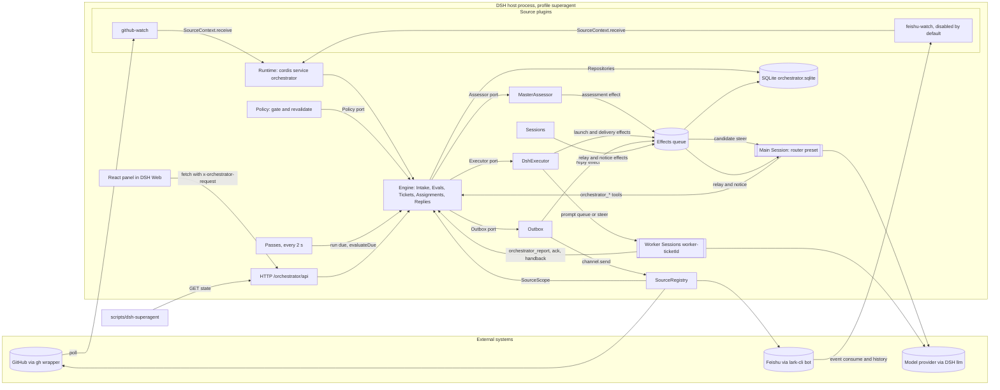
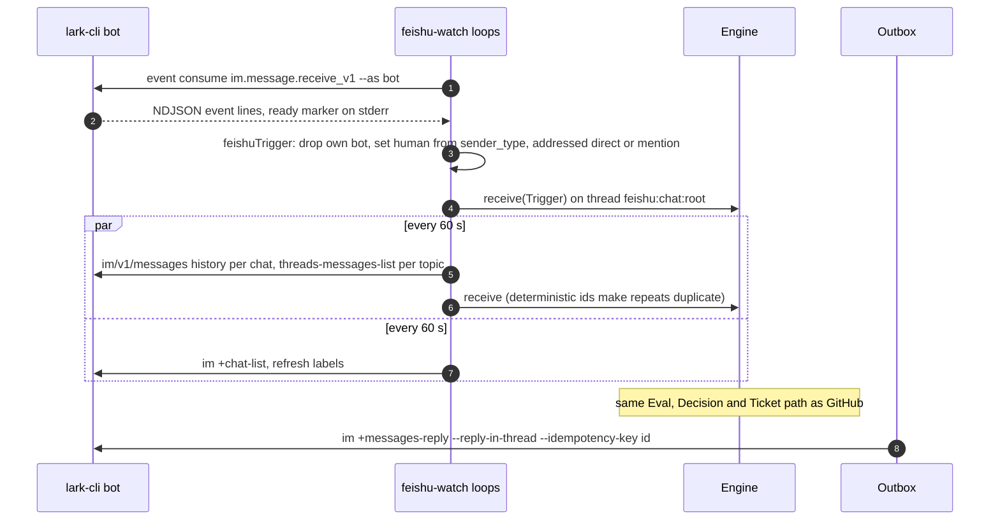
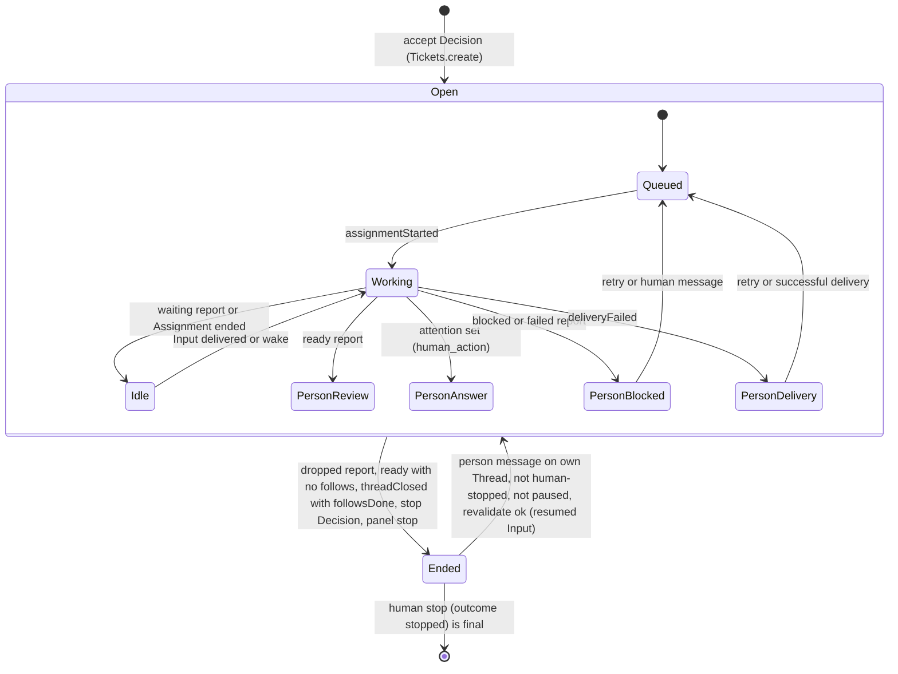
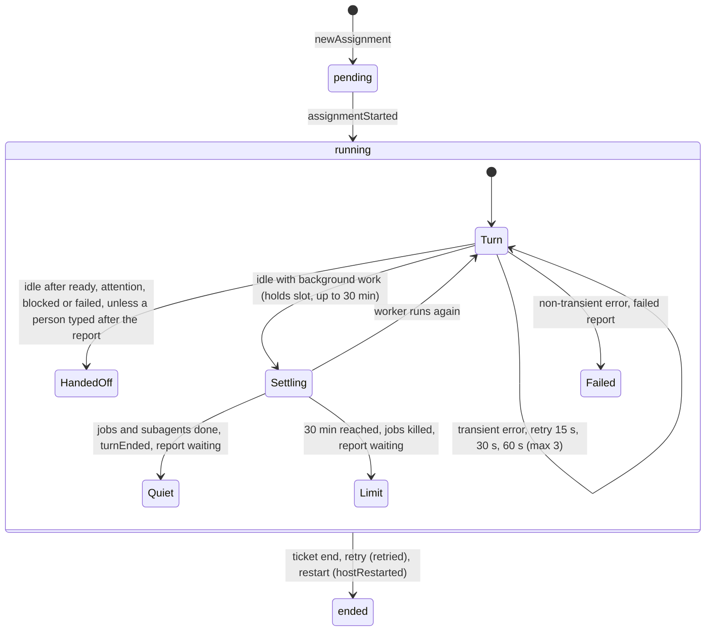
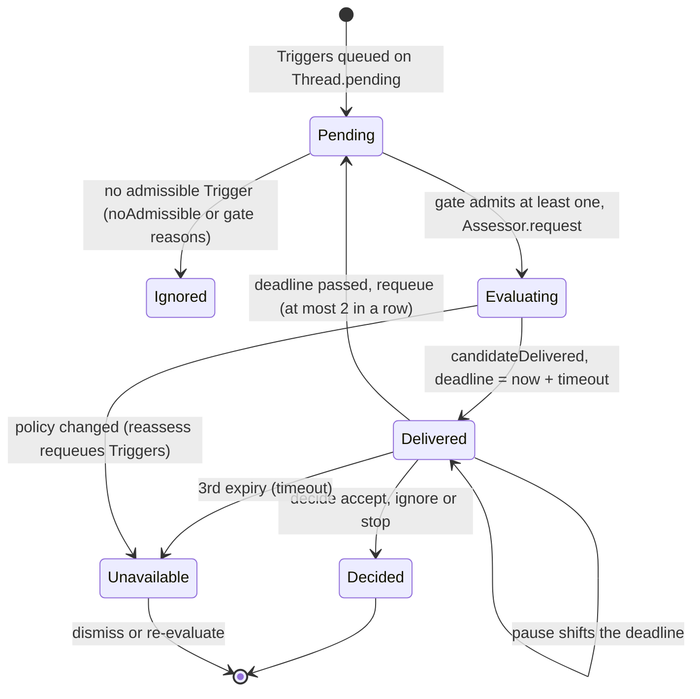
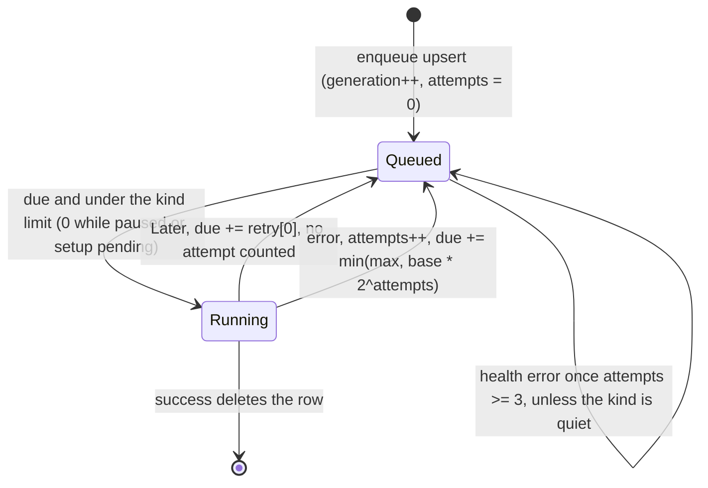

# dsh-superagent system map

Read-only map of the repository at `/home/gerald/workloads/dsh-superagent-prototype`, built from the eleven verified area readings. Verifier refutations have been applied and "missed" facts folded in. Every claim carries `file:line` evidence relative to the repo root unless an absolute or `~` path is given. No secret appears in this file. The relayed request contained a GitHub token. It was not used and is not reproduced here, and it should be treated as exposed and rotated. The code never reads `GH_TOKEN`: it strips `GH_TOKEN`/`GITHUB_TOKEN` and authenticates through a `gh` wrapper (src/infra/environment.ts:45-57).

---

## 1. System summary

dsh-superagent is a research-prototype DeepSeek Harness (DSH) bundle. It is a proactive coding agent for **one** GitHub repository (README.md:7). It listens to GitHub, which it polls through the agent's `gh` CLI (src/sources/github.ts:127-146,273-296), and optionally to Feishu through the bot's `lark-cli` (src/sources/feishu-loops.ts:18-19). Incoming events are normalized into **Triggers** grouped into **Threads**. A deterministic **gate** plus a model **assessment** (the **Eval**) turns authorized requests into **Tickets** that carry an immutable **Mandate** (docs/001-domain.md:7-19; src/policy.ts:166-242). Each Ticket runs in its own persistent DSH **Executor Session** `worker-<ticketId>` and its own directory (src/executor/dsh.ts:24-26,96-111). The agent replies in the originating conversation, often with a PR (README.md:7). A single **main Session** (the orchestrator, preset `dsh-superagent-router`) receives candidate cards, routes them with `orchestrator_*` tools and relays worker reports (src/app/sessions.ts:47-48; src/app/tools/main.ts:155-301). Everything runs as a cordis plugin inside the DSH host. The Engine is synchronous and transactional (docs/007-architecture.md:44-60). State is one SQLite file at `<stateDir>/orchestrator.sqlite` (src/app/runtime.ts:98). Side effects go through a durable effect queue (src/app/effects.ts:1-161). A loopback-only management API under `/orchestrator/api/*` (src/app/http.ts:230-247) serves a React panel inside the DSH Web UI, labelled "Superagent" (src/client/index.tsx:48-58). The guiding principle is to take as little human attention as possible and give as much value as possible (docs/000-philosophy.md:5).

---

## 2. Domain model and ubiquitous language

| Term (EN / 中文) | Meaning | Code shape | Evidence |
|---|---|---|---|
| Source / 来源 | Stream of events; a kind is an implementation, an instance a configuration. Holds read position and bot identity, drops own-bot and out-of-scope Triggers | `SourceKind<C>` with `scope`, `channel`, `threadContext`, `policy` and `environment` | docs/001-domain.md:27; src/sources/kind.ts:85-113 |
| Trigger / 触发 | One immutable event. `threads[0]` is primary and hosts the Eval. `text`/`meta` are untrusted | `{id, source, threads[], actor, human, addressed?: 'mention'\|'direct', at, text, channel?, url?, meta}` | src/core/model.ts:22-39 |
| Thread / 线程 | Triggers in time order, at most one Eval at a time, possibly several Tickets. Key `<source>:<id>` | `{key, ref, subscriptions[], context[], correlated[], pending[], evaluating?, expired?, meta}` | src/core/model.ts:11-12,156-182 |
| Correlation / 关联 | Threads that share a Trigger. Adds context, never routes | `Thread.correlated` | docs/001-domain.md:30,55 |
| Channel / 渠道 | Write side of a Thread. The address is Source-defined | `ChannelRef {source, thread, address}` | src/core/model.ts:8-9 |
| Policy / 策略 | Versioned assessment rules plus each Source's part (allowed list, bots, admission table) | `settingsPolicy()` builds `Policy` | src/policy.ts:166-242; src/core/ports.ts:17-27 |
| Policy version / 策略版本 | `key('mandate-v3', JSON{rules, eval.mode, policy.sources})`. Models, concurrency, pause and executor settings do not change it | `POLICY_REVISION`, `policyVersion()` | src/policy.ts:111-118 |
| Eval / 评估 | Stateless judgement on a Trigger batch: deterministic **gate** (准入), then model **assessment** (研判) | `Evaluation {id, threadKey, triggerIds, primary?, strength, basis, policyVersion, delivered?, deadline, pausedAt?}` | src/core/model.ts:135-154; docs/001-domain.md:33 |
| Decision / 决定 | Recorded Eval outcome: accept, stop, ignore or unavailable. `reopen` is legacy and never produced by core | `Decision {kind, reason[], strength, ticketId?, mandate?, audit?, dismissed?}` | src/core/model.ts:190-209 |
| Strength / 强度 | `explicit` (allowed sender addressed the agent) or `inferred` (proactive) | `Strength` | src/core/model.ts:96 |
| Mandate / 授权 | Immutable authorization created by accept, withdrawn only by a person's stop, revoked only by failed revalidation | `{strength, policyVersion, basis, actor, scope}` | src/core/model.ts:125-133; docs/002-authorization.md:129 |
| MandateBasis | How the gate admitted: `via` addressed, followup, admission (with cell), listed (legacy) or bot | | src/core/model.ts:105-123 |
| Admission cell | `listedUnaddressed` (default inferred), `unlistedAddressed` (default ignore), `unlistedUnaddressed` (default ignore). A listed sender who addresses the agent uses no cell | `ADMISSION_DEFAULTS` | src/admission.ts:1-13 |
| Accept mode | `off`, `observe` (default) or `auto`. Observe records would-accept as ignore with reason `observed` | `settings.eval.mode` | src/policy.ts:55-58,84 |
| Ticket / 工单 | Unit of authorized work, created only by Eval | `{mandate, channels, ended?{at, by, outcome}, attention?, assignments, inputs, undelivered, follows?, origin, execution?, delivery?}` | src/core/model.ts:277-315 |
| Assignment / 派工 | Binding of a Ticket to one Executor run: pending, running, ended | `AssignmentState` | src/core/model.ts:211-233 |
| Report / 报告 | Worker outcome: progress, waiting (host-only), ready, blocked, failed or dropped | `ReportState` | src/core/model.ts:216; src/app/tools/executor.ts:78 |
| Subscription / 订阅 / Fan-out 扇出 | Ticket-to-Thread relation held by the Thread. Matching Triggers fan out to live subscribed Tickets with no gate | | docs/001-domain.md:37; src/core/intake.ts:8-62 |
| Context thread | Read-only follow. Its messages grant nothing and cannot resume or be acked | `Thread.context` | src/core/model.ts:165-169 |
| Follow | Thread a Ticket follows, such as its PR. `followsDone` decides when a PR close ends the Ticket | `{thread, own, closed?}` | src/core/model.ts:309-314; src/core/tickets.ts:95-101 |
| Input / 输入 | What reaches a worker: trigger, policy-changed, resumed, note, text, or legacy reopen | `TicketInput` | src/core/model.ts:235-257 |
| PolicyEffect | How a policy change affects a live Ticket | `{rules[{id, name, change}], proactive?, requesterAllowed?, requester?}` | src/core/model.ts:259-269 |
| Attention / 待人工决定 | Open question for a person | `{id, question, triggerId?}` | src/core/model.ts:275 |
| Disposition / 去向 | Where a Trigger went | `{filtered?, evalId?, decisionId?, fanout[], context?, requeued?, handbacks?, acked?, at}` | src/core/model.ts:41-61 |
| Hand-back | Worker returns a Trigger once as beyond its scope | `disposition.handbacks` | src/core/part.ts:36-55 |
| Follow-up owners | Tickets whose worker decides a person's message, which keeps it out of Eval | `followupOwners()` | src/core/model.ts:68-88 |
| Main Session (orchestrator) / Executor Session (worker) | Router Session `masterId` (default `orchestrator-<key(stateDir)>`) and the per-Ticket Session | | src/app/runtime.ts:104-105; src/executor/dsh.ts:24 |
| Worker slot | Concurrency unit: `maxWorkers` plus one for a person's wake | `WorkerSlots` | src/executor/dsh.ts:165-199 |
| Execution environment / 执行环境 | Variables (key, value, description) registered by the Executor and Sources | | docs/001-domain.md:99; src/app/execution-environment.ts:10-15 |
| Ticket stage | First match wins: ended, person/{delivery\|answer\|review\|blocked\|failed}, working/queued, idle, working | `ticketStage()` | src/core/stage.ts:5-21 |
| Not domain concepts | A "person" is just the actor id the Source gives. Cross-Source identity is prompt text | | docs/001-domain.md:39,49 |

Bilingual glossary groups shown in the panel: src/client/locales.ts:755-765 and docs/001-domain.md:77-112.

---

## 3. Component map

| Component | Files | Responsibility |
|---|---|---|
| Plugin entry | src/index.ts:7-27 | Name `dsh-superagent`. Injects 11 DSH services, turns off DSH's auto settings page (`settings.configure({auto:false})`), builds Runtime, awaits `runtime.ready` |
| Machine config / setup probes | src/deployment.ts:13-131; src/setup.ts:4-39 | Config schema (`stateDir` plus 3 volatile limits). `machineOf` rejects unknown or moved keys. `resolveDeployment` / `resolveFeishuBot` probe the CLIs. 16 typed `SetupError` codes |
| Runtime (composition root) | src/app/runtime.ts:54-253 | cordis Service `orchestrator` (a SourceHost). Locks stateDir, opens Store, wires every component, runs Setup, starts Passes and Effects |
| Engine (core) | src/core/engine.ts; intake.ts; evals.ts; tickets.ts; assignments.ts; replies.ts; part.ts | Only writer of Triggers, Threads, Decisions, Tickets and Assignments. Synchronous and transactional, with role-scoped `Pick` views |
| Core ports and model | src/core/ports.ts:6-134; model.ts; stage.ts; reasons.ts; errors.ts; memory.ts | Assessor, Executor, Outbox, Policy, SourceScope, Repositories and DomainEvents. MemoryRepositories for tests |
| Policy / admission / limits | src/policy.ts; src/admission.ts; src/limits.ts | Settings zod schema, gate, revalidate, assessment validation, policyEffects, bounds |
| Store | src/app/store.ts:51-288; store-read.ts; versions.ts; migration.ts | SQLite (WAL, synchronous=FULL), savepoint `atomic`, typed KV, versioned settings, outbox receipts, schema 10 to 11 migration |
| Effects | src/app/effects.ts:1-161 | Durable queue with one row per kind+key. Kinds: assessment, launch, delivery, relay, notice, reply |
| Passes | src/app/passes.ts:17-69 | 2 s and on-demand passes. Each runs due effects, then `engine.evaluateDue()`. Does nothing until setup is configured |
| Outbox | src/app/outbox.ts:17-52 | Core Outbox port, only writer of receipts, sends through `reply` effects via `SourceRegistry.send` |
| Sessions | src/app/sessions.ts:47-349; delivery.ts; role-models.ts; retry-health.ts | Creates and decorates DSH Sessions (prompt section, skills, tool allow-lists, guards). Relay and notice delivery. Role models |
| MasterAssessor | src/app/assessment.ts:18-282 | Assessor port. Sends candidate cards (from the `assessment` effect), bounded reads, `orchestrator_eval*` tools |
| Settings | src/app/settings.ts:17-267; settings-history.ts | Revisioned blocks with origin panel, tool or sync. Pause, policy sync with backoff, label refresh |
| Setup | src/app/setup.ts:20-99 | Resolves deployment, writes the worker env and shims, tracks `problem` / `feishuProblem` |
| Prompts | src/app/prompts.ts:13-247; context.ts; skill-files.ts; prompts/**; skills/** | Versioned PromptConfig (team sections, skills, built-in overrides), composition, preview |
| Model tools and resources | src/app/tools/main.ts; tools/executor.ts; tools/tool.ts; resources.ts; cards.ts; notices.ts; links.ts | 14 main tools, 6 worker tools, `orchestrator_read` grammar |
| HTTP API | src/app/http.ts:62-247; src/app/api.ts:12-52; src/app/views/** | 25 management routes under `/orchestrator/api/` |
| DshExecutor | src/executor/dsh.ts; src/executor/background.ts | Executor port: per-Ticket Session and directory, slots, prepare, launch and delivery effects, background jobs and subagents, retries |
| SourceRegistry / SourceHost | src/sources/registry.ts:13-138; host.ts:11-67; kind.ts; src/app/source-context.ts:29-72 | Source kinds and instances, SourceScope, send, link, find, threadContext, health claims |
| GitHub Source | src/sources/github*.ts | Poll loop (notifications, streams, CI, ticket PRs, subscribed threads), Trigger builders, PR binding, replies |
| Feishu Source | src/sources/feishu*.ts | Live `event consume` consumer, 60 s backfill and topic polling, chat names, replies, policy sync, images |
| Infra | src/infra/commands.ts; environment.ts; health.ts; text.ts; paths.ts; src/kv.ts; src/navigation.ts | CLI wrapper (gh, lark, git), worker shims and gitconfig, HealthBoard, word limits, KV key registry, session navigation |
| Web panel | src/client/** | React 18 DSH web-client plugin. 6 tabs, settings drafts, prompt editor |
| Bundle patch / presets | cordis.patch.yml:1-193; examples/profile.cordis.patch.yml | Plugin rows, plus the `dsh-superagent-worker` (order 90) and `dsh-superagent-router` (order 91) presets |
| Service controller | scripts/dsh-superagent | Python 3 tmux manager: start, stop, restart and status, with exit codes 0-3 |



Contracts shown: Source to Engine `receive` / `bindThread` / `threadClosed` (src/core/engine.ts:48-65,261). Engine to Executor `start` / `deliver` / `stop`, and Executor to Engine facts (src/core/ports.ts:55-69; src/core/engine.ts:269-270). Main Session to Engine `candidate`, `decide`, `attach`, `reply`, `requestStatus`, `note` (src/core/engine.ts:263). People and panel to Engine `stopTicket`, `retryTicket`, `reevaluate`, `unsubscribe`, `dismiss` (src/core/engine.ts:265). Settings to Engine `policyChanged` (src/core/engine.ts:255-257,267).

### 3.1 Files the table above does not name (critic addition)

**Build outputs and plugin rows.** tsdown builds three ESM node entries, `lib/index.js` (src/index.ts), `lib/github-watch.js` (src/sources/github.ts) and `lib/feishu-watch.js` (src/sources/feishu.ts), with `@deepseek-ai/*`, zod and proper-lockfile left external, plus one CJS browser bundle `lib/client.js` (tsdown.config.ts:10-13). package.json exports map `./github-watch` and `./feishu-watch` to those files, which is how the bundle patch rows `dsh-superagent/github-watch` and `dsh-superagent/feishu-watch` resolve (package.json:12-21; cordis.patch.yml:5-12). The root export also re-exports the reusable core (`export * from './core/index.ts'`) (src/index.ts:27; src/core/index.ts:1). vitest runs `tests/**/*.spec.{ts,tsx}` (59 spec files) with React deduped (vitest.config.ts:3).

**Uncovered non-client src files.**

| File | Role | Evidence |
|---|---|---|
| src/core/ids.ts | `key(...values)` = first 32 hex chars of sha256 over the JSON array; used for `policyVersion` and the default `masterId` | src/core/ids.ts:3; src/policy.ts:117; src/app/runtime.ts:104 |
| src/core/index.ts | Public core surface (model, ports, engine, in-memory repositories) | src/core/index.ts:1 |
| src/app/cache.ts | `TextCache`, an LRU bounded by total UTF-16 units that always keeps the newest entry; instances for `orchestrator_read` pages (4M) and Feishu links | src/app/cache.ts:1-27; src/app/runtime.ts:118 |
| src/sources/admission-context.ts | Bounded thread window for assessments; refuses a repeated pagination cursor | src/sources/admission-context.ts:6-17,22-42 |
| src/sources/github-read.ts | Read-only repo, conversation and CI-check inspection used by `orchestrator_read`, the assessor and the GitHub poller | src/sources/github-read.ts:1; src/app/resources.ts:5; src/app/assessment.ts:11; src/sources/github.ts:7 |
| src/app/store-read.ts, versions.ts | Read-only Store queries; numbered-snapshot versioned records with a current-revision KV pointer | src/app/store-read.ts:1; src/app/versions.ts:1 |
| src/app/context.ts, skill-files.ts, infra/paths.ts | Load packaged prompt and skill files (missing or empty file aborts load); resolve assets from src or lib | src/app/skill-files.ts:8-32; src/infra/paths.ts:1 |
| src/app/cards.ts, retry-health.ts | Bounded model-facing projections; model budget-retry waits projected from Session events | src/app/cards.ts:1; src/app/retry-health.ts:1 |
| src/app/views/text.ts, views/tickets.ts | View text sanitising; Ticket list/detail, Mandate basis, executor load | src/app/views/text.ts:1; src/app/views/tickets.ts:1 |

**Prompt files and composition** (docs/004-prompts.md). Each `prompts/<name>.md` is loaded by `promptFile`, which joins one-sentence-per-line paragraphs (src/app/skill-files.ts:25-32).

| Part key | File(s) | Roles | Evidence |
|---|---|---|---|
| `runtime/shared` | prompts/shared.md | both | src/app/context.ts:7 |
| `runtime/orchestrator` / `runtime/worker` | prompts/orchestrator.md / prompts/worker.md | one each | src/app/context.ts:8-9 |
| team `communication`, `scope`, `delivery` | prompts/team/*.md (defaults; `##` headed, dropped when empty) | both | src/app/context.ts:17-18; src/app/prompts.ts:14,17,105-106 |
| `runtime/subscriptions`, `runtime/replies` | prompts/subscriptions.md, prompts/replies.md | both | src/app/context.ts:11-12 |
| `runtime/dispatch` / `runtime/work` | prompts/dispatch.md / prompts/work.md | orchestrator / worker | src/app/context.ts:11-12; src/app/prompts.ts:110 |
| `runtime/admission` | prompts/admission.md | orchestrator | src/app/context.ts:21; src/app/prompts.ts:111 |
| `runtime/handoff/<role>` | prompts/handoff.md + handoff-orchestrator.md or handoff-worker.md | one each | src/app/context.ts:23-24; src/app/prompts.ts:112 |
| `runtime/environment`, `runtime/policy` | generated (policy is orchestrator-only and always last) | | src/app/prompts.ts:113-114 |
| `skill/github`, `skill/feishu` | skills/dsh-superagent-*/SKILL.md body + `## CLI usage` + prompts/cli.md | both | src/app/skill-files.ts:18-24; src/app/prompts.ts:68-69 |

Composition order: shared, role, team sections, subscriptions, replies, dispatch or work, admission (orchestrator), handoff, environment, policy (src/app/prompts.ts:107-115).

**Panel (src/client, docs/005-panel.md).** Tabs `overview, source, trigger, eval, execution, settings`; settings groups `source, eval, execution, prompts, deployment` (src/client/route.ts:7,9).

| Group | Files |
|---|---|
| Shell and plumbing | index.tsx (slots), app.tsx (header, search, glossary, tabs), provider.tsx (contexts, state polling, restart), route.ts, api.ts, locales.ts, text.ts, markdown.ts, marks.ts (state to status dot), client.css + css.d.ts (`?raw` import) |
| Shared widgets | controls.tsx, widgets.tsx, rows.tsx, settings-kit.tsx, draft.tsx |
| Pages | overview.tsx, source.tsx, trigger.tsx (Thread list), eval.tsx (Decision log and Eval settings), execution.tsx (active Tickets, pause, Executor settings), thread.tsx, ticket.tsx, settings.tsx (settings shell), prompts.tsx + prompt-config.ts, deployment.tsx |

Evidence: each file's header comment at line 1 (for example src/client/app.tsx:1; src/client/eval.tsx:1; src/client/execution.tsx:1; src/client/trigger.tsx:1; src/client/marks.ts:1; src/client/css.d.ts:1).

---

## 4. Main flows

### 4.1 GitHub trigger, admission, ticket, executor, reply and PR

```mermaid
sequenceDiagram
  autonumber
  participant GH as GitHub (gh wrapper)
  participant GW as github-watch
  participant ENG as Engine
  participant POL as Policy gate
  participant EFF as Effects
  participant MS as Main Session
  participant EXE as DshExecutor
  participant W as Worker Session
  participant OB as Outbox
  GW->>GH: gh api repos/R/notifications, streams, CI, PRs
  GW->>ENG: receive(Trigger) returns stored, duplicate or filtered
  ENG->>ENG: scope filter, fan-out to subscribed Tickets, queue on Thread.pending
  Note over ENG: Passes call evaluateDue every 2 s and on demand
  ENG->>POL: gate(trigger, thread, tickets)
  POL-->>ENG: admissible with strength and basis, or a reason
  ENG->>EFF: Assessor.request(candidate) enqueues assessment
  EFF->>MS: steer candidate card, kind candidate, next_action
  alt strength explicit
    MS->>ENG: orchestrator_route accept, attach, ignore or stop
  else strength inferred
    MS->>ENG: orchestrator_eval, eval_read, eval_decide
    ENG->>POL: assessmentOutcome; observe mode turns accept into ignore
  end
  ENG->>ENG: record Decision, Mandate, Ticket, pending Assignment, subscriptions
  ENG->>OB: acknowledgeAccepted if primary is human with a channel
  ENG->>EFF: executor.start enqueues launch
  EFF->>EXE: launch: reserve slot, prepare dir, ensure worker Session
  EXE->>W: prompt queue, first assignment message
  W->>ENG: orchestrator_ack, orchestrator_report progress with pr_number
  ENG->>GW: claimPull binds PR thread to Ticket
  W->>ENG: orchestrator_report ready or blocked
  ENG->>EFF: relay worker_report to Main Session
  MS->>OB: orchestrator_reply purpose result
  OB->>GH: issue comment or review-thread reply with HTML marker
  GW->>ENG: threadClosed(PR, merged or closed) ends the Ticket when followsDone holds
  ENG-->>OB: on ticket.ended, Runtime sends pullEndNotices to the Ticket's conversations
```

PR binding rule (critic addition): `claimPull` accepts a PR only if it is the Ticket's origin PR, or an agent-authored PR whose head branch's last path segment equals the Ticket's `DSH_SUPERAGENT_NAME` (for example `agent/$DSH_SUPERAGENT_NAME`); otherwise the report is refused with that message (src/sources/github-pull.ts:27,35-44; src/sources/github.ts:94). Polling also auto-binds an open agent PR to the single open Ticket on its branch without a report (src/sources/github-pull.ts:51-61). On `ticket.ended` the Runtime's `emit` hook sends `pullEndNotices` through the Outbox when setup is configured (src/app/runtime.ts:147-152). Main-Session notices for DomainEvents are suppressed while `this.quiet` is set, i.e. inside `quietly(...)` runs for changes the main Session initiated itself (src/app/runtime.ts:139-146,165).

Evidence: poll order (src/sources/github.ts:273-296); notification path (src/sources/github.ts:304-305; src/infra/commands.ts:85,97); intake (src/core/intake.ts:8-62); gate (src/policy.ts:166-211); candidate via the assessment effect (src/app/assessment.ts:96-101; src/app/runtime.ts:133); `next_action` (src/app/links.ts:69-70); route (src/app/tools/main.ts:47-153); inferred path and the `notExplicit` refusal (src/core/evals.ts:151-154; src/core/errors.ts:14); assessment validation (src/policy.ts:34-61); accept flow (src/core/evals.ts:306-316; src/core/tickets.ts:37-56); auto-ack condition (src/core/replies.ts:43-45); launch (src/executor/dsh.ts:263-266,424-470); worker tools (src/app/tools/executor.ts:23-105); PR binding (src/sources/github-pull.ts:35-75); relay (src/app/notices.ts:108-129); GitHub send (src/sources/github-channel.ts:18-52); PR close (src/sources/github-pull.ts:80-105; src/core/tickets.ts:77-101).

### 4.2 Feishu trigger path



Evidence: three loops (src/sources/feishu-loops.ts:18-19); consumer spawn, ready marker and backoff (src/sources/feishu-loops.ts:43-97); Trigger mapping and self-drop (src/sources/feishu-trigger.ts:8-9,16,33,37-38); scope (src/sources/feishu.ts:54-65); backfill cursor and topic map (src/sources/feishu-loops.ts:143-206); lark command list (src/sources/feishu-loops.ts:71,111,179; src/sources/feishu-read.ts:33,57,77,92,120; src/sources/feishu-channel.ts:23); the channel thread is chat-level `feishu:<chatId>` while the Trigger thread is topic-level (src/sources/feishu-trigger.ts:8-9,16,37); a 100-word limit applies to Feishu replies (src/app/outbox.ts:29; src/infra/text.ts:3,12-16).

### 4.3 Panel interaction

```mermaid
sequenceDiagram
  autonumber
  participant P as Panel (React, DSH Web)
  participant H as HTTP /orchestrator/api
  participant RT as Runtime
  participant ENG as Engine
  participant S as Settings
  P->>H: GET state, polled every 5 s (1 s during a restart)
  H->>H: sameOrigin check (403 before waiting)
  H->>RT: await runtime.ready, then route match
  H-->>P: setup, load, masterId, paused, health
  P->>H: GET overview, tickets, threads, decisions (usePoll)
  P->>H: POST tickets/:id/retry or stop
  H->>ENG: retryTicket or stopTicket
  ENG->>ENG: end or new Assignment, executor.stop and start
  P->>H: PUT settings/:block with value and base revision
  H->>S: save(origin panel); 409 on stale revision
  S->>ENG: policyChanged(from, to, effects) when the version changes
  S-->>P: saved, revision, policy_changed, restarting, context_delivery
  alt restarting true
    P->>H: GET state every 1 s until it fails, then succeeds, or 30 s
  end
```

Evidence: client fetch (src/client/api.ts:32-43); polling (src/client/api.ts:60-98; src/client/provider.tsx:85-98); same-origin is checked first (src/app/http.ts:237), then `await runtime.ready` (src/app/http.ts:239), then route match with 404 "Unknown operation" (src/app/http.ts:240-241); sameOrigin itself at src/app/http.ts:75-79; retry and stop (src/app/http.ts:193-194; src/core/tickets.ts:164-180); settings save (src/app/http.ts:196-202; src/app/settings.ts:148-196); draft merge and rebase (src/client/draft.tsx:66-108,144-168).

---

## 5. State machines

### Ticket



Outcomes: completed, merged, closed, dropped or stopped. Ended by executor or human (src/core/model.ts:271-273). End conditions: src/core/assignments.ts:128-132; src/core/tickets.ts:77-101,345-363; src/core/evals.ts:293-302. Resume: src/core/tickets.ts:252-270,311-316. A failed revalidation calls `refuse()`, which clears undelivered Inputs and may requeue them for Eval (src/core/tickets.ts:257,288-316). Stage precedence: src/core/stage.ts:5-21. `canRetry` = open AND (waitsForPerson OR delivery failure) (src/core/stage.ts:23-26). waitsForPerson reads the **latest Assignment's** report (src/core/model.ts:349-353).

### Assignment and worker turn



Evidence: src/core/model.ts:211; src/core/tickets.ts:168-180,318-327,381-390; src/executor/dsh.ts:554-576,601-672; handoff exception (src/executor/dsh.ts:622-624).

### Eval on a Thread



Evidence: src/core/evals.ts:18-19,35-119,211-230,318-326. An undelivered Eval never expires (src/core/evals.ts:43). `thread.expired` is cleared by `ignore()` and by a Decision on the thread's own Eval, but not by a direct Eval (src/core/evals.ts:252,320-322).

### Effect row



Evidence: src/app/effects.ts:61-66,103-160. Ordered kinds (relay, notice) block behind their oldest row (src/app/effects.ts:108-113).

Other machines: outbox receipt pending, then sent or dropped (channelGone or channelIgnored) (src/app/store.ts:15-18; src/app/outbox.ts:39-51). Health entry starting, ready, paused or error (src/sources/host.ts:19). Source status, in priority order: missing, off, error, setup, starting, paused, ready (src/app/views/sources.ts:31-40). Thread stage: error, evaluating, queued, subscribed, dormant, unsubscribed (src/app/views/records.ts:155-163). Settings draft: clean, editing, saving, awaitingRevision (src/client/draft.tsx:66-108). Prompt revision 0 is the defaults; each save needs `baseRevision == current` (src/app/prompts.ts:149-158,202-216).

---

## 6. Configuration reference

| Key | Where | Default | Meaning |
|---|---|---|---|
| `dsh-superagent.config.stateDir` | Profile cordis.patch.yml | required, absolute | DB, lock, worker-bin, worker-gitconfig, default `work/` ticket dirs. Changing it remounts the plugin (src/deployment.ts:14-16; examples/profile.cordis.patch.yml:7-9) |
| `promptMaxChars` | same entry, volatile | 100000 (1000 to 1,000,000) | Largest saved PromptConfig JSON. The prompt routes cap request bodies at 4*value+4096 bytes (src/deployment.ts:17-18; src/app/http.ts:154) |
| `admissionContextMaxPages` | same entry, volatile | 10 (1 to 100) | Thread context pages per assessment (src/deployment.ts:19-20) |
| `admissionContextTimeoutMs` | same entry, volatile | 15000 (1 to 90000) | One `AbortSignal.timeout` over the **whole** admission-context load (all pages up to `admissionContextMaxPages`), not per page. On failure the model gets "Thread context unavailable … Use orchestrator_eval_read" (src/deployment.ts:21-22; src/app/assessment.ts:152-155,166). The loaded window is the first 5 messages plus ±5 around the Trigger, with omitted-gap counts (src/sources/admission-context.ts:6-17,22-42) |
| Retired keys `repository`, `branchPrefix`, `github`, `feishu`, `author`, `repositoryPath`, `worktreeRoot`, `blockedCommands` | plugin entry | rejected at startup | Moved to Source or Execution settings (src/deployment.ts:31-43) |
| `webserver.config.host` / `.port` | Profile patch | 127.0.0.1 / 3082 in the example (DSH default port 3080) | Must be 127.0.0.1 or registration throws (examples/profile.cordis.patch.yml:3-6; src/app/http.ts:231) |
| `dsh-superagent-feishu.disabled` | Bundle patch, overridden in profile | true | Enables the Feishu Source plugin (cordis.patch.yml:9-12) |
| `paused` | settings, block `pause` | false | Holds launch, delivery, assessment and reply effects and new Evals, and shifts Eval deadlines (src/policy.ts:100; src/core/evals.ts:35-46) |
| `eval.mode` | settings `eval` | `observe` | off, observe or auto. Part of the policy version (src/policy.ts:84) |
| `eval.timeoutSeconds` | settings `eval` | 120 (30 to 600) | Eval deadline after delivery (src/policy.ts:85; src/limits.ts:5) |
| `eval.model` | settings `eval` | null | Main Session RoleModel `{provider, model, reasoningEffort?}` (src/policy.ts:70,86) |
| `executor.model` | settings `executor` | null | Worker RoleModel. Applied only when a Session is created (src/policy.ts:92; src/app/sessions.ts:149-150) |
| `executor.maxWorkers` | settings `executor` | 3 (1 to 16) | Worker slots, plus one for a person's wake (src/policy.ts:93) |
| `executor.directory` | settings `executor`, panel-only | `''` meaning `<stateDir>/work` | Ticket directory root; must be an absolute path or empty (src/policy.ts:94; src/app/execution-environment.ts:18) |
| `executor.prepare` | settings `executor`, panel-only | `''` | `sh -c` run once per new ticket dir, 10-minute timeout, at most 4000 chars (src/policy.ts:95; src/limits.ts:7; src/executor/dsh.ts:28,247-262). It sees the execution environment variables below; the documented checkout recipe is a `git fetch` of `${DSH_SUPERAGENT_GITHUB_PR_HEAD:-HEAD}` plus `git worktree add -b agent/$DSH_SUPERAGENT_NAME "$DSH_SUPERAGENT_DIR"` (docs/006-deployment.md:149-154) |
| `executor.blockedCommands` | settings `executor`, panel-only | [] | Failing shims. gh, git and lark-cli cannot be blocked (src/policy.ts:88-89,96; src/infra/environment.ts:18) |
| `policy.rules[]` | settings `policy` | `copy`, `visual` | `{id ^[a-zA-Z0-9_-]{1,80}$, name ≤100, enabled, instruction ≤2000}` (src/policy.ts:13,62-68,80) |
| `policy.sources.<id>.allowed` | settings `policy` | [] | Allowed senders. GitHub logins `^[A-Za-z0-9-]+$`, Feishu `ou_…` (src/policy.ts:73; src/sources/github.ts:71-78; src/sources/feishu.ts:72-77) |
| `policy.sources.<id>.bots` | settings `policy` | absent | Listed bots, which can only yield inferred candidates (src/policy.ts:122-126) |
| `policy.sources.<id>.admission.<row>` | settings `policy` | inferred / ignore / ignore | Rows: GitHub `issues`, `pulls`, `comments`, `ci`; Feishu chatId, `other`, `direct` (src/admission.ts:8-13; docs/006-deployment.md:203) |
| `policy.sources.feishu.syncChat` | settings `policy` | `''` | Chat whose user members sync the allowed list (src/sources/feishu.ts:72-116) |
| `sources.<id>.enabled` | settings `source:<id>` | true | Source instance on or off (src/policy.ts:98,101) |
| `source:github.config.repository` / `.cli` | setup fields, panel-only | `''` | `owner/name` and the gh wrapper. A change restarts the plugin (src/deployment.ts:45-51) |
| `source:github.config.pollSeconds` | settings | 60 (60 to 3600) | Minimum poll interval. GitHub's X-Poll-Interval wins if longer (src/sources/github.ts:25,144) |
| `source:github.config.failuresBeforeError` | settings | 3 (1 to 20) | Consecutive failed polls before error (src/sources/github.ts:26) |
| `source:github.config.observeIssues/Pulls/Comments/Ci` | settings | false | Repository-wide streams and default-branch CI (src/sources/github.ts:27-28,173-192) |
| `source:feishu.config.cli` | setup field | `''` | Bot-only lark-cli. Empty turns Feishu off (src/deployment.ts:49,115-116) |
| `source:feishu.config.chats[]` | settings | [] | `{chatId oc_…, name?, listen mentions\|all}` (src/sources/feishu.ts:24-26) |
| `source:feishu.config.directMessages` / `otherChats` | settings | true / `none` | DM and unconfigured-chat scope; `otherChats` is `none` or `mentions` (src/sources/feishu.ts:27-28) |
| `source:feishu.config.readPageSize` / `linkTimeoutMs` | settings | 20 (1 to 50) / 5000 (1 to 90000) | Read paging and AppLink wait (src/sources/feishu.ts:22-23) |
| PromptConfig `{communication, scope, delivery, skills, overrides?}` | KV prompt versions | prompts/team/*.md | Team sections, skills and part overrides (src/app/prompts.ts:18-42) |
| `DSH_SUPERAGENT_PROFILE` / `DSH_SUPERAGENT_URL` | script env | `superagent` / `http://127.0.0.1:3082` | Service controller target (scripts/dsh-superagent:212-215) |
| `--timeout` / `--stop-timeout` / `--respect-stop` | script flags | 60 s / 300 s / off | Startup wait, graceful stop, monitor mode (scripts/dsh-superagent:216-223) |
| `--profile` / `--url` | script flags | env value, else `superagent` / `http://127.0.0.1:3082` | Flag form of the two env vars; the profile must match `[A-Za-z0-9_][A-Za-z0-9_.-]*`, and the tmux session is `dsh-<profile>` (scripts/dsh-superagent:160,212-215,224-225) |
| `DSH_HOME` | env | `~/.dsh` | Profile location (docs/006-deployment.md:85) |

**Execution environment variables** (critic addition). Registered per owner and shown under Settings → Execution and on each Ticket page; prepare commands and worker Sessions read them (docs/001-domain.md:99; src/app/http.ts:116-120).

| Variable | Owner | Value | Evidence |
|---|---|---|---|
| `DSH_SUPERAGENT_DIR` | Executor, per Ticket | The Ticket's directory, where the worker Session works | src/app/execution-environment.ts:11,29 |
| `DSH_SUPERAGENT_NAME` | Executor, per Ticket | Ticket short name and directory name; the PR branch's last segment must equal it for binding | src/app/execution-environment.ts:12,29; src/sources/github-pull.ts:43 |
| `DSH_SUPERAGENT_TICKET` | Executor, per Ticket | Ticket id | src/app/execution-environment.ts:13,29 |
| `DSH_SUPERAGENT_BLOCKED_COMMANDS` | Executor | `executor.blockedCommands` joined by spaces | src/app/execution-environment.ts:14,29 |
| `DSH_SUPERAGENT_GITHUB_REPOSITORY` | GitHub Source | `owner/name` | src/sources/github.ts:94,102 |
| `DSH_SUPERAGENT_GITHUB_ACCOUNT` | GitHub Source | Agent login (gh is signed in to it) | src/sources/github.ts:95,102 |
| `DSH_SUPERAGENT_GITHUB_COMMIT_EMAIL` | GitHub Source | Agent's noreply commit email; git has no identity otherwise | src/sources/github.ts:96,102 |
| `DSH_SUPERAGENT_GITHUB_NUMBER` | GitHub Source | Origin Issue/PR number, empty if not from GitHub | src/sources/github.ts:97,102 |
| `DSH_SUPERAGENT_GITHUB_PR_HEAD` | GitHub Source | `refs/pull/<n>/head` when the origin is a PR, else empty | src/sources/github.ts:98,103 |
| `DSH_SUPERAGENT_FEISHU_BOT` | Feishu Source | Bot name or bot id | src/sources/feishu.ts:120,123 |
| `DSH_SUPERAGENT_FEISHU_CHAT` | Feishu Source | Origin `chat_id`, empty if not from Feishu | src/sources/feishu.ts:121,123 |

**Package and locale files.** `locale/en.json` and `locale/zh.json` hold only the plugin `meta` title ("Superagent") and description, exported for DSH's plugin listing (locale/en.json:1-6; package.json:20,25). All panel strings live in src/client/locales.ts. Docs index: docs/000-philosophy through docs/008-cookbook; docs/004-prompts.md covers the prompt parts below and docs/005-panel.md covers the panel (docs/004-prompts.md:1; docs/005-panel.md:1).

Hard-coded tunables: REQUEUES=2 (src/core/evals.ts:18-19); pass interval 2000 ms (src/app/passes.ts:28); effect default retry [2000, 60000] ms; reply and launch [5000, 300000] ms (src/app/effects.ts:70; src/app/outbox.ts:24; src/executor/dsh.ts:233); transient tries 3 with backoff 15 s; background limit 30 min; shutdown 10 s (src/executor/dsh.ts:28-36); POLL_HORIZON_MS 14 days (src/sources/poll.ts:6); CLI timeout 90 s, maxBuffer 16 MiB (src/infra/commands.ts:9,70); setup probes 60 s (src/deployment.ts:75); policy-sync retry 1 min doubling to 1 h (src/app/settings.ts:96-97); preset shell and job waits 5000 ms (cordis.patch.yml:45-74,145-172).

---

## 7. Panel HTTP, RPC and WebSocket API surface

**Transport.** Plain HTTP JSON on the DSH web server under prefix `/orchestrator`. Only `/orchestrator/api/*` is served; other paths under the prefix get an empty 404 (src/app/http.ts:234-236). There is **no WebSocket**: the panel polls (src/client/api.ts:60-98). Registration requires `webServer.host === '127.0.0.1'` (src/app/http.ts:231). Each request needs Host `127.0.0.1:<port>` or `localhost:<port>`, the header `x-orchestrator-request: 1`, and an Origin that is absent or equal to `http://<host>`; otherwise 403 (src/app/http.ts:75-79,237). Every route waits for `runtime.ready` (src/app/http.ts:239). Responses are `no-store` and `nosniff` (src/app/http.ts:72-74). The default body cap is 128 KiB (src/app/http.ts:62). There is **no authentication**: any local process that passes the checks has panel rights (docs/006-deployment.md:163-165; src/app/settings.ts:143). The typed contract shared by host and client is `Api` (src/app/api.ts:20-52), and it under-declares two responses (see the notes).

| # | Method and path | Request | Response | Notes and evidence |
|---|---|---|---|---|
| 1 | GET `state` | none | `{setup{machine, problem, feishuProblem, accounts{repository, agent, feishu}\|null}, load{running, queued, maxWorkers}, masterId, paused, health}` | Stable route. Polled by the panel and by the script (src/app/http.ts:97-110,156) |
| 2 | GET `overview` | none | `{problems[kind], person, executor, flow, policyVersion}` | Problem kinds: setup, no-source, no-allowed, executor-paused, runtime-error, source-error, eval-overdue, eval-unavailable, outgoing (src/app/views/overview.ts:38-79) |
| 3 | GET `search?q` | q | `{tickets, items, threads}` | Max 10 tickets and 20 items (src/app/views/threads.ts:55-88) |
| 4 | GET `sources` | none | `SourceStatusView[]` (state, health, problem, stats, filtered, dropped) | Stable route (src/app/views/sources.ts:41-57) |
| 5 | GET `settings` | none | `{policyVersion, blocks{policy, eval, executor: {value, revision}}, sources[], environment{root, variables}}` | Stable route (src/app/views/settings.ts:23-41) |
| 6 | POST `sources/:id/labels` | none | `{added: string[]}` | Feishu chat names (src/app/settings.ts:258-266) |
| 7 | GET `threads?filter&offset&limit` | filter subscribed\|evaluating\|recent\|all | ThreadListView | limit default 20, max 1000 (src/app/api.ts:13; src/app/http.ts:138-146) |
| 8 | GET `threads/:key?limit&before&around` | cursor `<at>\|<id>` | ThreadDetailView, `earlier` cursor | limit 50, max 100. 404 "Thread not found" (src/app/http.ts:167-172) |
| 9 | POST `threads/:key/unsubscribe` | none | `{removed, thread, context_delivery}` | (src/app/http.ts:173-176) |
| 10 | POST `triggers/:id/requeue` | none | `{queued}` | Evaluate again (src/app/http.ts:177-181) |
| 11 | GET `decisions?kind&window=24h&offset&limit` | kind as CSV | DecisionListView | limit 30, max 200 (src/app/http.ts:182-186) |
| 12 | POST `decisions/:id/dismiss` | none | `{dismissed:true}` | (src/app/http.ts:187) |
| 13 | GET `tickets?state&offset&limit` | state open\|person\|working\|idle\|ended | TicketListView | The panel label "Pending" means `person` (src/app/api.ts:12; src/client/locales.ts:392) |
| 14 | GET `tickets/:id` | none | TicketPageView, the detail plus environment values | 404 if missing (src/app/http.ts:116-120,188-192) |
| 15 | POST `tickets/:id/retry` | none | `{retried:true}` | 400 `notRetryable` (src/app/http.ts:193) |
| 16 | POST `tickets/:id/stop` | none | `{stopped:true}` | Reason `humanStop` (src/app/http.ts:194; src/core/reasons.ts:14) |
| 17 | POST `executor/pause` | `{paused:boolean}` | `{paused}` | The only HTTP way to change `pause` (src/app/http.ts:195) |
| 18 | PUT `settings/:block` | `{value, revision}`, block policy\|eval\|executor\|source:`<id>` | runtime `{saved, revision, policy_changed, restarting, context_delivery}`; the Api type declares only `{revision, restarting}` | 409 SettingsConflict, 404 unknown Source (src/app/http.ts:147-149,196-202; src/app/settings.ts:174,195; src/app/api.ts:38) |
| 19 | GET `policy/history` | none | `{current, policyVersion, items[revision, savedAt, source, block, policyChanged, notified, changes]}` | Last 30 revisions (src/app/settings-history.ts:82-90) |
| 20 | POST `policy-sync/:id` | none | `{policy}` | Sync now (src/app/http.ts:204) |
| 21 | POST `setup/check` | none | `{restarting:true}` | 400 `setupComplete` when there is nothing to fix (src/app/http.ts:205; src/app/setup.ts:54-57) |
| 22 | GET `models` | none | DSH ModelCatalog `{groups[{id, name, models[{id, name, reasoning}]}], default}` | (src/app/http.ts:206; src/client/settings-kit.tsx:76-102) |
| 23 | GET `prompts?revision&offset` | none | PromptsView `{masterId, current, defaults, sections, skillName, builtin, skillPrefix, parts, defaultChanged, revision, sessions, notificationPending, revisions, next_offset}` | 404 `unknownPromptRevision` (src/app/http.ts:122-131,207) |
| 24 | PUT `prompts` | `{config, baseRevision}` | runtime `{revision, effect:'next-request', context_delivery}`; the Api type omits `effect` | 409 PromptConflict (src/app/http.ts:208-211; src/app/prompts.ts:246; src/app/api.ts:44) |
| 25 | POST `prompts/preview` | PromptConfig | `{orchestrator, worker, parts, skills, scope}` | (src/app/http.ts:212; src/app/prompts.ts:195-201) |

The agent-stable subset is rows 1, 4, 5, 17, 18, 20, 21, 23, 24, 15 and 16. Other routes "serve the panel and change with it" (docs/006-deployment.md:159-179).

**Errors** (src/app/http.ts:81-91,216): ZodError gives 400 `{error, issues[{path,message}]}`. SetupError gives 400 `{error, setup}`. UserError gives 404 if `missing`, otherwise 400, with `{error, code, values}` (codes in src/core/errors.ts:2-61). RouteError gives 400 or 404. A non-JSON or oversized body gives 400. SettingsConflict and PromptConflict give 409. Anything else gives 500. The client maps a fetch rejection to `offline` (status 0) and an empty 404 to `notRunning` (src/client/api.ts:36-55).

**Model-facing RPC (DSH tools, not HTTP).** Main Session (14): `orchestrator_read`, `_route`, `_ticket_retry`, `_ticket_request_status`, `_ticket_note`, `_trigger_requeue`, `_eval`, `_eval_read`, `_eval_decide`, `_reply`, `_thread_unsubscribe`, `_settings_save`, `_policy_sync`, `_prompts_save` (src/app/tools/main.ts:127-301; src/app/tools/tool.ts:25). Worker (6): `orchestrator_read`, `_ack`, `_report`, `_thread_unrelated`, `_thread_follow`, `_trigger_handback` (src/app/tools/executor.ts:23-105). The `orchestrator_read` grammar is at src/app/resources.ts:24-55.

**DSH UI integration.** Slots `main` (key `dsh-superagent`), `sidebar.panellist` (order 10), `plugins.row.config`; services `sessions`, `uiWorkspace.openSession`, `locale`, optional `configForms` (src/client/index.tsx:20-22,48-58). Deployment limits are edited through DSH ConfigForm, not this API (src/client/deployment.tsx:38-46). The client bundle `lib/client.js` is wrapped in `window.__ModuleLoader__.load({id:"dsh-superagent"})` (tsdown.config.ts:11-13). Client sessionStorage keys: `dsh-superagent/route`, `dsh-superagent/draft/<masterId>/<block>`, `dsh-superagent/prompts/<masterId>` (src/client/route.ts:49; src/client/settings-kit.tsx:37; src/client/prompts.tsx:32).

A **standalone UI** needs to be served same-origin from the DSH host, or proxied so that Host and Origin match `127.0.0.1:<port>`, and must send `x-orchestrator-request: 1` (src/app/http.ts:75-79). It also needs to reproduce `openSession` (DSH-only) and ConfigForm deployment edits, or drop them.

---

## 8. Storage and data ownership

- **SQLite** `<stateDir>/orchestrator.sqlite`: WAL, synchronous=FULL, directory 0700, file 0600 (src/app/store.ts:58-64; src/app/runtime.ts:90-98). Tables `kv`, `trigger`, `disposition`, `thread`, `ticket`, `decision`, `outbox`, `trigger_thread`, `effect`, with generated working-set columns and partial indexes (src/app/store.ts:26-44,64-87,103-120). SCHEMA_VERSION 11; 10 is migrated once; older or newer schemas are refused (src/app/migration.ts:20-25; src/app/store.ts:65-96).
- **Single writer per state** (docs/007-architecture.md:259-271): Engine for domain rows; Sources for read positions and Thread meta; Settings; Prompts; Effects; Outbox for receipts; one HealthBoard claimant per entry (src/infra/health.ts:4-35).
- **KV registry** (src/kv.ts:20-58): `schema`; `settings-revision`, `settings-block-revision:<block>`, `settings-version:<n>` (src/kv.ts:25-27); `prompt-revision`, `prompt-version:<n>`, `prompt-built-in:<base>` (:29-31); `master-id` (:33); `session-prompts:<session>` (:35); legacy `relay-queue`, `subscription-results`, `prompt-notification`, `settings-notification`, read only by migration (:36-38); `source-labels:<source>` (:40); GitHub `github-since`, `github-retry`, `github-cursor:<n>`, `github-stream:<s>`, `github-branch-ci`, `github-ci:<n>` (:46-50); Feishu `feishu-chats`, `feishu-history:<chat>`, `feishu-history-threads:<chat>`, `thread-seen:<thread>`, `thread-initialized:<thread>` (:51-57). External Source packages define keys with the exported `record`/`family` (src/kv.ts:14-19).
- **Files under stateDir**: `worker-bin/` shims (gh, lark-cli, blocked commands) and `worker-gitconfig`, rewritten atomically on every start with a marker; foreign files block setup (src/infra/environment.ts:14,19-20,60-105). The lock uses proper-lockfile with a 30 s stale window, one process per stateDir (src/app/runtime.ts:93). Ticket directories are `<root>/<worktreeName>-<id12>` (src/executor/dsh.ts:57,96-111).
- **DSH-owned**: Session transcripts and inboxes, read through sessionPersistence (src/app/delivery.ts:33-60).
- **In memory, lost on restart**: TextCache for Feishu links (200k chars) and resource pages (4M chars); assessment read caches; RetryHealth; executor maps; HealthBoard (src/app/runtime.ts:77,118; src/executor/dsh.ts:207-226).
- **Service script state**: `<repo>/.artifacts/` logs (newest 20 kept) and `control/profiles/<p>/{manually-stopped, service.pid, operation.lock}` (scripts/dsh-superagent:24-39,151-156).
- **No retention**: no row is ever deleted (docs/007-architecture.md:484).

---

## 9. Security and authorization model

1. **Authority lives in the host, not in text.** Allowed lists, rules and Mandates are enforced by the host. Message text and meta are untrusted and cannot change permissions (docs/002-authorization.md:5; src/core/model.ts:21-38).
2. **Gate, human Triggers** (src/policy.ts:191-211). An allowed sender who addresses the agent gets explicit. Next, an `explicit` admission cell wins, checked before follow-ups. Next, a follow-up on a Thread with live non-context Tickets is explicit if the sender is allowed, otherwise inferred; unlisted DM senders are excluded, and unlisted senders need mode != off. Next, an `inferred` cell with mode != off. Otherwise rejected with `not_a_member`, `admission_ignored` or `no_mention`. An unaddressed message uses the table only when the scope is listened and observed.
3. **Gate, non-human Triggers** (src/policy.ts:170-188). `not_human` covers unlisted bots, unlistened scopes, and unaddressed messages in unobserved scopes. A listed bot becomes inferred via `bot` unless the mode is off (`admission_ignored`). Senderless CI events pass only when the `unlistedUnaddressed` cell is `inferred`. Bots never yield explicit requests or stops (docs/002-authorization.md:16,79). Human detection: GitHub `!/\[bot\]$/` and type User, excluding the agent (src/sources/github-trigger.ts:46-47,62-63); Feishu `sender_type==='user'` (src/sources/feishu-trigger.ts:38).
4. **Inferred acceptance** needs mode auto, a settled direction, at least one matched enabled rule, intent_evidence, and exactly one assessment per enabled rule (src/policy.ts:18-61). Inferred workers get a "small, one-module" mandate prompt suffix (src/executor/dsh.ts:87-95).
5. **Follow-up ownership.** A person's message on a Ticket's own Thread belongs to that worker. The main Session can only stop it (`workerDecides`) (docs/002-authorization.md:20-26; src/core/part.ts:31-35). Stop is effective only from explicit Eval strength (src/core/evals.ts:293-298). The main Session cannot attach a Trigger back to the Ticket that handed it back (`handedBackHere`) (src/core/engine.ts:111-113).
6. **Revalidation before resume or attach** (src/policy.ts:213-242; docs/002-authorization.md:133-139). The Source must still listen. An explicit follow-up passes. An inferred one needs auto plus enabled rules. A table-cell Mandate needs at least its original strength under the current table; an `unlistedAddressed` Mandate passes once the sender is listed (src/policy.ts:228-232). A bot Mandate needs the bot still listed. Others need the sender still allowed.
7. **Policy change** does not revoke live Mandates. It discards running Evals and sends `policy-changed` Inputs to affected Tickets (src/policy.ts:143-165; src/core/tickets.ts:200-208).
8. **Process isolation is guardrails, not a boundary.** Both presets run `danger-full-access` as the operator's OS user (src/app/sessions.ts:152; docs/006-deployment.md:19; src/infra/environment.ts:4). Credential hygiene: `agentVariables` strips `GH_TOKEN`/`GITHUB_TOKEN`, git location and identity variables; forces `GIT_CONFIG_GLOBAL=worker-gitconfig`, `GIT_CONFIG_NOSYSTEM=1`, `GIT_TERMINAL_PROMPT=0`, `GIT_ASKPASS=''`; and is applied to the **whole DSH process** (src/infra/environment.ts:38-58,119-125; src/app/setup.ts:92). The worker gitconfig uses only the agent `gh auth git-credential` for github.com and rewrites SSH to HTTPS (src/infra/environment.ts:106-115). `verifyDirectory` rejects `credential.*` and `http.*extraheader` in a ticket dir's repo config, but only on **first creation** (src/infra/environment.ts:145-157; src/executor/dsh.ts:434-438). The DSH subprocess service strips KEY/PASSWORD/SECRET/TOKEN-named variables; this is documented but unverified against rc.3 (docs/006-deployment.md:218).
9. **Tool restriction.** Main Session: skill, bash, read, read_image, job_* plus its own tools, with a noWait guard. The guard refuses `sleep`, bash timeoutMs > 30 s and job_output waits > 5 s. Off the router preset it also refuses bash without a timeout or background flag, and job waits without `timeout_ms` (src/app/sessions.ts:63-86,262-264). Worker: `WORK_TOOLS` filtered to tools that exist. `send_message`, `list_agents` and `interrupt_agent` reach only its own subagent tree. `web_fetch` is intentionally absent (worker preset `fetch:false`) (src/app/sessions.ts:61-62,292; cordis.patch.yml:16-17,116-120). Every worker tool is refused once the Ticket ends (src/app/sessions.ts:289-297). The router has read-only fs (cordis.patch.yml:163-167).
10. **Settings origin.** Only `panel` saves may change `executor.directory/prepare/blockedCommands` (`panelOnlyEnvironment`) or account fields (`panelOnlyAccounts`) (src/app/settings.ts:44-51). Tool saves **can** rewrite policy rules, allowed lists, admission and `eval.mode`; the "explicit human request only" rule is in tool descriptions only (src/app/tools/main.ts:249-250,279-280).
11. **Management API** is loopback-only with a same-origin and custom-header CSRF guard, and no authentication (see §7).
12. **Feishu.** The bot CLI must be strict-mode `bot` (`feishuUserIdentity` otherwise) (src/deployment.ts:110-113,125-126). Reads are anchored to the source Trigger's chat. Image downloads are bounded (src/sources/feishu-read.ts:12,39-72; src/sources/feishu-image.ts:23-46).
13. **GitHub.** API paths are confined to `repos/<repo>/`; absolute paths, schemes, `.` and `..` are rejected (src/infra/commands.ts:94-98). Setup requires push permission (src/deployment.ts:95-105). A PR belongs to at most one open Ticket; a Ticket can follow several (src/sources/github-pull.ts:19-20,45-46,65).
14. Error text never echoes argv (src/infra/commands.ts:17-31). Markdown in the panel emits only http(s) links (src/client/markdown.ts:1-23).

---

## 10. Failure handling

| Area | Behaviour | Evidence |
|---|---|---|
| Transactions | Mutating Engine commands run in one `repo.atomic`. `evaluateDue` runs one atomic per unit. `candidate()` is a plain read | src/core/engine.ts:19-23,75-90 |
| Eval timeout | Requeue twice, then `unavailable` (timeout). Panel attention if < 24 h old, latest on its Thread, not dismissed, not queued or evaluating. The `evals` health entry shows errors from the last hour | src/core/evals.ts:56-69; src/app/views/overview.ts:12-33; src/app/runtime.ts:154-156 |
| Policy change mid-Eval | Reassess: unavailable (`policyChanged`), Triggers requeued | src/core/evals.ts:218-221,284-288 |
| Launch | Closing or `Later` rethrown. Transient errors retried 3 times with effect delays of about 5, 10 and 20 s. Prepare failure is not retried: `failed` report plus relay, and only an empty directory is removed | src/executor/dsh.ts:252-259,276-283,410-422; src/app/effects.ts:141 |
| Worker turn | `agent/error`: transient errors resume after 15, 30 and 60 s (queue mode, wake slot); otherwise `failed` report. A retry prompt into a deleted Session fails the Ticket | src/executor/dsh.ts:505-511,554-576 |
| Delivery | `deliveryFailed` stores `ticket.delivery` (stage person/delivery) and retries forever (2 s to 60 s, quiet). A deleted Session is recreated | src/executor/dsh.ts:313-324; src/core/assignments.ts:72-77 |
| Blocked or failed hold | Automatic Inputs are held until a person, a retry, or a non-blocked report | src/core/tickets.ts:237-241; src/core/assignments.ts:126 |
| Background work | Settle up to 30 min, then kill jobs (subagents continue) and report `waiting` | src/executor/dsh.ts:629-672 |
| Restart | `resume()`, oldest first: running Assignments are cancelled (keepInbox) and interrupted, then restart with RECOVERY_NOTE or keep the Session. Unread delivered Inputs are requeued | src/executor/dsh.ts:519-537; src/core/assignments.ts:21,78-92; src/core/tickets.ts:318-337 |
| Shutdown | Cancel turns and drain effects, then `executor.shutdown` bounded at 10 s overall | src/app/runtime.ts:230-253; src/executor/dsh.ts:387-402 |
| Ticket end | `letGo`: unread or untaken human messages owned by no other Ticket go back to Eval | src/core/tickets.ts:288-310 |
| Replies | Wait while their Source is off (`Later`), dropped as channelIgnored or channelGone, held behind an earlier pending reply until it fails 3 times | src/app/outbox.ts:39-51 |
| GitHub | Each step fails independently. 404 is retried, 410 means deleted. Reads failing for 24 h are abandoned. Health error after `failuresBeforeError` failures. Cursors do not advance past unread items | src/sources/github.ts:123-165,225-227,273-289 |
| Feishu | Consumer restart backoff 1 s to 60 s, 45 s ready timeout, a WARN/error stderr line sets health error until the next ready. `Promise.allSettled` swallows escaping loop errors | src/sources/feishu-loops.ts:18-19,43-97 |
| Setup | A SetupError keeps HTTP up; runtime is `paused`/`setupPending` and passes and effects do not run. A Feishu failure is soft (`feishuProblem`). A missing or broken git is reported as `gitTooOld` | src/app/setup.ts:45-98; src/app/passes.ts:56-58; src/infra/environment.ts:141-142 |
| Effects | Ordered kinds block behind a failing head. `Later` does not count as a failure | src/app/effects.ts:108-113,130-160 |
| Migration | One transaction. On failure the DB is left unchanged | src/app/migration.ts:31-34; src/app/store.ts:92-96 |
| Service script | Exit 0 ok; 1 for no single PID, a runtime that is not ready or paused, or unreachable; 3 for a setup problem; 2 for a non-runtime component error. Never force-kills. flock per operation | scripts/dsh-superagent:3-6,102-148,227-231 |

---

## 11. Local-run checklist

**Probe on this machine, 2026-11-04 (critic addition; read-only commands, no auth calls).** Present: node v24.16.0, pnpm 11.7.0, git 2.51.0, tmux 3.6, Python 3.13.12, gh 2.96.0, `dsh` 0.2.1-rc.3 (global `@deepseek-ai/dsh` package.json version), `lark-cli` on PATH under the nvm bin (a plain CLI, not a dedicated bot wrapper). Absent: `~/.local/bin/gh-agent` (the documented wrapper path), a `superagent` profile (`~/.dsh/profiles` has only `headless`, `web` and a `node_modules` dir), and `lib/` and `node_modules/` in the repo. npm registry is the public `registry.npmjs.org`, and docs state the pinned rc.3 is public (docs/006-deployment.md:76,83). Every binary minimum below is met; the open items are the wrappers, accounts, profile and build.

**Binaries**
- [ ] Node `^22.19.0 || >=24.0.0` (node:sqlite) and pnpm 11.7.0 (package.json:53-57; src/app/store.ts:2)
- [ ] DSH CLI: global `@deepseek-ai/dsh@0.2.1-rc.3`, which satisfies `engines.dsh ^0.2.1-alpha.2`. Note that devDependencies pin alpha.2 exactly (package.json:55,62-124; docs/006-deployment.md:76)
- [ ] git ≥ 2.32 (otherwise `gitTooOld`), git-lfs if the repo uses LFS, tmux, Python 3.8+ with fcntl, `ps` with `-ww -ax -o` (docs/006-deployment.md:23-25; src/infra/environment.ts:138-143; scripts/dsh-superagent:1,57-59)
- [ ] `gh` ≥ 2.48 through a wrapper (for example `~/.local/bin/gh-agent` with its own `GH_CONFIG_DIR`) (docs/006-deployment.md:24,30-45)
- [ ] Feishu only: `lark-cli` (tested 1.0.90) with its own `LARKSUITE_CLI_CONFIG_DIR`, strict-mode bot, and a wrapper (docs/006-deployment.md:27,52-69)

**Build and install**
- [ ] `pnpm install && pnpm build`; `lib/` and `node_modules/` are currently absent. `pnpm check` = typecheck + vitest + tsdown (package.json:46-52)
- [ ] For a new install only: `dsh superagent --from-default-profile web --dump-config > /dev/null`. It replaces the profile and deletes its patch. Then `dsh plugin --profile superagent add "link:$PWD"` (docs/006-deployment.md:76-87). Only `~/.dsh/profiles/{headless,web}` exist now, and `web` does not load the bundle (~/.dsh/profiles/web/package.json:5-11)
- [ ] Copy `examples/profile.cordis.patch.yml` to `$DSH_HOME/profiles/superagent/cordis.patch.yml` and set an absolute `stateDir` (SETUP.md default `~/.dsh/state/superagent`) (examples/profile.cordis.patch.yml:1-12; SETUP.md:55-59)

**DSH profile and ports**
- [ ] `webserver` host `127.0.0.1` (required) and port 3082 (to match the script's default URL) (src/app/http.ts:231; scripts/dsh-superagent:214)
- [ ] Keep the bundle preset rows `dsh-superagent-worker`/`-router`. Their absence gives `agent-preset/not-found` (docs/006-deployment.md:246)
- [ ] Port 3082 must be free. `start` refuses only when an orchestrator-like 200 JSON answer comes back; anything else lets it launch and then time out (scripts/dsh-superagent:85-95,170-171)
- [ ] Start with `scripts/dsh-superagent start` (tmux `dsh-superagent`, window `server`, log in `.artifacts/`), check with `status` (scripts/dsh-superagent:159-206). Both `dsh` and `tmux` must be on PATH, and the script runs `dsh --profile <p> --no-open` from the repo root, so the panel URL is only in the log (scripts/dsh-superagent:165-167,177-181; docs/006-deployment.md:131)
- [ ] Because the bundle is installed with `link:$PWD` and its rows resolve to `lib/*.js` through package exports, rebuild (`pnpm build`) after every source change and before `dsh plugin add` (package.json:9,17-18; tsdown.config.ts:10-13)

**Environment variables**
- [ ] None are required by the plugin. `DSH_HOME` and `DSH_SUPERAGENT_PROFILE`/`_URL` are optional. **Do not rely on `GH_TOKEN`**: setup strips it from process.env (src/app/setup.ts:34-38,92). The model API key is held by the DSH provider config. Per the PRD it lives in `~/.config/dsh-superagent/env` as `DEEPSEEK_API_KEY`, never committed (.trellis/tasks/11-04-dsh-superagent-program/prd.md "LLM provider")

**GitHub account and repo**
- [ ] A dedicated GitHub **user** account (not an App, because notifications are read) with push permission on a github.com repo (GHES is unsupported) (docs/006-deployment.md:25,33; src/deployment.ts:95-105)
- [ ] Set `source:github.config.repository` and `.cli` **from the panel or the HTTP API** (setup fields; a save restarts the plugin). HTTP `PUT settings/:block` saves carry origin `panel`, so they may change panel-only fields (src/deployment.ts:45-51; src/app/settings.ts:51,176; src/app/http.ts:196-202). SETUP.md prescribes the order: `source:github`, `source:feishu`, `policy`, `executor` (with a prepare command), then `PUT prompts`; after a `restarting: true` response wait until `status` stops exiting 1 and re-read revisions from `GET settings` (SETUP.md:69)
- [ ] Set `executor.prepare` so each Ticket gets a checkout, for example the `git fetch` plus `git worktree add -b agent/$DSH_SUPERAGENT_NAME "$DSH_SUPERAGENT_DIR"` recipe; the command runs with the parent directory as cwd and the Ticket's variables in env; with an empty prepare the Ticket directory is just created empty, so the worker has no checkout unless it makes one, and only a branch whose last segment is `DSH_SUPERAGENT_NAME` binds its PR (docs/006-deployment.md:149-154; src/executor/dsh.ts:250-260; src/sources/github-pull.ts:43)
- [ ] Set the team prompt sections: GitHub disclosure line, review bots, commit author and auto-merge condition (docs/006-deployment.md:157; SETUP.md:50-51)
- [ ] Add at least one allowed login. Until a Source's allowed list has someone, no request becomes a Ticket (docs/006-deployment.md:148)
- [ ] Keep `eval.mode = observe` at first (SETUP.md:58)

**Feishu app (optional)**
- [ ] A self-built app with the bot capability: message receive events, read and send chat messages, read chat members; publish the version (docs/006-deployment.md:51)
- [ ] `auth status` reports bot `ready`, `config strict-mode` prints `bot`, and `/open-apis/bot/v3/info` returns an `ou_…` open_id (src/deployment.ts:108-131)
- [ ] The bot is a member of each configured chat (error 232011 otherwise) (src/infra/commands.ts:49-54)
- [ ] Profile patch: `- id: dsh-superagent-feishu`, `disabled: false` (examples/profile.cordis.patch.yml:10-12)

**Model provider and how the model id is selected**
- [ ] DSH needs a configured model provider (docs/006-deployment.md:26; SETUP.md:27)
- Selection: the main Session uses `settings.eval.model`; workers use `settings.executor.model`. Both are `RoleModel {provider, model, reasoningEffort?} | null` (src/policy.ts:70,86,92). They are applied only when a Session is **created** (src/app/sessions.ts:149-150; docs/003-execution.md:143). `initializeRoleModel` resolves them through `ctx.llm.resolveCallConfig` and seeds a durable `model/selection` event on brand-new Sessions without changing the global DSH default. It skips Sessions that already have a request header or a selection (src/app/role-models.ts:7-44). `null` falls back to the DSH profile default. Unknown providers are refused with `modelUnavailable` (tests/settings.spec.ts:21-30). Pick from `GET models` (src/app/http.ts:206). Worker subagents run under DSH's `standard` preset (cordis.patch.yml:107-111).
- [ ] Reconcile the PRD's note that `~/.dsh/settings.yaml` defaults to `deepseek-v4-flash` while the API lists `deepseek-flash` and `deepseek-v4-pro`. Then set `eval.model`/`executor.model` explicitly (prd.md "LLM provider")

---

## 12. Self-improvement hooks

**Outcomes already recorded**
- Decisions: kind, structured reason codes, assessment audit (`rule_assessments`, `direction`, `intent_evidence`, `would_accept` plus proposal in observe mode) (src/core/model.ts:190-209; src/policy.ts:47-58; src/core/reasons.ts:5-38).
- Ticket outcomes (`ended {by, outcome, reason}`) and per-Assignment reports `{state, summary, at}` (src/core/model.ts:216-225,271-285).
- Hand-back and thread-unrelated reasons in `disposition.handbacks` (src/core/model.ts:56-57).
- Settings history with origin, policy version, changes and notified tickets (src/app/settings-history.ts:47-90; GET `policy/history`). Prompt versions with history, override `base`, `defaultChanged` (src/app/prompts.ts:183-236). `session-prompts:<id>` records which prompt revision each Session ran under (src/app/sessions.ts:329-339), so outcomes can be joined to prompt versions.
- Health: the `evals` entry (unavailable Evals), the `models` entry (budget retries), source `pollError`, `Tally.skipped` (src/app/runtime.ts:154-156; src/app/sessions.ts:217-227; src/sources/poll.ts:17-33; src/infra/commands.ts:42-48).
- PR merged or closed outcomes and CI transitions as Triggers (src/sources/github-pull.ts:80-105; src/sources/github.ts:251-272,404-424).
- Prompt-level ledgers: workers record bot review rounds and credited reviewers in reports (prompts/team/communication.md:92-94; prompts/team/delivery.md:22,25).

**Where a learning loop can attach**
1. **DomainEvent stream**: `options.emit` with 13 event types (src/core/ports.ts:85-103). The Runtime consumes only `ticket.ended`, `trigger.requeued`, `thread.unsubscribed` and human `trigger.received`/`ticket.resumed`/`trigger.followup` (src/app/runtime.ts:137-153; docs/007-architecture.md:109). Those are main-Session notices and relays (src/app/notices.ts:48-60); `ticket.ended` additionally drives `pullEndNotices` to the Ticket's conversations through the Outbox (src/app/runtime.ts:147-152). A recorder can subscribe here without touching the core.
2. **Observe-mode shadow data**: would-accept Decisions are a labelled dataset for tuning rules before switching to auto (src/policy.ts:55-58).
3. **Self-edit tools**: `orchestrator_prompts_save` (with preview) and `orchestrator_settings_save` take effect on the next model request. Origin `tool` cannot touch the execution environment or accounts, and tool saves send no notice (src/app/tools/main.ts:248-299; src/app/settings.ts:44-51,184). The human-request-only rule is not enforced in code.
4. **HTTP**: `PUT prompts`, `PUT settings/policy` and `POST prompts/preview` give an external loop the same levers with panel rights (§7).
5. **Policy sync**: origin `sync` saves notify the main Session, which is an existing automatic feedback path (src/app/settings.ts:184,242).
6. **Operator monitor**: an hourly check from another profile acts on script exit codes (docs/006-deployment.md:135-141).
7. **Tests as guardrails**: model-surface budgets (orchestrator 59,000 and worker 40,500 chars) and the cards.spec phrase rules (tests/model-surface.spec.ts:38-42; tests/cards.spec.ts:8-112).

No code learns, reflects or tunes automatically today (src/app/runtime.ts:154-156; src/sources/** per the sources verification).

---

## 13. Article and doc designs not implemented in code

- README says the published prototype differs from the internal version and from the article "Exploring Super-agent Design". Some article designs are future directions, but they are **not enumerated** (README.md:3-5).
- **Waiting conditions** (for example "no assignee for N hours") would be a Source. No such Source exists, and Eval never schedules delayed Triggers (docs/002-authorization.md:145; docs/001-domain.md:50,68).
- **Rejected by intent**: Principal/Membership entity, cross-Source identity mapping, Eval self-scheduling, waiting/revoked Eval states, one live Ticket per Thread, an "append to Ticket" Decision, admission checks on Subscriptions, routing Correlation, Ticket state following the DSH Session, Executor-declared stop, cancelling Tickets on Policy change, locking Session tools on failure, inferring waiting from free text (docs/001-domain.md:47-60).
- **No retention or cleanup** of any table (docs/007-architecture.md:484).
- **Planned**: the agent profile on its own pinned DSH install, and a trust model for Trigger fields (docs/007-architecture.md:614-617).
- **Generic-ness gaps**: Setup probes only GitHub and Feishu. Outbox word limits, links, resources, cards, PR binding and built-in skills are hard-coded to GitHub and Feishu (docs/007-architecture.md:275-286; docs/008-cookbook.md:78,125).
- The cookbook's `webhook` Source and `hookq` CLI are hypothetical (docs/008-cookbook.md:7). GitHub ingestion is **polling-only, with no webhooks** (src/sources/github.ts:127-146).
- Most DomainEvents have no consumer (docs/007-architecture.md:109).
- TODO: the `settings.describe()` reread workaround (src/index.ts:14-19). DSH cannot hide presets from the picker (cordis.patch.yml:19,25,130).
- GHES is unsupported (docs/006-deployment.md:25; src/infra/environment.ts:111-112).
- **Doc and code drift**: docs/003 gives no backoff numbers (docs/003-execution.md:124 vs src/executor/dsh.ts:30,233). The doc says shutdown is "10 s per worker"; the code bounds the whole shutdown at 10 s (docs/003-execution.md:45; src/executor/dsh.ts:391-402). The doc says a retry re-prepares after a failed prepare, but a non-empty leftover directory skips prepare (docs/003-execution.md:53; src/executor/dsh.ts:256-257,434-438). The default delivery prompt names no merge CLI and the default communication prompt names no review bots (prompts/team/delivery.md:10-11; prompts/team/communication.md:83). Six tools are never named in prompts (src/app/tools/main.ts:162,177,249,267,279; src/app/tools/executor.ts:51). `api.ts` under-declares two responses (§7).

---

## 14. Open questions

1. **Article gap list.** Which article designs are future work? README gives only a blanket statement (README.md:3-5). The `article-capture` child must enumerate them.
2. **Model id.** `deepseek-v4-flash` (settings default) or `deepseek-flash` (API list)? Set `eval.model`/`executor.model` explicitly, or rely on the profile default? (prd.md; src/policy.ts:86,92)
3. **Feishu identity.** dsh-superagent requires a dedicated strict-mode **bot** lark-cli config (src/deployment.ts:125-126; docs/006-deployment.md:52-69). Is the operator's `lark-cli --profile personal` app strict-mode bot, and can it be reused without breaking the keychain-shared secret (docs/006-deployment.md:69)?
4. **rc.3 compatibility.** devDependencies pin alpha.2. Typecheck and tests have not been run against rc.3 (node_modules is absent). Do `agentPresets.presetForSession` and `sessionProjections` behave as `routed()` expects (src/app/sessions.ts:274-282)? Is the DSH subprocess KEY/TOKEN stripping real (docs/006-deployment.md:218)?
5. **Standalone UI hosting.** Same-origin proxy or DSH-served? Must it keep `openSession` and ConfigForm deployment edits (src/client/index.tsx:34-44; src/client/deployment.tsx:38-46)? Should it use the stable route subset only (docs/006-deployment.md:167)?
6. **No auth on the management API.** Workers run danger-full-access as the same user and can call `PUT settings` with panel rights (src/app/http.ts:75-79; src/app/settings.ts:143). Acceptable for a standalone UI?
7. **Tool-origin policy edits.** The main Session can switch `eval.mode` to `auto` or rewrite allowed lists; only the tool description forbids unprompted saves (src/app/tools/main.ts:248-263). Should a learning loop be allowed this lever?
8. **assignmentStarted is called twice per launch** and the second call re-saves the ticket and re-emits `assignment.started` (src/executor/dsh.ts:466-469; src/core/assignments.ts:34-42). Intended?
9. **verifyDirectory runs only on first creation** (src/executor/dsh.ts:434-438). A pre-existing or partially-failed directory is never re-checked.
10. **Feishu backfill gaps.** No history before the first sighting of a chat, and no DM backfill for chats never seen live (src/sources/feishu-loops.ts:92-94,138-148). Health is reset only by a new `[event] ready` (src/sources/feishu-loops.ts:79-85).
11. **Startup polling.** `runtime.ready` covers `sessions.ensure` and every policy sync. Can the script's 2 s polls all time out, so a healthy start hits the 60 s deadline (src/app/runtime.ts:201-217; scripts/dsh-superagent:86)?
12. **Unheaded prompt blocks.** Admission, handoff and environment have no `##` heading, yet prompt text calls them sections (src/app/prompts.ts:61-63,111-112; prompts/dispatch.md:13). Empty team sections are dropped while fixed text still refers to them (src/app/prompts.ts:106,115; prompts/worker.md:3,5-6).
13. **Where are CI checks enforced?** There is no CI workflow file. The `client.spec` state fixture is older than StateView (tests/client.spec.tsx:44-45).
14. **Exposed GitHub token** in the relayed request. Rotate it. It is not needed, because the GitHub Source uses the gh wrapper login (src/infra/environment.ts:47).

---

## Critic notes

Completeness pass on 2026-11-04. Read-only on the repo. Only this file was edited. Every addition carries `file:line` evidence inline.

1. **Corrected §4.3 (panel flow).** The diagram had `await runtime.ready` before the same-origin check. The code checks `sameOrigin` first and returns 403 without waiting, then awaits `ready`, then matches the route (src/app/http.ts:237-241). Both the diagram and the evidence line now show this order.
2. **Corrected §6 `admissionContextTimeoutMs`.** It is one timeout over the whole multi-page admission-context load, not a per-read limit (src/app/assessment.ts:152-155). Added the window rule (first 5 messages plus ±5 around the Trigger) and the fallback text the model sees.
3. **Added to §4.1** the PR binding rule: origin PR, or an agent PR whose branch's last segment equals `DSH_SUPERAGENT_NAME`. Also added polling auto-bind, the `pullEndNotices` Outbox step on `ticket.ended`, and the `quiet` suppression of self-initiated notices.
4. **Added to §6** an **execution environment variables** table with 11 `DSH_SUPERAGENT_*` variables from the Executor, GitHub and Feishu, plus the `--profile`/`--url` script flags. `executor.directory` must be absolute. `executor.prepare` is capped at 4000 chars, and the documented worktree recipe is noted. Also added notes on the `locale/*.json` role and the docs index (004/005 were never cited before).
5. **Added §3.1** covering files the component table did not name: the tsdown entries and how the `github-watch`/`feishu-watch` plugin rows resolve through package exports, the vitest scope (59 specs), and a table for `core/ids.ts`, `core/index.ts`, `app/cache.ts`, `sources/admission-context.ts`, `sources/github-read.ts` and other uncovered app files. It also has a **prompt-file-to-part table** with the composition order (all 15 `prompts/**/*.md` and both `skills/*/SKILL.md`) and a **panel file map** (6 tabs, 5 settings groups, 27 client files grouped).
6. **Added to §11 (local-run checklist):** probe results for this machine. All binary minimums are met. The `gh-agent` wrapper, the `superagent` profile, `lib/` and `node_modules/` are absent. Other additions: `dsh` and `tmux` must be on PATH, `--no-open`, and rebuild after changes because the bundle is linked. Settings can be saved through the HTTP API with panel origin, in the order SETUP.md prescribes. The `executor.prepare` checkout step and the team prompt sections were also added as checklist items.
7. **Bounds added to the §6 Feishu rows:** `readPageSize` is 1 to 50, `linkTimeoutMs` is 1 to 90000, and `otherChats` is `none` or `mentions` (src/sources/feishu.ts:22-28). The GitHub Source schema matches §6 (src/sources/github.ts:25-28).
8. **Added to §12:** the DomainEvent consumers now include `pullEndNotices`, and `eventNotice` is cited.
9. **Spot-checked and left unchanged** because they match the code: 25 HTTP routes (src/app/http.ts:156-213), 11 injected services (src/index.ts:8), 6 effect kinds (src/app/effects.ts:11-24), 13 DomainEvents (src/core/ports.ts:86-102), 14 main and 6 worker tools, the eval and executor defaults and bounds (src/policy.ts:83-97; src/limits.ts:1-11), the 128 KiB body cap (src/app/http.ts:62), script exit codes and env defaults (scripts/dsh-superagent:3-6,98-119,212-215), and 5 s/1 s/30 s panel polling (src/client/api.ts:67; src/client/provider.tsx:85-97).
10. **Not verified (left open):** behaviour against DSH rc.3 at runtime (no build or tests were run), and Feishu/GitHub account readiness (no `gh api user` or `lark-cli auth` calls were made). The exposed-token note (line 3, Q14) stands. The token value is not reproduced.


## Adversarial review — Codex round 1 (2026-11-04)

Not yet reconciled into the sections above; downstream tasks must treat these as constraints.

1. **high — Empty allow-list is not a kill switch.** The map claims no Ticket can originate until someone is allowed (`.trellis/tasks/11-04-dsh-superagent-program/research/system-map.md:503`). But `unlistedAddressed` permits `explicit`, and that path bypasses allow-list membership (`src/admission.ts:9`; `src/policy.ts:204`). **Fix:** qualify the claim as default-policy behavior. Test unlisted senders against every configured admission row.

2. **high — Observe mode is not a dry run.** Only **inferred** acceptance becomes `would_accept`. Explicitly addressed, allowed senders still qualify for execution (`system-map.md:30`; `src/policy.ts:55`; `src/policy.ts:197`; `src/core/evals.ts:152`). **Fix:** document this in the startup checklist. Use a separate execution-disabled environment for initial evaluation.

3. **high — Panel privileges are reachable by workers.** The map acknowledges unauthenticated management access. That also defeats the proposed learning loop's tool-origin restrictions. Sessions receive `danger-full-access`, and HTTP checks only caller-supplied headers and saves as `panel` (`src/app/sessions.ts:152`; `src/app/http.ts:75`; `src/app/http.ts:201`). **Fix:** isolate workers from the management listener and operator credentials. Give the learning process a separate, narrowly scoped interface.

4. **high — Self-improvement can change its own authorization.** The human-request requirement is only tool-description text. Execution accepts policy, eval and pause changes without verifying human provenance (`src/app/tools/main.ts:250`, `:252`, `:258`). The guards cover environment and account fields, not these controls (`src/app/settings.ts:40`, `:45`, `:51`). **Fix:** make learning proposal-only. Enforce approval server-side for authorization, mode and pause changes.

5. **med — Setting `deepseek-flash` does not switch existing Sessions.** The map recommends setting both role models (`system-map.md:515`). Initialization exits when a Session already has a request header or model selection (`src/app/role-models.ts:15`). Saving validates the route without migrating Sessions (`src/app/settings.ts:160`). **Fix:** add an explicit Session migration or recreation procedure. Verify the actual request's provider and model before acceptance.

6. **med — Feishu-only startup is unsupported.** GitHub resolution runs first and requires a repository, CLI identity and push access (`src/app/setup.ts:79`; `src/deployment.ts:91`, `:95`, `:104`). Unconfigured setup prevents processing (`src/app/passes.ts:58`). **Fix:** state this dependency prominently, or decouple executor setup from GitHub before supporting Feishu-only operation.

7. **med — A standalone proxy can erase the intended browser boundary.** The map recommends rewriting Host/Origin (`system-map.md:416`). The backend trusts those headers without authenticating the caller (`src/app/http.ts:75`). **Hypothesis:** a remotely reachable proxy following that recipe would expose panel privileges. **Fix:** keep the proxy loopback-only, validate the original browser Origin, and require authentication before any remote deployment.

8. **med — Prompt history cannot precisely attribute outcomes.** The map says outcomes can be joined to prompt versions (`system-map.md:525`). Storage holds only a deduplicated Session-level revision list, with no request IDs or timestamps (`src/app/sessions.ts:335`). **Fix:** record immutable bindings from each request or assignment to its prompt, policy and model before comparing revisions by outcome.

9. **med — "Would accept" is not an independent quality label.** The map calls shadow Decisions a labelled tuning dataset (`system-map.md:532`). Both the audit and `would_accept` derive from the same model assessment (`src/policy.ts:47`, `:55`). **Fix:** treat them as predictions. Add independent human judgments and held-out outcome evaluations before promoting changes.

10. **med — Domain events are not a durable subscription stream.** The proposed recorder hook (`system-map.md:531`) is a synchronous callback invoked inside transactional commands (`src/core/part.ts:64`; `src/core/engine.ts:100`). Transactions can roll back afterward (`src/app/store.ts:146`). **Fix:** persist learning events in the same transaction and export them after commit through a durable queue. Do not run external learning actions directly inside `emit`.
