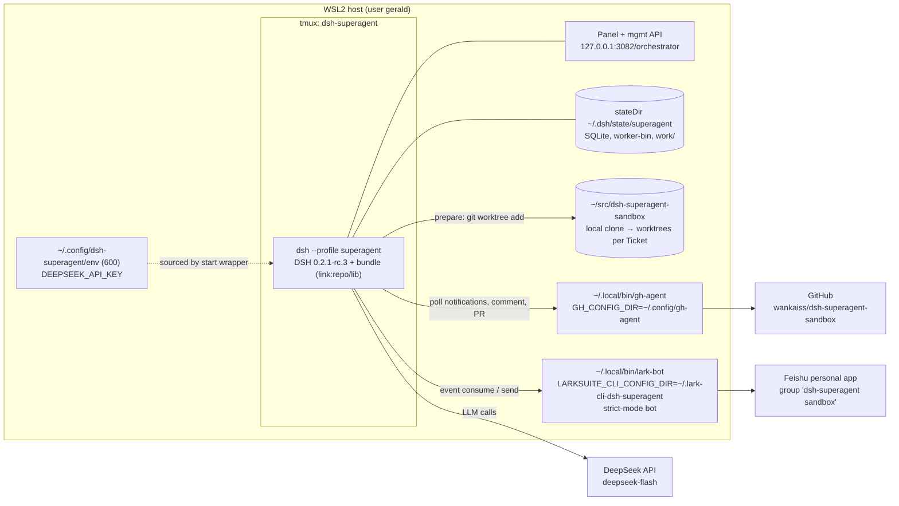

# Design: local run

Source of truth for system facts: `../11-04-dsh-superagent-program/research/system-map.md` (§6 config, §7 API, §11 checklist).

## Runtime topology

## Components and configuration

| Piece | Where | Content |
|---|---|---|
| Profile | `~/.dsh/profiles/superagent/` | Created once with `dsh superagent --from-default-profile web --dump-config`, then `dsh plugin --profile superagent add "link:$REPO"` |
| Machine patch | `~/.dsh/profiles/superagent/cordis.patch.yml` | From `examples/profile.cordis.patch.yml`: `stateDir: /home/gerald/.dsh/state/superagent`, `webserver` host `127.0.0.1` port `3082`, `dsh-superagent-feishu` `disabled: false` |
| Key injection | tmux global env (no repo/script change) | The DeepSeek provider reads `DEEPSEEK_API_KEY` from the **launch environment** (`dsh-llm-deepseek-api-key` `apiKeyEnv` default). `scripts/dsh-superagent` passes no env to tmux and a pre-existing tmux server would not inherit the caller's env (Codex r2 #3). So: `tmux start-server; tmux set-environment -g DEEPSEEK_API_KEY "$(. ~/.config/dsh-superagent/env; printf %s "$DEEPSEEK_API_KEY")"` then `scripts/dsh-superagent start`. Proof = `loaded 2 model(s)` line in the `.artifacts/` log |
| gh-agent | `~/.local/bin/gh-agent` | docs/006 wrapper only; `gh-agent auth login --with-token` fed from the env file. **No** `setup-git`, **no** repo-local credential helper: setup generates an isolated git config in stateDir whose helper calls the configured `gh-agent` (`src/infra/environment.ts:106-112`, applied `src/app/setup.ts:91-93`), and `verifyDirectory` rejects any local/worktree `credential.*` (`src/infra/environment.ts:149-156`) (Codex r2 #1) |
| lark-bot | `~/.lark-cli-dsh-superagent/config.json` + `~/.local/bin/lark-bot` | `apps[0]` copied from `~/.lark-cli/config.json` `apps[1]` (appId `cli_aa2c133e05b85bce`, `appSecret` keychain ref, brand) **without `users`**; then `lark-bot config strict-mode bot --global`. Fallback if keychain ref is not honoured: operator runs `config init --app-secret-stdin` (operator step) |
| Sandbox repo | GitHub + `~/src/dsh-superagent-sandbox` | `gh repo create wankaiss/dsh-superagent-sandbox --private`, seed: `package.json`, `src/sum.ts` with a deliberate bug, `README.md`; issues #1 "sum() is wrong for negatives", #2 "add a CLI" |
| Feishu group | Feishu | `lark-cli --profile personal im +chat-create --as bot` name "dsh-superagent sandbox", invite operator open_id; record `chat_id` |

## Settings sequence (management API)

All via `curl -H 'x-orchestrator-request: 1' http://127.0.0.1:3082/orchestrator/api/...`, order from SETUP.md:69. Every `PUT settings/<block>` sends `{"value": <whole block from GET settings with edits>, "revision": n}`; after `restarting: true` wait for `scripts/dsh-superagent status` to stop exiting 1 and re-`GET settings` for fresh revisions.

Order puts models first, while setup is still incomplete, so the main Session (created as soon as setup succeeds, `src/app/runtime.ts:204-210`) is born with the explicit model (Codex r2 #5). Saves are accepted during setup (`PUT settings/:block` has no setup guard, `src/app/http.ts:196-202`) and each restarts the plugin.

1. `eval` → `mode: "observe"`, `model: {provider: "deepseek-official", model: "deepseek-flash"}` (provider id confirmed from `GET models` first)
2. `executor` → same `model`; `prepare` = docs/006 recipe with `/home/gerald/src/dsh-superagent-sandbox`
3. `source:github` → `{enabled: true, config: {repository: "wankaiss/dsh-superagent-sandbox", cli: "/home/gerald/.local/bin/gh-agent"}}` (strict schema: no `allowed` here)
4. `source:feishu` → `{enabled: true, config: {cli: "/home/gerald/.local/bin/lark-bot", chats: [{chatId, name: "dsh-superagent sandbox", listen: "mentions"}], directMessages: false, otherChats: "none"}}`
5. `policy` → keep default rules; set `sources.github.allowed = [{id: "wankaiss"}]`, `sources.feishu.allowed = [{id: "ou_6af531addda67d7c6839104657601f76"}]` (`src/policy.ts:79-82`) (Codex r2 #4)
6. `PUT prompts` team sections: disclosure line "🤖 dsh-superagent (local prototype, acting as wankaiss)", review bots none, commit author = wankaiss noreply, remove auto-merge paragraph.

## E2E trigger (D8)

GitHub intake drops agent-authored items, and agent = operator, so the request comes from Feishu:
- After creating the group, list its bot members **from the default profile** (`lark-cli im +chat-members-list --chat-id <oc> --member-types bot --as user`) to get the personal bot's id in that app's namespace; send `lark-cli im +messages-send --as user --chat-id <oc>` with a post/markdown containing `<at user_id="<that id>">` and the task. The event the personal bot receives carries the sender as `ou_6af5…` (app-scoped), matching the allow-list.
- Success = Ticket with a running worker (observe mode executes *addressed* allowed requests); an unaddressed message would only record `would_accept`.
- Fallback: operator sends one @bot message by hand.

## Verification (smoke / e2e, no unit tests)

`pnpm typecheck && pnpm build` → `status` exit code → `GET state` / `GET settings` assertions → GitHub round-trip → Feishu round-trip → secret grep. Details in `implement.md`.

## Rollback

- Stop: `scripts/dsh-superagent stop`.
- Remove: `rm -rf ~/.dsh/profiles/superagent ~/.dsh/state/superagent ~/.config/gh-agent ~/.lark-cli-dsh-superagent ~/.local/bin/{gh-agent,lark-bot}`; `gh repo delete wankaiss/dsh-superagent-sandbox` (operator confirms). The `web` profile, `~/.lark-cli` and the operator's gh login are never modified.
